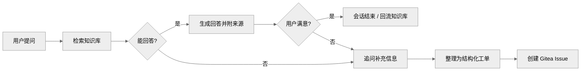
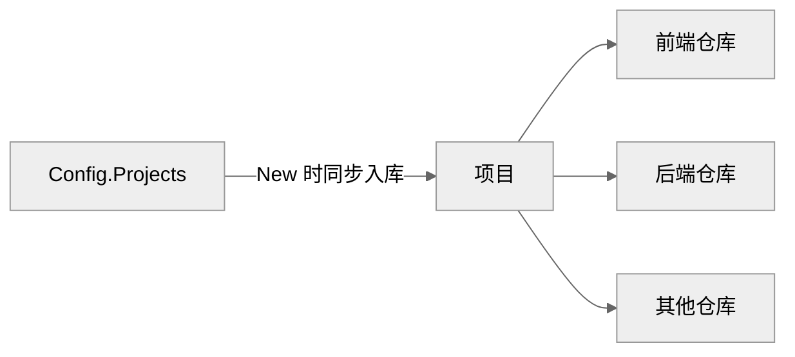
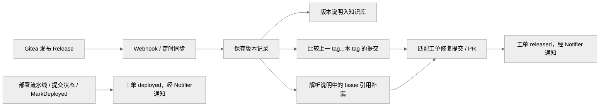
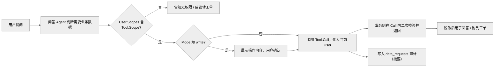
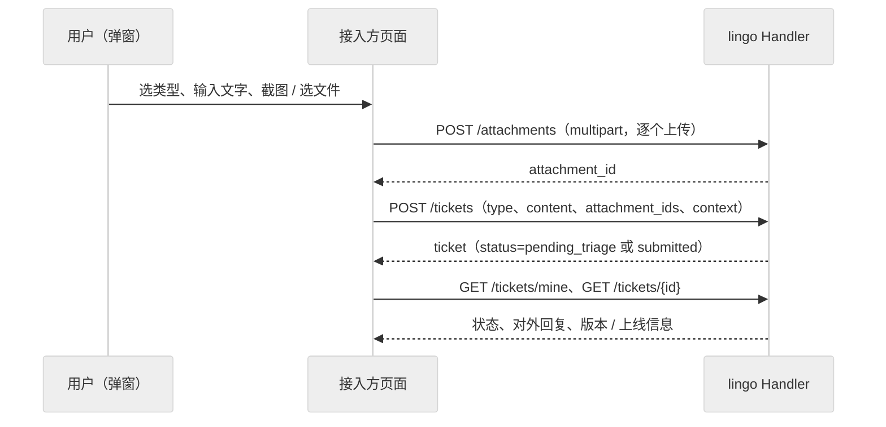
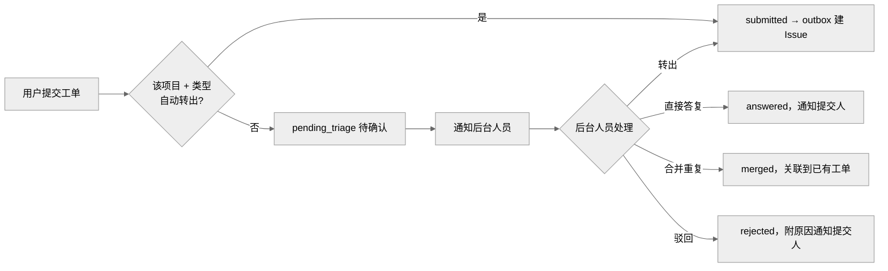
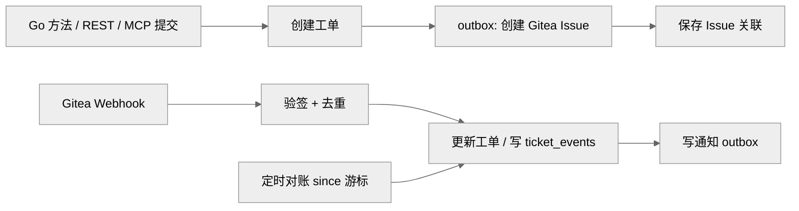
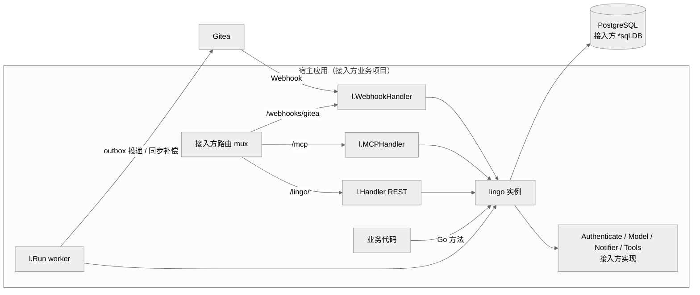

# 产品需求文档 (PRD)

| 字段 | 内容 |
|-----|------|
| 产品名称 | 灵问 Lingo（连接 Agent AI 智能开发团队与用户的知识问答 Agent） |
| 文档版本 | v1.8 |
| 创建日期 | 2026-11-13 |
| 最后更新 | 2026-11-17 |
| 文档负责人 | haiqing |
| 状态 | 草稿 |

---

## 修订历史

| 版本 | 日期 | 修改人 | 修改内容 |
|-----|------|-------|---------|
| v1.0 | 2026-11-13 | haiqing | 初始版本（模板） |
| v1.1 | 2026-11-13 | haiqing | 按现有架构设计回填概述、用户、功能、数据、技术方案等章节 |
| v1.2 | 2026-11-13 | haiqing | 调整产品定位为 Agent 研发与用户的问答平台，重写背景与用户画像；并入数据库迁移约定 |
| v1.3 | 2026-11-13 | haiqing | 研发方明确为 Agent AI 智能开发团队；灵问定位为知识问答 Agent；新增 MCP、开放接口、固定角色多用户 |
| v1.4 | 2026-11-13 | haiqing | 新增项目与对接仓库：前后端多仓库归属一个项目，按项目授权与提问，Issue 落到项目内合适仓库；新增对接版本记录：同步 Gitea Release、工单关联修复版本 |
| v1.5 | 2026-11-13 | haiqing | 新增浏览器 JS 接入：嵌入问答组件、JS API、公开 Key 与域名白名单、身份令牌 |
| v1.6 | 2026-11-13 | haiqing | 新增基于人员权限的业务数据请求：数据接口登记、代用户调用、双重权限校验、审计 |
| v1.7 | 2026-11-13 | haiqing | 新增系统在线升级（可插拔执行器）；明确可扩展部署约定 |
| v1.8 | 2026-11-17 | haiqing | 改为 Go 库形态，去掉租户、前端与在线升级 |
| v1.10 | 2026-11-18 | haiqing | 新增反馈提交接口（供接入方弹窗组件：类型、文字、截图与附件上传）、后台确认转出（按项目与类型的自动 / 手动开关，运行时可覆盖；待确认默认 24 小时提醒）；事件补充 `triage.resolved` 与事件 ID 等字段，新增查询方法与变更流、提交人身份与数据隔离；弹窗界面仍由接入方实现 |
| v1.13 | 2026-11-20 | haiqing | REST `Handler` 落地（工单、后台确认、待确认列表与统计、变更流、自动转出开关、`GET /ticket-types`）；新增 Go 方法 `ListMyTickets`、`ListTicketComments`、`TicketTypes`、`AutoForwardSettings`；实现 `ListTriage`、`TriageSummary`、`ListEvents` 与待确认超时提醒；变更流只返回早于所有进行中事务的事件，游标不会跳过；PostgreSQL 最低 13 |
| v1.12 | 2026-11-18 | haiqing | 工单提交与后台确认落地：Go 方法 `CreateTicket`、`ForwardTicket`、`AnswerTicket`、`MergeTicket`、`RejectTicket` 与公开错误 `ErrInvalidInput` / `ErrForbidden` / `ErrConflict`；项目在 `Run` 启动或首次调用时同步入库（不停用配置中删掉的项目与仓库，以当前 Config 为准校验，避免滚动发布时旧实例停掉新项目）；建 Issue 经 outbox 执行，重试时按隐藏标记查重，用户文本中的灵问标记被去掉，Issue 正文不含提交人身份；建单被放弃时工单变为 `abnormal`，可再次转出 |
| v1.11 | 2026-11-18 | haiqing | Webhook 回流规则补充：新增事件 `ticket.scheduled`（排期）；Issue 关闭但尚无修复 PR 时等待 30 秒再判定；重开清除修复记录；标签全名带 `LabelPrefix`（如 `lingo/review/need-info`） |
| v1.9 | 2026-11-18 | haiqing | 细化 Gitea 对接（含启动自检；调研见 [gitea-integration.md](../architecture/gitea-integration.md)）：按仓库 Issue 表单模板提单、评论往来与对外回复规则、工单状态机、PR 合并识别修复、按 tag 区间提交关联版本、上线信号、Webhook 自动注册与对账；Gitea 最低 1.22 |

---

## 1. 概述

### 1.1 背景与问题

**现状**：研发由 Agent AI 智能开发团队承担：AI Agent 在 Gitea 中领取 Issue、编写代码、提交 PR，人类工程师负责评审与把关。研发速度大幅提升，但用户侧的提问、反馈与需求仍靠群聊、私信、邮件人工传递。

**问题**：
- **用户与 AI 研发团队之间没有通道**：用户没有也不需要 Gitea 账号；AI Agent 只能处理结构化的 Issue，读不懂零散的聊天记录。
- **反馈质量决定 AI 研发效率**：描述不清、缺少复现信息的反馈，AI Agent 无法直接动手，只能反复追问或交由人工整理。
- **大量提问其实不需要研发介入**：用法、限制、已知问题等咨询占比高，却同样流向研发，挤占研发容量。
- **反馈闭环断裂**：Issue 处理完毕，用户不知道结果，需要有人手工转达。
- **知识没有沉淀**：问答散落在各处，同样的问题被反复提出、反复解答。

**机会**：做一个可嵌入业务项目的知识问答 Agent Go 库，站在用户与 AI 研发团队之间：
- 先由灵问基于知识库直接回答，能答的当场解决；
- 答不了的，整理成结构化、带上下文的 Issue 交给 AI 研发团队，处理进展自动回传用户；
- 业务项目 `import "github.com/zhouhao4221/lingo"` 即可嵌入，通过 Go 接口、HTTP Handler 与 MCP，让业务系统、用户侧的 AI 客户端和研发侧的 Agent 都能直接接入；
- 每一次问答与 Issue 处理都回流知识库，让灵问越用越聪明。

### 1.2 产品愿景

灵问是可嵌入业务项目的知识问答 Agent Go 库，连接 Agent AI 智能开发团队与用户：用户随时提问，灵问能答即答，答不了的转成 AI 研发团队能直接处理的任务，结果自动回到用户手中，每一次问答都让知识库更完整。

### 1.3 目标与成功指标

| 目标类型 | 指标 | 当前值 | 目标值 | 衡量方式 |
|---------|-----|-------|-------|---------|
| 业务目标 | 集成 lingo 的业务项目数 | 0 | 待定 | 待定 |
| 业务目标 | 问答直接解决率（无需转 Issue） | - | 待定 | 未转 Issue 且用户认可的会话 / 全部会话 |
| 业务目标 | 转出 Issue 被 AI Agent 直接领取处理的比例 | - | 待定 | 无需人工补充信息即开始处理的 Issue / 转出 Issue |
| 用户目标 | 问答首次响应时间 | - | P95 < 5s | 会话日志 |
| 用户目标 | 工单状态变更到提交人收到通知的延迟 | - | P95 < 1 分钟 | Webhook 接收时间 vs Notifier 投递时间 |
| 技术目标 | 通知投递成功率（含重试） | - | ≥ 99.9% | outbox 表状态统计 |
| 技术目标 | 工单与 Gitea 状态一致性 | - | 补偿后 100% | 同步补偿任务对账 |

### 1.4 范围定义

**包含（In Scope）**：
- 知识问答 Agent：基于知识库与 LLM 回答用户提问，答不了时引导转为工单
- 业务数据请求：以提问人员身份、基于其权限调用接入方注册的 Tool 函数查询数据或提交操作，用于回答与工单
- 公开 API：单一公开包（根包 `lingo`），提供 Go 方法、REST JSON Handler、MCP Handler 与 Gitea Webhook Handler
- 接入与配置：`lingo.Config` 声明数据库、模型、Gitea、项目、身份解析、通知与业务数据工具；迁移由接入方显式调用 `lingo.Migrate`
- 身份与固定角色：身份由接入方经 `Authenticate` 提供，固定角色 external / agent / reviewer / admin
- 项目与对接仓库：项目及其前端、后端等多个 Gitea 仓库在代码中声明；提问 / 提交时指定项目（可选仓库）
- 对接版本记录：同步 Gitea Release，版本说明入知识库，工单关联修复版本并通知提交人
- 工单提交：类型为咨询 / Bug / 需求，转出时自动整理为结构化 Issue（问题描述、复现信息、期望结果）
- Gitea 同步：机器人账号建 Issue、打类型标签；Webhook 接收 Issue 评论/状态/标签变更
- 信息反馈：工单 / 版本事件经 outbox 回调接入方 `Notifier`，失败重试
- 需求评审：内部人员评审（通过 / 驳回 / 需补充信息）与回复，结论回写 Gitea
- 知识库：结案工单与问答会话自动抽取问答对，供问答 Agent 检索

**不包含（Out of Scope）**：
- AI 研发 Agent 本身（领取 Issue、写代码、提 PR 由研发侧 Agent 完成，灵问只负责交付任务与回传结果）
- 替代 Gitea 的研发协作功能（看板、代码评审、CI 等）
- 支持 Gitea 以外的代码托管平台（GitHub、GitLab 等）
- 前端界面（原 Web 门户、管理后台、浏览器 JS 嵌入 SDK 均不提供），界面由接入方自行实现
- 用户登录与用户管理（lingo 不存用户表、不做登录、不发令牌）
- 多租户（不区分接入方，无租户隔离）
- 在线升级（升级即 `go get -u`）；部署方式由接入方自行决定
- 工单 SLA 计时与工时统计（后续版本再评估）
- 移动端原生 App

---

## 2. 用户研究

### 2.1 目标用户

| 用户角色 | 用户特征 | 使用场景 | 核心痛点 | 期望收益 |
|---------|---------|---------|---------|---------|
| 接入开发者 | 集成 lingo 的业务项目的开发者 | `import` lingo，配置 `lingo.Config`，挂载 Handler、运行 worker，实现 Model / Notifier / Tool | 自建反馈与问答通道成本高 | 以 Go 库方式嵌入，复用业务项目已有的登录、用户体系与界面 |
| 用户（external） | 使用研发团队交付的产品的人，无 Gitea 账号，不关心研发流程；经接入方界面或 MCP 使用 | 不会用、遇到 Bug、希望增加功能 | 不知道找谁问；问题说不清；提了之后石沉大海 | 随时提问、即时得到答复；答不了的有人跟进，进展主动告知 |
| AI 研发 Agent | Agent AI 智能开发团队中的 AI Agent，在 Gitea 领取并处理 Issue；经 MCP 使用 | 读取灵问转出的 Issue，开发修复后在 Issue 中回复；通过 MCP 查询知识库与问题上下文 | 需求描述模糊、缺少复现信息时无法直接动手 | 拿到结构化、可执行的任务；处理结果自动回传用户 |
| 研发负责人（reviewer） | 监督 AI 研发团队的人类工程师 / 产品；经接入方界面或 MCP 使用 | 评审需求、把关 AI 产出、处理 AI 无法解决的问题、审核知识库 | 需求来源杂，评审结论难留痕 | 统一评审入口，结论自动同步 Gitea 与用户 |

### 2.2 用户旅程


### 2.3 竞品分析

| 竞品 | 优势 | 劣势 | 我们的差异化 |
|-----|-----|-----|-------------|
| 直接使用 Gitea Issue | 零开发，研发习惯 | 用户需账号，无问答、无反馈通知与知识库 | 用户免账号，先问答后转 Issue，自动反馈 |
| 通用工单系统（如 Zammad、Jira Service Management） | 功能完备 | 与 Gitea 割裂，工单不面向 AI Agent 消费 | 以 Gitea 为事实来源，Issue 为 AI 研发可执行格式 |
| 通用 AI 客服 / 知识库问答 | 即时回答 | 答不了就断了，不连接研发 | 问答与研发闭环，处理结果回流知识库 |
| 各业务系统自建反馈模块 | 贴合业务 | 重复建设，数据分散 | Go 库嵌入 + MCP 统一接入 |

---

## 3. 功能需求

### 3.1 功能概览

| 优先级 | 功能模块 | 功能描述 | 用户价值 | MVP |
|-------|---------|---------|---------|-----|
| P0 | 知识问答 Agent | 基于知识库与 LLM 回答提问，答不了时引导转工单 | 能答即答，减少研发打扰 | 是 |
| P1 | 业务数据请求 | 以人员身份、按其权限调用接入方注册的 Tool 函数，结果用于回答 | 直接回答“我的数据”类问题 | 否 |
| P0 | 公开 API（Go 接口 / HTTP Handler） | 根包 `lingo` 提供 Go 方法与 REST JSON Handler：提问、工单、评审、知识库、版本 | 业务项目以库方式嵌入 | 是 |
| P0 | MCP Server | `MCPHandler` 以 MCP 工具暴露提问、检索知识库、提交/查询工单，与 REST 对齐 | AI 客户端与研发 Agent 直接接入 | 是 |
| P0 | 接入与配置 | `lingo.Config` 声明依赖与扩展点；`lingo.Migrate` 显式迁移；挂载 Handler、运行 worker | 接入方按需组装，自行决定单体或拆分进程 | 是 |
| P0 | 项目与对接仓库 | 在代码中声明项目及其多个仓库（前后端等）；按项目提问，Issue 落到项目内合适的仓库 | 用户按产品提问，问题直达对应仓库 | 是 |
| P0 | 工单提交 | 咨询、Bug、需求；文字 + 截图 / 附件，接口供接入方弹窗组件调用；转出时整理为结构化 Issue | AI 研发可直接处理 | 是 |
| P0 | 后台确认转出 | 后台人员确认后转出到 Gitea，或直接答复、合并、驳回；按项目与类型设自动 / 手动开关 | 过滤无效反馈，Issue 质量可控 | 是 |
| P0 | 数据隔离 | 工单、会话、附件按提交人 ID 归属，按角色与项目控制可见范围；个人信息不外传 Gitea | 用户之间、项目之间互不可见 | 是 |
| P0 | Gitea 同步 | 按仓库 Issue 模板建 Issue + 作用域标签；评论双向往来；Webhook 回流评论、指派、标签、里程碑、PR 合并、关闭 / 重开；定时对账 | 研发留在 Gitea 工作 | 是 |
| P0 | 信息反馈（Notifier） | 工单 / 版本事件经 outbox 回调接入方 `Notifier`，失败重试 | 提交人及时获知进度，渠道由接入方决定 | 是 |
| P1 | 需求评审 | 内部人员评审需求类工单并回复，结论回写 Gitea | 评审有入口、有记录 | 是 |
| P0 | 身份与固定角色 | 预置固定角色，身份由接入方经 `Authenticate` 提供并映射角色；按角色控制权限 | 复用接入方用户体系，权限清晰 | 是 |
| P0 | 知识库 | 结案工单与问答会话抽取问答对，供问答 Agent 检索 | 问答 Agent 的知识来源 | 是 |
| P1 | 对接版本记录 | 同步 Gitea Release，版本说明入知识库，工单关联修复版本并通知；识别上线 | 用户知道问题在哪个版本解决、何时上线 | 否 |

### 3.2 功能详情

#### 3.2.0 知识问答 Agent

**功能描述**：灵问本身是一个知识问答 Agent。用户从任一入口提问，灵问检索知识库并结合 LLM 生成回答；无法回答或用户不满意时，引导用户补充信息并转为工单。

**用户故事**：
> 作为用户，我希望提问后立刻得到答复；答不了时，系统帮我把问题整理清楚交给研发，而不是让我重新描述一遍。

**功能流程**：



**业务规则**：
- 回答需附知识来源（知识条目 / 历史工单），无可靠依据时不编造，直接说明并引导转工单
- 转工单前由灵问追问关键信息（Bug：复现步骤、期望与实际结果、版本；需求：场景与期望），整理成 AI 研发 Agent 可执行的 Issue 模板
- 转工单需用户确认，会话记录随工单附带
- 模型服务由接入方经 `Config.Model`（`lingo.Model` 接口：Chat + Embed）提供；提示词是否可配置：待定

**验收标准**：
- [ ] 知识库已有答案的问题，灵问直接回答并给出来源
- [ ] 知识库无答案时不编造，引导转为工单
- [ ] 转出的 Issue 包含结构化的问题描述、复现信息与原始会话链接

#### 3.2.0.1 公开 API：Go 接口、HTTP Handler 与 MCP

**功能描述**：灵问只提供公开 Go API：单一公开包（根包 `lingo`），其余实现位于 `internal/`。`lingo.New` 返回的实例 `l` 提供以下接入形式，能力一致：
- **Go 方法**：`Ask`、`CreateTicket`、`GetTicket`、`ReplyTicket`、`Review`、`SearchKnowledge`、`ListReleases` 等，接入方可不走 HTTP 直接调用
- **REST JSON 接口**：`l.Handler()`，提供提问、工单、评审、知识库、版本能力
- **MCP Server**：`l.MCPHandler()`，Streamable HTTP，以 MCP 工具形式暴露能力，与 REST 对齐，供用户侧 AI 客户端（IDE、桌面助手等）和研发侧 AI Agent 直接调用
- **Gitea Webhook**：`l.WebhookHandler()`，验签 + 去重
- **后台 worker**：`l.Run(ctx)`，负责 outbox 投递、Gitea 同步补偿、知识库生成

**MCP 工具（草案）**：

| 工具 | 说明 | 主要使用方 |
|-----|-----|----------|
| `list_projects` | 列出当前身份可对接的项目及其仓库 | 两侧 |
| `ask` | 向灵问提问（指定 `project`，可选 `repo`），返回回答与来源 | 用户侧 AI 客户端 |
| `search_knowledge` | 检索知识库条目（按 `project` / `repo` 过滤） | 两侧 |
| `create_ticket` | 提交咨询 / Bug / 需求工单（指定 `project`，可选 `repo`） | 用户侧 AI 客户端 |
| `get_ticket` | 查询工单状态、回复、关联 Issue 与修复版本 | 两侧 |
| `reply_ticket` | 在工单中回复用户（同步为 Issue 评论） | 研发侧 AI Agent |

**业务规则**：
- Handler 内的路径为相对路径，挂载前缀由接入方决定（见 3.2.1）
- REST 与 MCP 的请求身份均由接入方提供的 `Authenticate` 解析（见 3.2.0.2）；Go 方法如何传入身份：待确认
- MCP 传输方式：Streamable HTTP（是否同时支持 stdio：待定）
- 研发侧工具仅对 `reviewer` / `agent` 角色开放
- Go 方法签名、REST 路径与请求格式：待设计

**验收标准**：
- [ ] 通过 Go 方法可完成提问、检索、提交与查询工单
- [ ] 通过 REST 接口与 MCP 客户端可完成同样操作
- [ ] 未授权身份无法调用研发侧工具

#### 3.2.0.2 身份与固定角色（由接入方提供）

**功能描述**：lingo 不存用户表、不做登录、不发令牌。接入方通过 `Config.Authenticate`（`func(r *http.Request) (lingo.User, error)`）解析请求身份，返回 `lingo.User{ID, Name, Email, Role, Scopes}`：`ID` 为接入方自己的用户 ID，`Role` 由接入方把自身用户映射为下列固定角色之一，可选 `Projects` 限制可访问的项目（见 3.2.0.3）。系统预置一组固定角色，不支持自定义角色或细粒度权限配置。

**固定角色**：

| 角色 | 标识 | 权限 |
|-----|-----|-----|
| 用户 | `external` | 提问、提交工单、查看本人会话与工单（可见范围见 3.2.0.6） |
| AI 研发 Agent | `agent` | 通过 MCP / REST 接口读取工单、回复用户、检索知识库 |
| 研发负责人 | `reviewer` | 在用户权限之外：查看所负责项目的全部工单、确认转出、评审需求、回复用户、审核知识库 |
| 管理员 | `admin` | 全部权限 |

**用户故事**：
> 作为接入开发者，我希望沿用业务项目已有的登录与用户体系，只把当前用户映射为灵问的固定角色，不必维护第二套账号。

**业务规则**：
- 角色集合固定，权限随角色内置，不提供角色编辑
- 登录、用户管理、令牌签发由接入方负责；每个 AI Agent 的身份如何区分由接入方在 `Authenticate` 中处理
- 同一角色的多个用户权限相同，操作记录按 `User.ID` 留痕

**验收标准**：
- [ ] `Authenticate` 返回不同角色时，只能执行该角色权限内的操作
- [ ] 工单回复、评审等操作记录到具体 `User.ID`

#### 3.2.0.3 项目与对接仓库（代码声明）

**功能描述**：灵问以**项目**为对接单位。一个项目可包含多个 Gitea 仓库（如前端、后端、移动端）。项目与仓库由接入方在 `Config.Projects`（`[]lingo.Project`）中声明，`New` 时同步入库；提问或提交工单时指定项目（可进一步指定仓库），问答在整个项目范围内进行，转出的 Issue 落到项目下合适的仓库。

**用户故事**：
> 作为用户，我只关心“哪个产品出了问题”，不想分辨是前端还是后端；我希望选择项目后提问，由灵问判断问题该交给哪个仓库。
>
> 作为接入开发者，我希望在代码中把一个产品的前后端仓库声明到同一个项目下，并设置项目内的默认仓库。

**层级关系**：



**指定方式**：

| 入口 | 方式 |
|-----|-----|
| Go 方法 / REST 接口 | 参数 `project`（项目标识），可选 `repo`（`owner/name`，须属于该项目） |
| MCP | 工具参数 `project`、可选 `repo`；可先调用 `list_projects` 获取可选项目及其仓库 |

**业务规则**：
- 项目在代码中声明（标识、名称、说明及其仓库）；仓库归属一个项目，并标注类型（前端 / 后端 / 移动端 / 文档 / 其他）；一个仓库只属于一个项目；`lingo.Project` 具体字段：待确认
- 每个项目设一个默认仓库；机器人账号需对项目下所有仓库有 Issue 读写权限
- 项目授权（谁能访问哪个项目）由接入方在 `Authenticate` / 业务中处理；`User.Projects` 为可选限制，设置后只能指定其中的项目
- 未指定 `project` 时取 `Config.Projects` 中第一个项目（须在 `User.Projects` 范围内，否则报错要求指定）
- 问答范围：知识库检索覆盖项目下所有仓库的知识与版本说明，回答时注明来源仓库
- Issue 落库仓库的确定顺序：用户指定的 `repo` → 问答 Agent 按问题内容判断（如界面 / 交互类 → 前端仓库，接口 / 数据类 → 后端仓库），转出前请用户确认 → 项目默认仓库
- 跨仓库问题（前后端都要改）：在主要仓库创建 Issue，并在其他相关仓库创建关联 Issue 互相引用（是否自动创建：待定）
- 工单创建后仓库调整由研发负责人操作（是否支持跨仓库迁移 Issue：待定）

**验收标准**：
- [ ] 在 `Config.Projects` 中声明项目、多个仓库与默认仓库后，`New` 时同步入库
- [ ] 设置 `User.Projects` 时，指定其外的项目被拒绝
- [ ] 指定项目提问时，回答可引用该项目下任一仓库的知识，并注明来源仓库
- [ ] 未指定仓库时，问答 Agent 给出建议仓库，用户确认后 Issue 创建在该仓库
- [ ] `list_projects` 仅返回当前身份可对接的项目及其仓库

#### 3.2.0.4 对接版本记录

**功能描述**：灵问同步各对接仓库在 Gitea 中的版本记录（Release / Tag 及版本说明），用于三件事：
- **问答**：版本说明入知识库，回答“最新版本有什么变化”“这个问题在哪个版本修复了”“某功能从哪个版本开始支持”
- **关联**：以两个版本 tag 之间的提交为准定位已发布的修复，版本说明中的 Issue 引用（如 `closes #12`、`#12`）补漏，把工单与修复版本关联
- **通知**：包含某工单的版本发布后，通知提交人“已在 vX.Y.Z 发布”；识别到上线后再通知“已上线”

**用户故事**：
> 作为用户，我希望知道我反馈的问题在哪个版本修复、我现在用的版本有哪些已知问题，以便决定是否升级。
>
> 作为 AI 研发 Agent，我希望发版后关联的工单自动更新并通知用户，不需要逐个回复。

**功能流程**：



**业务规则**：
- 来源：Gitea Release（标签、标题、说明、发布时间、是否预发布）；通过 `release` Webhook（published / updated / deleted）实时接收，并定时全量同步兜底；只打 tag 不建 Release 的仓库经 `create` 事件（`ref_type=tag`）与定时列 tag 同步
- 同步项目下各仓库的版本；草稿（draft）不同步，预发布（prerelease）同步但单独标记，是否通知：待定
- 关联规则：
  1. 取同仓库上一个正式版本 tag，调用 `compare/{prevTag}...{tag}` 得到区间提交；
  2. 提交命中工单的 `fixed_commit`，或经 `commits/{sha}/pull` 反查到的 PR 命中工单的 `fixed_pr`，即关联；
  3. 再解析版本说明中的 `#N` / `owner/repo#N` 补漏（`release_tickets.ref` 记录来源：`commit` 或引用原文）；
  4. 同一工单出现在多个版本时取最早的正式版本
- 跨仓库工单（一个工单对应前端、后端多个 Issue）：所有关联 Issue 的修复都已发布才算 `released`，都已上线才算 `deployed`
- 上线识别（Gitea 无 Deployment API），按仓库配置 `Repo.Deploy`，任一信号命中即视为该版本上线：
  - Gitea Actions（需 Gitea ≥ 1.25）：`workflow_run` 事件 `completed` 且 `conclusion=success`，工作流文件名匹配 `Deploy.Workflow`，以 run 的 `head_sha` / tag 对应版本；补偿用 `GET /actions/runs`
  - 提交状态：外部 CI/CD 调用 `POST /statuses/{sha}`，`context` 等于 `Deploy.StatusContext`（如 `deploy/production`）且 `state=success`，灵问经 `status` 事件识别
  - 接入方调用 `l.MarkDeployed(ctx, repo, tag, env)`（始终可用的兜底）
- 研发约定：PR 正文写 `Fixes owner/repo#N`（Gitea 关闭关键词，PR 合并后自动关闭 Issue）
- 提交 Bug 时可填写当前使用版本（Go 方法 / HTTP 接口 / MCP 参数 `version`），问答 Agent 据此判断问题是否已在更新版本修复，并提示升级
- 版本记录按仓库保存、按项目汇总：按项目查询时按时间合并前后端各仓库的发布；问答时引用所选项目下的版本记录并注明仓库
- 项目是否需要统一的产品版本号（映射到各仓库的版本组合）：待定
- 版本格式遵循 semver（`vX.Y.Z`）；非 semver 标签按发布时间排序

**MCP 工具（新增）**：

| 工具 | 说明 |
|-----|-----|
| `list_releases` | 列出指定项目（或其下某仓库）的版本记录（可分页、可过滤预发布） |
| `get_release` | 查看某版本的说明与关联工单 |

**验收标准**：
- [ ] Gitea 发布 Release 后，灵问在 1 分钟内同步该版本记录
- [ ] 修复 PR 已合并的工单，在包含该合并提交的版本发布后显示修复版本，提交人收到发布通知；版本说明未写 `#N` 时同样能关联
- [ ] 配置的部署工作流成功、提交状态成功或调用 `MarkDeployed` 后，相关工单变为已上线，提交人收到通知
- [ ] 用户问“某问题在哪个版本修复”时，问答 Agent 能给出版本号并附版本说明来源
- [ ] 提交 Bug 并填写旧版本号，若该问题已在新版本修复，问答 Agent 提示升级

#### 3.2.0.5 基于人员权限的业务数据请求（Tool 函数）

**功能描述**：问答过程中，灵问可以**以提问人员的身份**调用接入方注册的业务数据工具（`lingo.Tool`，Go 函数），查询数据或提交业务操作，把结果用于回答或附到工单中。是否能取到数据、能取到哪些数据，由该人员的权限决定，灵问不持有超越用户本人的权限。

**用户故事**：
> 作为用户，我问“我昨天提交的订单 1024 为什么审批失败”，希望灵问直接查到这张订单的状态和失败原因来回答，而不是让我截图。
>
> 作为接入方，我希望灵问只能看到当前用户本人有权看到的数据，并且每一次数据请求都有记录可查。

**人员信息**：

| 来源 | 内容 |
|-----|-----|
| `Authenticate` 返回的 `lingo.User` | `ID`（接入方用户 ID）、`Name`、`Email`、`Role` |
| `User.Scopes` | 用户可用的数据权限，如 `order:read`、`order:read:dept`、`leave:apply` |

> 人员信息与权限由接入方提供，灵问只校验和使用，不自行修改。

**工具注册**：接入方在 `Config.Tools`（`[]lingo.Tool`）中注册可供灵问调用的业务数据工具：

| 字段 | 说明 |
|-----|-----|
| `Name` / `Description` | 供问答 Agent 理解何时调用，如“查询订单详情” |
| `InputSchema` | 入参定义（JSON Schema），如 `order_id` |
| `Scope` | 调用前用户必须具备的 scope，如 `order:read` |
| `Mode` | `read`（查询） / `write`（操作，如提交申请、重试任务） |
| `Sensitive` | 返回结果中需脱敏或不得展示的字段（`[]string`） |
| `Call` | `func(ctx, lingo.User, json.RawMessage) (any, error)`，业务侧实现 |

**功能流程**：



**业务规则**：
- **代用户请求，双重校验**：灵问先校验 `User.Scopes` 含 `Tool.Scope`；`Call` 收到当前 `lingo.User`，业务侧必须在 `Call` 内按该用户的权限二次校验并做数据范围过滤。灵问不使用任何超级账号
- **只用于本次会话**：取到的数据只用于本次会话，不写入知识库，不用于回答其他用户
- **操作需确认**：`write` 类工具必须向用户展示将要提交的内容并经明确确认后才调用；防重复提交：调用方传入幂等键（idempotency key），同一用户 + 工具 + 幂等键只执行一次，记录于 `data_requests.idempotency_key`
- **转工单时的数据**：业务数据随工单转给 AI 研发 Agent 前需用户同意，并按 `Sensitive` 脱敏
- **审计**：每次数据请求写入 `data_requests`，只存摘要（人员、工具、参数摘要、结果状态、耗时）；研发负责人与管理员可查，用户可查看本人记录
- **失败处理**：`Call` 返回错误时如实告知用户，不编造数据；连续失败的工具自动熔断并告警（阈值：待定）
- `User.Scopes` 不含 `Tool.Scope` 时，不发起调用

**验收标准**：
- [ ] 接入方可在 `Config.Tools` 注册工具并配置 `Scope`、`Mode` 与 `Sensitive`
- [ ] 具备权限的用户提问时，灵问以其身份调用 `Call` 并基于返回数据回答
- [ ] 不具备权限的用户无法触发调用；`Call` 拒绝时灵问如实告知
- [ ] `write` 类工具未经用户确认不会被调用
- [ ] 每次请求均有审计记录；业务数据不进入知识库，转工单时按 `Sensitive` 脱敏

#### 3.2.0.6 提交人身份与数据隔离

**功能描述**：lingo 无租户，但必须保证不同用户、不同项目之间的数据互不可见。所有工单、会话、附件都关联提交人的接入方用户 ID（`User.ID`），并按角色与项目做访问控制；提交人的个人信息不外传到 Gitea。

**业务规则**：
- **归属**：工单、会话、附件、补充评论都记录 `user_id`（接入方用户 ID）及提交时的姓名 / 邮箱快照；快照只用于后台展示与通知，不用于权限判断
- **访问控制**（所有接口与 MCP 工具在领域层统一执行，不依赖调用方自觉）：

| 角色 | 工单 / 会话 / 附件可见范围 | 可执行操作 |
|-----|-----|-----|
| `external` | 仅 `user_id` 等于本人的数据 | 提交、补充、查看本人工单与对外回复 |
| `agent` | `User.Projects` 内项目的已转出工单；看不到待确认、已驳回的工单 | 读取工单上下文、回复用户 |
| `reviewer` | `User.Projects` 内项目的全部工单 | 确认转出、答复、合并、驳回、评审 |
| `admin` | `User.Projects` 内项目的全部工单（为空表示全部项目） | 全部操作，含修改自动转出开关 |

- **越权返回 404**：访问不属于自己的工单、附件时返回“不存在”，不暴露其存在
- **存储层强制带范围**：store 层查询函数必须接收访问范围（用户 ID / 项目集合），不提供不带范围的列表查询；测试覆盖越权场景
- **对 Gitea 脱敏**：Issue 与评论中不写提交人姓名、邮箱、手机号与业务系统账号，只写工单号（`lingo:ticket=<id>`）；研发需要联系提交人时通过灵问评论往来。附件转出前由后台人员勾选（3.2.1.2）
- **研发回复的可见性**：只有按 `ReplyMode` 判定为对外的评论（3.2.2）才出现在提交人的工单详情中
- **知识库**：从工单抽取问答对时去除提交人身份信息与附件内容；业务数据工具的结果不入库（3.2.0.5）
- **合并工单**：被合并工单的提交人只能看到目标工单的对外进展，看不到其他提交人的内容与附件

**验收标准**：
- [ ] `external` 用户用他人的工单 ID、附件 ID 访问时返回 404
- [ ] `agent` / `reviewer` 无法访问 `User.Projects` 之外项目的工单
- [ ] 转出的 Issue 正文与评论中不包含提交人姓名、邮箱
- [ ] 知识库条目中不出现提交人身份信息

#### 3.2.1 接入与配置

**功能描述**：接入方在业务项目中 `import "github.com/zhouhao4221/lingo"`，通过 `lingo.New(lingo.Config{...})` 创建实例，显式执行迁移，并把 Handler 挂到自己的路由上。最小接入示例见 `examples/server/main.go`。

**接入示例（草案）**：

```go
l, err := lingo.New(lingo.Config{
    DB:           db,       // 接入方提供的 *sql.DB（PostgreSQL）
    Model:        myModel,  // lingo.Model：Chat + Embed
    Gitea:        lingo.GiteaConfig{BaseURL: ..., Token: ..., WebhookSecret: ...},
    Projects:     []lingo.Project{...},
    Authenticate: func(r *http.Request) (lingo.User, error) { ... },
    Notifier:     myNotifier,
    Tools:        []lingo.Tool{...},
})

lingo.Migrate(ctx, db) // 在发布流程中显式调用

mux.Handle("/lingo/", http.StripPrefix("/lingo", l.Handler()))
mux.Handle("/mcp", l.MCPHandler())
mux.Handle("/webhooks/gitea", l.WebhookHandler())
go l.Run(ctx)
```

**Config 字段**：

| 字段 | 说明 |
|-----|-----|
| `DB` | 接入方提供的 `*sql.DB`（PostgreSQL），驱动由接入方选择，lingo 不引入数据库驱动依赖 |
| `Model` | `lingo.Model` 接口：Chat + Embed，接入方实现或用适配器 |
| `Gitea` | `lingo.GiteaConfig{BaseURL, Token, WebhookSecret}` |
| `Projects` | 项目与仓库声明，`New` 时同步入库（见 3.2.0.3） |
| `Authenticate` | 接入方解析请求身份，返回 `lingo.User`（见 3.2.0.2） |
| `Notifier` | `lingo.Notifier` 接口：工单 / 版本事件回调接入方（见 3.2.3） |
| `Tools` | 业务数据工具，代用户取数（见 3.2.0.5） |
| `MaxAttachmentBytes` | 单个附件大小上限，默认 10 MB（见 3.2.1.1） |
| `TriageRemindAfter` | 待确认工单的提醒间隔，默认 24 小时；负数关闭提醒（见 3.2.1.2） |
| `Project.AutoForward` | 按工单类型的自动转出默认值，未配置为手动确认（见 3.2.1.2） |

**业务规则**：
- 迁移 SQL 经 `go:embed` 打包在库内，由接入方在发布流程中显式调用 `lingo.Migrate(ctx, db)`；`New` 时不自动执行迁移（见 5.4）
- 挂载路径由接入方决定；`l.Run(ctx)` 可与 Handler 分进程运行，接入方自行决定单体或拆分进程
- 登录、用户管理、界面、部署、升级由接入方处理；升级 lingo 即 `go get -u`

**验收标准**：
- [ ] 按 `examples/server/main.go` 完成 `New`、`Migrate`、挂载与 `Run` 后，可跑通提问、转工单与通知闭环
- [ ] `New` 不执行迁移；未调用 `Migrate` 时的行为：待确认

#### 3.2.1.1 反馈提交接口（供接入方弹窗组件对接）

**功能描述**：网页上的反馈入口是一个弹出窗口：用户选择类型（咨询 / Bug / 需求）、输入文字、截图或上传文件后提交。弹窗界面由接入方实现（lingo 不提供前端），lingo 提供它需要的全部接口与字段约定：上传附件、提交工单、查看本人工单与进展、补充信息。

**用户故事**：
> 作为用户，我希望在出问题的页面点开弹窗，选“Bug”，粘贴截图、写两句话就能提交，之后在同一个弹窗里看到处理进展。
>
> 作为接入开发者，我希望弹窗只调几个接口，身份沿用宿主页面的登录态，不需要额外签发令牌。

**功能流程**：



**接口（Handler 相对路径，Go 方法同名能力）**：

| 接口 | 说明 |
|-----|-----|
| `GET /ticket-types` | 可选类型与每类的表单字段（取自对应仓库的 Issue 模板必填字段，见 3.2.2），弹窗据此渲染表单 |
| `POST /attachments` | multipart 上传单个附件（截图、日志、文件），返回 `attachment_id`；未关联工单的附件 24 小时后清理 |
| `POST /tickets` | 提交工单：`project`、`repo`（可选）、`type`、`title`（可选，缺省由模型生成）、`content`、`fields`（模板字段）、`attachment_ids`、`context`（页面 URL、页面标题、浏览器、`version`，由弹窗自动采集）、`conversation_id`（从问答转出时带上） |
| `GET /tickets/mine` | 本人工单列表，按状态过滤、分页 |
| `GET /tickets/{id}` | 工单详情：状态时间线、对外回复、附件、修复版本、上线时间；不返回 Gitea 内部讨论 |
| `POST /tickets/{id}/comments` | 用户补充说明，可带 `attachment_ids`；已转出时同步为 Issue 评论 |
| `GET /attachments/{id}` | 下载附件，按 3.2.0.6 校验访问权限 |

**业务规则**：
- 身份由接入方 `Authenticate` 从请求中解析（同域 cookie 或接入方令牌），lingo 不另发凭据；未登录用户能否提交由接入方在 `Authenticate` 中决定
- 附件限制：类型白名单默认 `png / jpg / gif / webp / pdf / txt / log / zip`，单个大小上限 `Config.MaxAttachmentBytes`（默认 10 MB），单工单最多 10 个；转出时还要满足 Gitea `/settings/attachment` 的限制，超出的附件只留在 lingo、Issue 中注明
- 附件存在 lingo 数据库中（`attachments` 表），不依赖对象存储；转出到 Gitea 时再上传为 Issue 附件
- 截图由弹窗在浏览器侧完成（如截取当前页面或粘贴剪贴板图片），lingo 只接收图片文件
- 弹窗提交与问答转出走同一套工单逻辑；直接提交时，问答 Agent 仍可按模板必填字段追问缺失信息（追问经 `GET /tickets/{id}` 返回的 `pending_questions` 呈现）

**验收标准**：
- [ ] 弹窗按 `GET /ticket-types` 渲染类型与字段，提交带截图的 Bug 后返回工单号
- [ ] 超过大小或类型不在白名单的附件被拒绝，并返回明确错误
- [ ] 用户在弹窗中只能看到本人的工单与对外回复

#### 3.2.1.2 后台确认转出（自动 / 手动开关）

**功能描述**：用户提交的工单不一定都要交给研发。后台人员（`reviewer` / `admin`）可以先确认再转出到上游 Gitea：确认无误后转出，已能答复的直接答复关闭，重复的合并到已有工单。是否需要确认由开关控制，可按项目、按工单类型分别设置。

**用户故事**：
> 作为研发负责人，我希望用户反馈先经我过目：明显是使用问题的我直接回复，真正的 Bug 再转给 AI 研发，避免无效 Issue。
>
> 作为研发负责人，我希望 Bug 自动转出、需求必须人工确认，而且随时能临时关掉自动转出。

**功能流程**：



**业务规则**：
- **开关**：`Project.AutoForward`（按工单类型的映射，如 `{bug: true, feature: false}`）为代码中的默认值；未配置的类型默认**手动确认**
- **运行时覆盖**：`admin` 可经 `PUT /settings/auto-forward`（Go：`l.SetAutoForward(ctx, user, project, type, on)`）临时开关，存入数据库并优先于代码默认值；可恢复为代码默认值；每次修改记录操作人
- **转出时可修改**：后台人员确认时可改标题、类型、目标仓库、补充说明，并勾选哪些附件转到 Gitea（截图可能含敏感信息）；自动转出时附件全部转出
- **处理动作**：`forward`（转出）/ `answer`（直接答复并关闭，答复可入知识库）/ `merge`（合并到另一工单，提交人一并收到后者进展）/ `reject`（驳回，必须填原因）
- 待确认工单通过 `Notifier` 发出 `triage.required` 事件，由接入方通知后台人员；超过 `Config.TriageRemindAfter`（默认 24 小时，可修改）仍未处理时发出 `triage.overdue` 事件，之后每隔同样时长重复提醒，直到被处理；设为负数时关闭 lingo 的提醒，由接入方用 `GET /triage?pending_before=` 自行实现
- 处理完成（转出 / 答复 / 合并 / 驳回）时发出 `triage.resolved` 事件，带处理动作 `Action` 与操作人 `ActorID`，供接入方消除后台待办；待确认期间用户的补充走 `ticket.comment`
- 分工：何时提醒由 lingo 判断，提醒谁、经什么渠道由接入方在 `Notifier` 中决定
- 确认操作按 `User.ID` 留痕；转出的 Issue 评论中注明“由 <后台人员姓名> 确认转出”
- 需求类工单转出后仍进入需求评审（3.2.4），确认转出不等于评审通过

**接口**：

| 接口 | 说明 |
|-----|-----|
| `GET /triage` | 待确认列表（`reviewer` / `admin`），按项目、类型过滤；`pending_before=<时间>` 只返回在该时间之前进入待确认的工单；游标分页 |
| `GET /triage/summary` | 各项目待确认数与超时数，供后台红点 / 角标 |
| `POST /tickets/{id}/forward` | 转出，可带修改后的 `title`、`type`、`repo`、`note`、`attachment_ids` |
| `POST /tickets/{id}/answer` | 直接答复并关闭 |
| `POST /tickets/{id}/merge` | 合并到 `target_ticket_id` |
| `POST /tickets/{id}/reject` | 驳回，必须带 `reason` |
| `GET / PUT /settings/auto-forward` | 查看 / 修改自动转出开关（修改仅 `admin`） |

**验收标准**：
- [ ] `feature` 设为手动时，提交后状态为 `pending_triage`，Gitea 中不产生 Issue，后台人员收到通知
- [ ] 后台人员转出后才创建 Issue，Issue 中只包含其勾选的附件
- [ ] 直接答复、驳回后提交人收到通知，Gitea 中无 Issue
- [ ] 待确认工单超过 `TriageRemindAfter` 未处理时，`Notifier` 收到 `triage.overdue` 事件；修改该值后按新间隔提醒
- [ ] `admin` 关闭某类型的自动转出后，新提交的该类型工单立即进入待确认；恢复默认后按代码配置执行

#### 3.2.2 工单提交与 Gitea 同步

**功能描述**：用户经 Go 方法、REST 接口或 MCP 提交工单（或由问答 Agent 转出），灵问以机器人账号在项目内确定的仓库（规则见 3.2.0.3）按仓库的 Issue 表单模板创建 Issue，打上作用域标签并保存 `repo + issue number` 关联；之后用户与研发经 Issue 评论往来，Gitea 侧变更经 Webhook 回流并定时对账。接口与事件明细见 [Gitea 对接调研](../architecture/gitea-integration.md)。

**用户故事**：
> 作为用户，我希望不用登录 Gitea 就能提交问题并看到处理进度。

**功能流程**：



**初始化**（`Run` 启动时按仓库执行）：
- `GET /user` 缓存机器人 login；`GET /repos/{o}/{r}` 校验仓库可访问
- 补齐标签（前缀 `GiteaConfig.LabelPrefix`，默认 `lingo`）：来源标签 `lingo`；`type/consult|bug|feature`、`review/pending|approved|rejected|need-info`（exclusive 作用域标签，同组互斥）；缓存 `name → id`
- `GiteaConfig.AutoRegisterWebhook` 为真时，按 `WebhookURL` 查找或创建仓库级 Webhook（`type=gitea`、`content_type=json`、事件 `issues`、`issue_comment`、`issue_assign`、`issue_label`、`issue_milestone`、`pull_request`、`pull_request_comment`（PR 上的评论走该事件）、`release`、`create`、`status`、`workflow_run`）；否则只校验
- 启动自检（结果写日志，不阻断启动；清单见 [gitea-integration.md 12.3](../architecture/gitea-integration.md)）：
  1. `GET /version` ≥ 1.22，低于 1.25 时关闭 Actions 上线信号并告警；`GET /settings/api`、`/settings/attachment` 读取分页上限与附件限制
  2. 每个仓库可访问、`has_issues=true`、未启用外部 Issue 跟踪
  3. 机器人对每个仓库有 write 权限（`GET /collaborators/{bot}/permission`）
  4. 标签齐全（缺的补上）
  5. Webhook 存在、已启用、事件订阅完整，测试投递成功；失败时提示检查 Gitea `[security] ALLOWED_HOST_LIST`
  6. `Repo.Templates` 中的模板文件存在，`GET /issue_config/validate` 通过
  7. 配置了 `Repo.Deploy.Workflow` 时，`GET /actions/workflows` 中能找到该工作流
- 灵问对仓库设置只读；写操作仅限标签、Webhook 与 Issue 相关接口，不修改仓库属性、分支保护、协作者等，不需要管理员 token

**模板提单**：
- `GET /repos/{o}/{r}/issue_templates` 读取仓库 `.gitea/ISSUE_TEMPLATE/`（兼容 `.github/`）下的模板；工单类型到模板的映射见 `Repo.Templates`，未配置时按模板 `labels` 匹配类型标签，都没有时用内置结构（现象 / 复现步骤 / 期望 / 环境）
- 表单模板（YAML）中必填的 `input` / `textarea` / `dropdown` / `checkboxes` 字段作为问答 Agent 的追问槽位，`dropdown` 选项作为候选；字段补齐后才建单
- 正文按 Gitea 表单渲染格式 `### <label>\n\n<value>` 拼接，末尾附项目、仓库、`reported_version`、环境，以及隐藏标记 `<!-- lingo:ticket=<id> -->`；不写入提交人邮箱等个人信息
- `POST /issues`：标题 = 模板标题前缀 + 摘要，`labels` 传标签 id，`assignees` 取 `Repo.Assignees`；附件建单后经 `POST /issues/{index}/assets` 上传并在正文引用
- 幂等：outbox 重试建单前按隐藏标记查重，避免重复 Issue

**评论往来**：
- 用户补充 → 机器人 `POST /issues/{index}/comments`，正文标明“来自提交人的补充”；工单处于 `need_info` 时补充后回到 `in_progress`
- 研发回复 → `issue_comment` 事件（created / edited / deleted）；`sender` 为机器人自己的事件只作确认，不再通知，防止回环
- 哪些评论转给提交人由 `GiteaConfig.ReplyMode` 决定：`marked`（默认）只转发以 `/reply` 开头、含 `<!-- lingo:public -->` 标记或经 MCP 回复工具发出的评论；`all` 转发全部非机器人评论
- 工单结束（`closed` / `deployed`）后锁定 Issue（`PUT /issues/{index}/lock`），重开时解锁

**工单状态**：

| 状态 | 含义 | 触发 |
|-----|-----|-----|
| `pending_triage` | 待后台确认 | 该项目 + 类型未开启自动转出（3.2.1.2） |
| `answered` | 后台直接答复，未转出 | 后台 `answer` |
| `merged` | 已合并到其他工单 | 后台 `merge` |
| `rejected` | 已驳回，未转出 | 后台 `reject` |
| `submitted` | 已确认，Issue 待创建 | 自动转出或后台 `forward` |
| `open` | 已转研发 | Issue 创建成功 |
| `in_progress` | 已领取 / 开发中 | `issue_assign` assigned；引用本 Issue 的 PR opened |
| `need_info` | 需提交人补充 | 评审 `need_info` 或加 `review/need-info` 标签 |
| `fixed` | 已修复，待发版 | 引用本 Issue 的 PR 合并（`pull_request` closed 且 `merged=true`），记录 `fixed_pr`、`fixed_commit` |
| `released` | 修复已随版本发布 | 见 3.2.0.4 关联规则 |
| `deployed` | 已上线 | 见 3.2.0.4 上线识别 |
| `closed` | 关闭未修复（已答复 / 不修复 / 重复） | `issues` closed 且无已合并的修复 PR |
| `abnormal` | Issue 被删除或仓库不可访问 | `issues` deleted；API 返回 404 |

`issues` reopened 时回到 `in_progress`、清除已记录的修复 PR 与提交并通知提交人；`issue_milestone` milestoned 时记录计划版本与截止日期，经 `ticket.scheduled` 通知提交人。

回流处理细则（`internal/ticket`、`internal/worker`）：
- 指派、标签、里程碑、关闭 / 重开等状态类事件只是触发器：worker 先 `GET /issues/{index}` 读取当前状态再判定，返回 404 时按 Issue 已删除处理（`abnormal`）；与灵问工单无关的 Issue 直接跳过，不调用 Gitea
- PR 合并经关闭关键词自动关闭 Issue 时，`issues` closed 常先于 `pull_request` merged 到达：Issue 关闭而工单尚无修复 PR 时，等待 30 秒、且队列中没有同项目仓库更早收到的未处理 PR 合并投递（失败过的不计）后再判定；Gitea 读取 Issue 返回 404 记为 `abnormal`，之后又能读到时按当前状态恢复，避免先把工单误判为 `closed` 并通知提交人
- 只有带关闭关键词（`Fixes #N` 等）的 PR 合并才记为 `fixed`；仅提及的 PR 打开时工单进入 `in_progress`
- `need_info` 由带前缀的标签全名判定，如 `lingo/review/need-info`；标签移除后回到 `in_progress`
- 评论保存到 `ticket_comments`（内部评论 `public=false`），对外评论首次出现时发 `ticket.comment`，编辑不重复通知；机器人自己的评论跳过
- 投递与通知处理失败按 10 秒起翻倍（最长 1 小时）重试，失败 10 次后放弃（推迟处理与退出释放不计），由对账补齐；Notifier 中的 panic 按失败处理

**业务规则**：
- 工单类型：`consult`（咨询）/ `bug` / `feature`（需求），对应 Gitea 标签
- REST / MCP 请求身份由 `Authenticate` 解析
- 对 Gitea 的写操作经 outbox + worker 异步执行，可重试；Issue 创建失败不影响工单入库
- Webhook 必须校验共享密钥签名：`X-Gitea-Signature` = `hex(HMAC-SHA256(WebhookSecret, 原始请求体))`，常量时间比较；按 `X-Gitea-Event-Type` 分发
- 去重两层：`X-Gitea-Delivery` 唯一约束；Gitea 手动重投会生成新的 delivery ID、对账数据也没有 delivery ID，因此再按业务键幂等：一次性事件（Issue 创建 / 删除、评论创建 / 删除、PR 打开 / 合并、Release 发布 / 删除）用 `对象 id + 动作`，对象之后被编辑也能由对账重建同一个键；可重复事件用 `对象 id + 动作 + updated_at`，标签 / 指派 / 里程碑另加当前标签 id / 指派人 / 里程碑 id，编辑另加内容摘要；缺少 updated_at 时与 Release 更新一样只按 delivery 去重。状态类事件只是触发器，worker 以 Gitea 当前状态为准；Issue 正文中的 `lingo:ticket` 标记只在机器人创建的 Issue 上采信，且须与库中的 Issue 关联核对；push / 测试投递不进投递表，只记录仓库最近一次连通时间（实现见 `internal/webhook`）
- Webhook 只验签、去重、落库后立即返回 2xx（Gitea 默认投递超时 5 秒），业务处理交给 worker
- Gitea 投递失败不自动重试，因此定时增量对账为必需：按仓库保存 `since` 游标，拉取 `GET /issues?state=all&labels=lingo&since=` 与仓库级 `GET /issues/comments?since=`，必要时用 `GET /issues/{index}/timeline` 回放
- 机器人 token 最小 scope：`write:issue`、`read:repository`、`read:user`；自动注册 Webhook 另需 `write:repository`

**验收标准**：
- [ ] 提交工单后在指定仓库生成带类型标签的 Issue
- [ ] `Run` 启动后日志列出每个仓库的 7 项自检结果；版本过低、无权限、Webhook 不通等问题给出明确提示，且不阻断启动
- [ ] Bug 工单按仓库表单模板的必填字段完成追问后建单，Issue 正文与网页按模板提交的格式一致
- [ ] Gitea 中评论、指派、关闭/重开、改标签、PR 合并后，工单状态与事件记录同步更新
- [ ] `marked` 模式下，研发的内部讨论不通知提交人，`/reply` 评论通知提交人；机器人自己的评论不触发通知
- [ ] 签名错误的 Webhook 被拒绝；重复投递（含手动重投）的事件只处理一次
- [ ] 关闭 Webhook 期间发生的评论与状态变化，在下次对账后补齐

**边界情况**：
| 场景 | 处理方式 |
|-----|---------|
| Gitea 不可用 | 工单正常创建，Issue 创建任务进入 outbox 重试 |
| Issue 在 Gitea 被删除 | 工单标记 `abnormal`，待定是否通知提交人 |
| Webhook 乱序到达 | 按 Issue `updated_at` 比较，旧于本地记录的事件只记 ticket_events 不改状态；有疑问时以 `GET /issues/{index}` 当前状态为准 |
| outbox 重试时 Issue 其实已创建 | 按隐藏标记 `lingo:ticket=<id>` 查到后补记关联，不再新建 |
| 仓库无模板 / 模板不合法 | 用内置结构建单；启动时 `GET /issue_config/validate` 报告问题 |

#### 3.2.3 信息反馈（Notifier）

**功能描述**：工单状态变化、待确认与处理、评审结论、Issue 评论、修复版本发布与上线时，灵问调用接入方实现的 `Notifier.Notify(ctx, lingo.Event)`；发邮件、站内信等渠道由接入方决定。接入方还可以主动查询（Go 方法 / REST）或按事件 ID 增量拉取变更流。

**事件类型**：

| Kind | 触发 | 典型用途 |
|-----|-----|-----|
| `ticket.created` | 工单提交 | 回执 |
| `ticket.status` | 状态变化（含 `PrevStatus`） | 通知提交人进展 |
| `ticket.comment` | 对外回复、用户补充 | 通知提交人 / 后台人员 |
| `ticket.scheduled` | Issue 排进里程碑（`Body` 为计划版本与预计日期） | 告知提交人预计版本 |
| `triage.required` | 进入待确认 | 后台待办 |
| `triage.overdue` | 待确认超时（按 `TriageRemindAfter` 重复） | 催办 |
| `triage.resolved` | 后台处理完成（`Action`：forward / answer / merge / reject） | 消除后台待办 |
| `review.decision` | 需求评审结论 | 通知提交人 |
| `ticket.released` | 修复版本已发布 | 通知提交人 |
| `ticket.deployed` | 修复版本已上线 | 通知提交人 |

**Event 字段**：`ID`（全局递增，去重与排序用）、`Kind`、`At`、`ProjectKey`、`TicketID`、`TicketType`、`Title`、`Status`、`PrevStatus`、`Action`、`UserID`（提交人）、`ActorID`（触发人，系统触发为空）、`Body`、`URL`。字段足够直接使用，多数场景不必回查。

**接入方获取数据的方式**：

| 方式 | 接口 | 适用 |
|-----|-----|-----|
| 推送 | `Notifier.Notify` | 实时提醒、更新角标 |
| Go 方法 | `l.GetTicket`、`l.ListTriage`、`l.TriageSummary`、`l.ListEvents` | 接入方为 Go 进程，直接调用，不经 HTTP |
| REST | `GET /tickets/{id}`、`GET /triage`、`GET /triage/summary`、`GET /events?after=` | 接入方后台前端 |
| 变更流 | `l.ListEvents(ctx, user, afterID, limit)` / `GET /events?after=<ID>` | 把工单同步进接入方自己的库；补回漏处理的推送（P1，可在 MVP 之后提供） |

推送与变更流使用同一个 `Event.ID`：接入方平时收推送，定期按最后处理的 ID 拉变更流对账。变更流同样按 3.2.0.6 做数据隔离：`external` 只能拉到本人工单的对外事件，`triage.*` 事件只对 `reviewer` / `admin` 可见。

**业务规则**：
- 事件先写入 `events` 表（分配 `ID`）并写 `outbox`，再由 worker 投递给 `Notifier`，失败按策略重试并记录尝试次数
- 投递为至少一次（at-least-once），接入方按 `Event.ID` 去重；同一工单的事件按 `ID` 顺序投递
- 内部评论是否外发由 `GiteaConfig.ReplyMode` 决定（见 3.2.2）；状态变化（`need_info`、`fixed`、`released`、`deployed`、`closed`、重开、排期）均触发通知

**验收标准**：
- [ ] 工单状态变更后 `Notifier` 收到对应事件
- [ ] `Notify` 返回错误时按策略重试，超过上限标记失败
- [ ] 重试导致的重复投递携带相同 `Event.ID`
- [ ] 后台处理待确认工单后，`Notifier` 收到 `triage.resolved`，`Action`、`ActorID` 正确
- [ ] 按 `ListEvents` 从某个 ID 继续拉取，结果与推送的事件一致且不重不漏

#### 3.2.4 需求评审

**功能描述**：需求类工单进入评审，内部人员经 `Review` 方法或 REST 接口给出结论（`approve` 通过 / `reject` 驳回 / `need_info` 需补充）并回复，结论同步为 Gitea 评论与标签。

**用户故事**：
> 作为评审人，我希望集中查看待评审需求并给出结论，结论自动同步到 Gitea 和提交人。

**验收标准**：
- [ ] 仅 reviewer / admin 角色可评审
- [ ] 评审结论在 Gitea Issue 中生成评论并更新标签
- [ ] `need_info` 时提交人收到补充信息通知

#### 3.2.5 知识库

**功能描述**：知识库是问答 Agent 的知识来源。工单结案后，worker 从工单正文、评论与评审记录抽取问答对；被用户认可的问答会话、各仓库的版本说明同样入库。研发负责人可经知识库接口审核、编辑条目。

**业务规则**：
- 知识库条目按项目（`project_id`）归属，可关联到仓库
- 自动抽取的条目可设为“待审核”，审核通过后才用于回答（是否强制审核：待定）
- 抽取与检索方式（LLM 抽取、向量检索）：待定；Embed 由 `Config.Model` 提供

**验收标准**：
- [ ] 结案工单自动生成问答条目并关联来源工单
- [ ] 新条目入库后，问答 Agent 能检索并引用

---

## 4. 非功能需求

### 4.1 性能需求

| 场景 | 指标 | 目标值 | 测量方法 |
|-----|-----|-------|---------|
| API 响应 | P95 延迟 | < 200ms（不含异步 Gitea 调用） | 服务端日志 |
| Webhook 处理 | 接收到工单更新 | < 1s | ticket_events 时间戳 |
| 并发能力 | QPS | 待定 | 压测 |

### 4.2 可用性需求

- 系统可用性：99.9%
- Gitea 故障时 lingo 可继续受理工单，恢复后由 outbox 补齐
- 故障恢复时间（RTO）：待定
- 数据恢复点（RPO）：待定

### 4.3 安全需求

| 类别 | 需求 | 优先级 |
|-----|-----|-------|
| 认证 | lingo 不做登录、不发令牌；请求身份由接入方 `Authenticate` 解析 | P0 |
| 授权 | 固定角色 external / agent / reviewer / admin；用户仅能访问本人会话与工单；可选 `User.Projects` 限制项目 | P0 |
| 模型安全 | 回答仅基于知识库；防提示词注入；不在回答中泄露其他用户数据 | P0 |
| 业务数据权限 | 代用户调用 Tool，灵问预校验 `User.Scopes` + 业务侧在 `Call` 内二次校验；业务数据不入知识库；`write` 需确认；审计只存摘要 | P0 |
| 数据安全 | Gitea token 与 Webhook 密钥经 `Config.Gitea` 传入 | P0 |
| 集成安全 | Webhook 验签 + 按事件去重 | P0 |
| 数据隔离 | 按 `user_id` 与 `User.Projects` 在领域层统一做访问控制，越权返回 404；store 查询强制带范围；个人信息不写入 Gitea（3.2.0.6） | P0 |
| 附件安全 | 类型白名单 + 大小上限；按工单归属校验下载权限；转出 Gitea 前由后台人员勾选 | P0 |
| 审计日志 | 工单事件全量记录于 ticket_events | P1 |

### 4.4 兼容性需求

- Go 版本：Go 1.24
- 数据库：PostgreSQL ≥ 13（变更流用 `pg_current_xact_id` / `pg_snapshot_xmin`），驱动由接入方选择
- Gitea 版本：最低 1.22（Issue 表单模板、依赖、timeline、Release、Webhook）；使用 Actions 上线信号需 1.25 及以上；不依赖仅 main 分支提供的项目看板 API
- 部署环境：由接入方决定

---

## 5. 数据需求

### 5.1 数据模型

> 表结构见 `migrations/0001_init.sql`（未发布前可修改）；不含租户字段，用户 ID 均为接入方用户 ID（文本）；迁移记录表 `lingo_schema_migrations` 保存每个迁移的 sha256，已执行的迁移被修改时 `Migrate` 报错

| 实体 | 描述 | 关键字段 |
|-----|-----|---------|
| projects | 项目，`New` 时由 `Config.Projects` 同步 | key, name, description, default_repo_id, enabled |
| repos | Gitea 仓库，归属一个项目 | project_id, owner, name, kind(frontend/backend/mobile/docs/other), enabled |
| conversations | 问答会话 | user_id(接入方用户 ID，文本), project_id, channel(api/mcp/go), status, ticket_id |
| messages | 会话消息 | conversation_id, role(user/assistant), content, sources |
| tickets | 工单 | user_id(接入方用户 ID，文本), 提交人姓名/邮箱快照, project_id, repo_id, type(consult/bug/feature), title, body, status(见 3.2.2), gitea_issue_number, gitea_updated_at, reported_version, milestone, due_date, fixed_pr, fixed_commit, fixed_release_id, deployed_at |
| attachments | 附件（截图、文件） | user_id, ticket_id(可空，未关联 24 小时后清理), comment_id(可空), filename, content_type, size, sha256, data(bytea), forwarded(是否已转 Gitea), gitea_attachment_uuid |
| events | 对外事件（Notifier 推送与变更流共用） | id(递增), kind, project_id, ticket_id, user_id, actor_id, status, prev_status, action, payload, created_at |
| triage_actions | 后台确认记录 | ticket_id, actor_id, action(forward/answer/merge/reject), note, target_ticket_id, created_at |
| project_settings | 运行时设置（自动转出覆盖值） | project_id, ticket_type, auto_forward, updated_by, updated_at |
| ticket_comments | 工单评论：用户补充、后台答复、研发对外回复 | ticket_id, author_id, author_name, source(user/staff/gitea), body, public, gitea_comment_id(唯一) |
| ticket_issues | 工单拆到多个仓库时的附加 Issue | ticket_id, repo_id, gitea_issue_number, state, fixed_pr, fixed_commit |
| deployments | 上线记录 | release_id, env, source(workflow/status/manual), ref, deployed_at |
| sync_cursors | 对账游标 | repo_id, kind(issues/comments/releases), since |
| releases | 版本记录 | repo_id, tag, name, body, prerelease, published_at, gitea_release_id |
| release_tickets | 版本关联工单 | release_id, ticket_id, ref(`commit` 或引用原文) |
| data_requests | 业务数据请求审计（只存摘要） | user_id, conversation_id, tool(Tool.Name), params_digest, status, latency_ms, idempotency_key |
| ticket_events | 工单事件 | ticket_id, source, kind, payload |
| reviews | 需求评审 | ticket_id, reviewer_id(接入方用户 ID), verdict(approve/reject/need_info), comment |
| outbox | 异步任务 outbox（原 notifications）：Gitea 写操作、Notifier 投递 | 字段待确认（至少含 payload, status, attempts） |
| webhook_deliveries | Webhook 投递（去重 + 待 worker 处理） | delivery_id(唯一), event, event_type, kind, dedup_key(唯一，业务键), repo, issue_number, from_bot, payload(bytea), parse_error, received_at, processed_at, attempts, next_attempt_at, locked_until, last_error |
| webhook_pings | Webhook 连通记录（push / 测试投递） | repo(唯一), last_ping_at |
| kb_entries | 知识库问答 | project_id, repo_id(可空), question, answer, source_ticket_id, tags, embedding |

### 5.2 数据采集

| 数据点 | 采集时机 | 用途 | 保留期限 |
|-------|---------|-----|---------|
| 工单事件 | 接口调用 / Webhook 到达 | 审计、状态追溯 | 待定 |
| 通知投递记录 | 每次投递尝试 | 排障、成功率统计 | 待定 |
| 问答会话 | 每次提问与回答 | 评估直接解决率、回流知识库 | 待定 |
| 用户反馈（满意/不满意） | 回答后 | 评估回答质量 | 待定 |

### 5.3 数据报表

| 报表名称 | 维度 | 指标 | 更新频率 |
|---------|-----|-----|---------|
| 工单概览 | 项目、类型、状态 | 工单数、平均处理时长 | 待定 |
| 通知投递 | 事件类型 | 成功率、重试次数 | 待定 |

### 5.4 数据库迁移约定

- 迁移 SQL 目录：`migrations/`，数据库 PostgreSQL；迁移文件经 `go:embed` 打包在库内
- 执行：由接入方在发布流程中显式调用 `lingo.Migrate(ctx, db)`，`lingo.New` 时不自动执行
- 文件命名：`NNNN_<snake_case_name>.sql`，编号四位递增（现有 `0001_init.sql`），新文件取当前最大编号 + 1
- 已发布的迁移文件不得修改，结构变更一律新增文件
- 迁移须向前兼容，保证滚动发布期间新旧版本可同时运行；每个迁移需可在已有数据上执行（加列给默认值或允许 NULL，避免锁大表的操作）
- 业务表不含租户字段，时间列用 `timestamptz`
- 回滚：`/rd:release` 会为本版本迁移生成回滚 SQL，编写时保证每条变更可逆

---

## 6. 技术方案

### 6.1 系统架构

> 详见 [docs/prompt/architecture.md](../prompt/architecture.md) 与 [docs/architecture/overview.md](../architecture/overview.md)

lingo 以 Go 库形式内嵌在宿主应用（接入方业务项目）中运行：



**库**：
- 语言/框架：Go 1.24，标准库 `net/http`；单一公开包（根包 `lingo`），其余实现在 `internal/`
- 数据库：PostgreSQL，经接入方提供的 `*sql.DB` 访问，lingo 不引入数据库驱动依赖
- 缓存：暂无
- 消息队列：不引入，使用数据库 outbox + 后台 worker（`l.Run`）
- 问答 Agent：LLM + 知识库检索（RAG），模型经 `lingo.Model` 接口由接入方提供
- MCP Server：`l.MCPHandler()`，复用 `Authenticate` 与领域服务，工具与 REST 对齐

**部署**：
- 由接入方决定：单体（Handler 与 `l.Run` 同进程）或拆分进程（`l.Run` 单独运行）
- 可扩展约定：无状态；Worker 多实例安全（`SKIP LOCKED` + advisory lock）；迁移向前兼容且不在 `New` 时自动执行（详见 [architecture.md](../prompt/architecture.md#可扩展部署约定)）
- 监控告警：待定
- 日志系统：待定

### 6.2 第三方依赖

| 服务类型 | 服务商 | 用途 | 备选方案 |
|---------|-------|-----|---------|
| 代码托管 / Issue | Gitea（自建） | 工单的事实来源，机器人账号读写 | - |
| 通知渠道 | 接入方 | 经 `Notifier` 实现邮件、站内信等 | - |
| 大模型服务 | 接入方选择 | 问答生成、追问、Issue 整理、知识抽取；经 `lingo.Model`（Chat + Embed）接入 | 接入方实现或用适配器 |
| 向量检索 | 待定（如 PostgreSQL pgvector） | 知识库语义检索 | 关键词检索 |
| MCP | MCP 协议（Streamable HTTP） | 对 AI 客户端与研发 Agent 暴露工具 | - |

### 6.3 接口设计

> Handler 内路径均为相对路径，挂载前缀由接入方决定；下表 HTTP 路径为示例挂载点

| 接口 | 方法 | 描述 |
|-----|-----|-----|
| `lingo.New(cfg)` | Go | 创建实例，同步 `Config.Projects` 入库 |
| `lingo.Migrate(ctx, db)` | Go | 执行库内 `go:embed` 的迁移 |
| `l.Ask` / `l.CreateTicket` / `l.GetTicket` / `l.ReplyTicket` / `l.Review` / `l.SearchKnowledge` / `l.ListReleases` 等 | Go | 不走 HTTP 直接调用，签名待设计 |
| `l.Run(ctx)` | Go | 后台 worker：outbox 投递、Gitea 初始化（标签、Webhook）与对账补偿、知识库生成 |
| `l.SetAutoForward(ctx, user, project, type, on)` / `l.ResetAutoForward(ctx, user, project, type)` | Go | 运行时覆盖 / 恢复自动转出开关（admin） |
| `l.CreateTicket(ctx, user, TicketInput)` | Go | 提交工单，按开关自动转出或进入待确认 |
| `l.ForwardTicket` / `l.AnswerTicket` / `l.MergeTicket` / `l.RejectTicket` | Go | 后台处理待确认工单（reviewer / admin），发出 `triage.resolved` |
| `l.GetTicket` / `l.ListTriage` / `l.TriageSummary` / `l.ListEvents` | Go | 查询工单、待确认列表、待确认统计、变更流（均接收 `lingo.User` 做数据隔离） |
| 反馈与确认接口 | REST | 见 3.2.1.1、3.2.1.2（`/ticket-types`、`/attachments`、`/tickets`、`/triage`、`/triage/summary`、`/events`、`/settings/auto-forward` 等） |
| `l.MarkDeployed(ctx, repo, tag, env)` | Go | 接入方部署完成后告知灵问某仓库版本已上线（`repo` 为 `owner/name`） |
| `l.Handler()`（示例挂载 `/lingo/`） | - | REST JSON：提问、工单、评审、知识库、版本，路径待设计 |
| `l.MCPHandler()`（示例挂载 `/mcp`） | POST/GET | MCP Server（Streamable HTTP），工具见 3.2.0.1、3.2.0.4；提问 / 工单接口支持 `project`、`repo`、`version` 参数 |
| `l.WebhookHandler()`（示例挂载 `/webhooks/gitea`） | POST | Gitea Webhook 接收，验签 + 去重 |
| 健康检查 | - | 不由 lingo 提供，由接入方在宿主应用中实现（可用 `DB.PingContext` 判断数据库就绪） |

---

## 7. 发布计划

### 7.1 版本规划

> lingo 以 Go module semver tag（`vX.Y.Z`）发布，接入方通过 `go get -u` 升级

| 版本 | 目标 | 核心功能 | 预计时间 |
|-----|-----|---------|---------|
| MVP | 跑通“问答 → 转 Issue → 回传”闭环 | 知识问答 Agent、知识库、公开 API（Go 接口 / HTTP Handler）、MCP Server、身份与固定角色、项目与对接仓库、工单与 Gitea 双向同步、Notifier 通知、`examples/server` 最小接入示例 | 待定 |
| v1.0 | 正式上线 | 需求评审、同步补偿、知识库审核、对接版本记录、业务数据请求 | 待定 |
| v1.x | 持续迭代 | 报表、回答质量评估、更多 MCP 工具 | 待定 |

### 7.2 里程碑

| 里程碑 | 计划时间 | 实际时间 | 状态 | 备注 |
|-------|---------|---------|-----|-----|
| 项目骨架搭建 | 2026-11-13 | 2026-11-13 | 已完成 | 目录、包职责、迁移草案 |
| 需求评审通过 | | | 待开始 | |
| 技术方案确定 | | | 待开始 | |
| 开发完成 | | | 待开始 | |
| 测试通过 | | | 待开始 | |
| 上线发布 | | | 待开始 | |

### 7.3 灰度策略

先在 1 个内部业务项目中集成试运行，验证同步与通知闭环后再逐步推广到其他业务项目。

---

## 8. 风险管理

### 8.1 风险识别

| 风险 | 类型 | 可能性 | 影响 | 应对措施 | 负责人 |
|-----|-----|-------|-----|---------|-------|
| Webhook 丢失或乱序导致状态不一致 | 技术 | 中 | 高 | 事件去重 + 定期同步补偿 | |
| Gitea API 限流或不可用 | 技术 | 低 | 中 | outbox 异步重试 | |
| 机器人 token 泄露 | 技术 | 低 | 高 | 由接入方经 `Config.Gitea` 传入，不入代码仓库，最小权限，定期轮换 | |
| 内部评论误外发给用户 | 业务 | 中 | 中 | 明确外发规则（待定） | |
| 知识库抽取质量差 | 技术 | 中 | 低 | 人工审核或可编辑条目 | |

### 8.2 依赖项

| 依赖项 | 类型 | 状态 | 风险 |
|-------|-----|-----|-----|
| Gitea 实例与机器人账号 | 内部 | 待确认 | 权限范围需覆盖所有项目下的仓库 |
| PostgreSQL（接入方提供 `*sql.DB`） | 内部 | 待确认 | - |
| 模型/向量服务（接入方实现 `lingo.Model`） | 内部/外部 | 待确认 | 仅影响知识库 |

### 8.3 假设与约束

**假设**：
- 研发团队以 Gitea 为日常工作平台，愿意在 Issue 中回复
- 接入方能提供稳定的用户标识（`User.ID`）

**约束**：
- Gitea 为工单事实来源，lingo 不承载研发协作
- 不引入独立消息队列，异步依赖数据库 outbox
- lingo 不引入数据库驱动依赖；迁移不在 `New` 时自动执行

---

## 9. 需求追踪

> 本章节由 `/rd:new` 和 `/rd:done` 命令自动维护，记录所有从本 PRD 派生的需求。

| 编号 | 标题 | 模块 | 状态 | 创建日期 | 完成日期 |
|-----|------|------|------|---------|---------|
| - | 暂无需求 | - | - | - | - |

---

## 10. 附录

### 10.1 术语表

| 术语 | 定义 |
|-----|-----|
| 接入方 | 以 Go 库方式集成 lingo 的业务项目 |
| Agent AI 智能开发团队 | 由 AI Agent 承担开发、人类工程师评审把关的研发团队 |
| 知识问答 Agent | 灵问自身：基于知识库回答提问，答不了时转为工单 |
| MCP | Model Context Protocol，AI 客户端调用外部工具的开放协议 |
| 工单（ticket） | 灵问中的咨询 / Bug / 需求记录，与一个 Gitea Issue 关联 |
| 机器人账号 | 灵问用于调用 Gitea API 的专用账号 |
| outbox | 先写库再由 worker 异步投递的任务表，保证可重试 |
| 同步补偿 | 定期比对 Gitea 与灵问的工单状态，修复不一致 |
| Notifier | 接入方实现的 `lingo.Notifier` 接口，接收工单 / 版本事件回调 |
| Tool | 接入方注册的业务数据工具（Go 函数），代用户取数 |

### 10.2 参考资料

- Gitea API 文档：https://docs.gitea.com/api
- Gitea Webhook 文档：https://docs.gitea.com/usage/webhooks

### 10.3 相关文档

| 文档 | 链接 |
|-----|-----|
| 代码仓库 | `https://github.com/zhouhao4221/lingo.git` |
| 最小接入示例 | `examples/server/main.go` |
| 架构概览 | [docs/architecture/overview.md](../architecture/overview.md) |
| 项目架构（开发规范） | [docs/prompt/architecture.md](../prompt/architecture.md) |
| 数据库草案 | [migrations/0001_init.sql](../../migrations/0001_init.sql) |
| 原型设计 | 待补充 |
| 测试用例 | 待补充 |

---

## 审批记录

| 角色 | 姓名 | 意见 | 日期 |
|-----|-----|-----|-----|
| 产品负责人 | | | |
| 技术负责人 | | | |
| 业务负责人 | | | |

---

> 下一步：完善 PRD 后，可使用 `/rd:new <标题>` 创建具体需求
