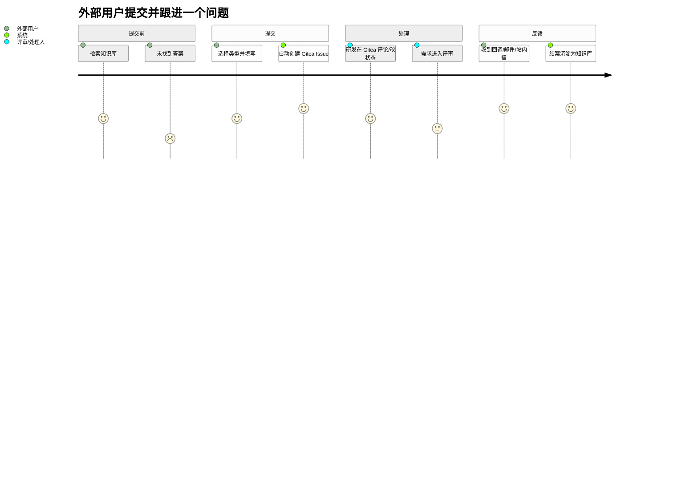
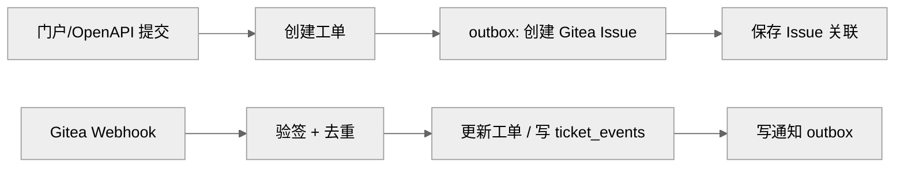

# 产品需求文档 (PRD)

| 字段 | 内容 |
|-----|------|
| 产品名称 | 灵问 Lingo（Gitea 外接工单门户） |
| 文档版本 | v1.1 |
| 创建日期 | 2026-11-13 |
| 最后更新 | 2026-11-13 |
| 文档负责人 | haiqing |
| 状态 | 草稿 |

---

## 修订历史

| 版本 | 日期 | 修改人 | 修改内容 |
|-----|------|-------|---------|
| v1.0 | 2026-11-13 | haiqing | 初始版本（模板） |
| v1.1 | 2026-11-13 | haiqing | 按现有架构设计回填概述、用户、功能、数据、技术方案等章节 |

---

## 1. 概述

### 1.1 背景与问题

**现状**：多个内部业务系统各自收集用户的咨询、Bug 与需求，研发团队在 Gitea 上用 Issue 跟踪处理。

**问题**：
- 业务系统用户没有 Gitea 账号，也不熟悉 Gitea，只能通过群聊、邮件等非结构化渠道反馈，信息易丢失、难追踪。
- 研发在 Gitea 处理完后，提交人得不到及时反馈，需要人工转达。
- 需求缺少统一的评审入口，评审结论散落在聊天记录中。
- 重复咨询多，已解决问题的经验没有沉淀和复用。

**机会**：以 Gitea 为唯一事实来源，在其前面加一层统一门户：对外提供结构化提交入口与 OpenAPI，对内保持研发在 Gitea 的原有工作方式，并把处理记录自动沉淀为知识库。

### 1.2 产品愿景

让内部各系统的用户用一个入口提问、报 Bug、提需求，研发留在 Gitea 处理，结果自动回到提交人手里，经验自动沉淀为知识库。

### 1.3 目标与成功指标

| 目标类型 | 指标 | 当前值 | 目标值 | 衡量方式 |
|---------|-----|-------|-------|---------|
| 业务目标 | 已接入系统数 | 0 | 待定 | 管理后台统计 tenants |
| 业务目标 | 通过门户提交的工单占比 | 待定 | 待定 | 门户工单数 / 全部反馈数 |
| 用户目标 | 工单状态变更到提交人收到通知的延迟 | - | P95 < 1 分钟 | Webhook 接收时间 vs 通知投递时间 |
| 用户目标 | 咨询类工单经知识库自助解决率 | - | 待定 | 检索后未提交 / 检索总次数 |
| 技术目标 | 通知投递成功率（含重试） | - | ≥ 99.9% | notifications 表状态统计 |
| 技术目标 | 门户与 Gitea 状态一致性 | - | 补偿后 100% | 同步补偿任务对账 |

### 1.4 范围定义

**包含（In Scope）**：
- 接入系统管理：注册、AppKey/Secret 凭据、回调地址、Gitea 仓库映射
- 工单提交：门户页面与 OpenAPI 两种入口，类型为咨询 / Bug / 需求
- Gitea 同步：机器人账号建 Issue、打类型标签；Webhook 接收 Issue 评论/状态/标签变更
- 信息反馈：接入系统回调、邮件、站内信，失败重试
- 需求评审：内部人员评审（通过 / 驳回 / 需补充信息）与回复，结论回写 Gitea
- 知识库：结案工单自动抽取问答对，提交咨询前检索
- 管理后台：接入系统、用户与角色管理

**不包含（Out of Scope）**：
- 替代 Gitea 的研发协作功能（看板、代码评审、CI 等）
- 支持 Gitea 以外的代码托管平台（GitHub、GitLab 等）
- 工单 SLA 计时与工时统计（后续版本再评估）
- 移动端原生 App

---

## 2. 用户研究

### 2.1 目标用户

| 用户角色 | 用户特征 | 使用场景 | 核心痛点 | 期望收益 |
|---------|---------|---------|---------|---------|
| 外部用户（external） | 各业务系统的使用者，无 Gitea 账号 | 遇到问题时咨询、报 Bug、提需求 | 反馈渠道散乱，不知道处理进度 | 一处提交，进度主动通知 |
| 接入系统（tenant） | 内部业务系统，通过 OpenAPI 集成 | 在自身系统内嵌入反馈入口 | 各自造轮子对接研发 | 统一 API + 回调，接入成本低 |
| 评审/处理人（reviewer） | 研发、产品等内部人员，有 Gitea 账号 | 在 Gitea 处理 Issue，在门户评审需求 | 需求来源杂、缺少上下文 | 结构化工单，评审结论自动同步 |
| 管理员（admin） | 门户运维/负责人 | 管理接入系统、用户、角色 | 手工维护凭据与仓库映射 | 后台集中管理 |

### 2.2 用户旅程

### 2.3 竞品分析

| 竞品 | 优势 | 劣势 | 我们的差异化 |
|-----|-----|-----|-------------|
| 直接使用 Gitea Issue | 零开发，研发习惯 | 外部用户需账号，无反馈通知与知识库 | 外部用户免账号，自动反馈 |
| 通用工单系统（如 Zammad、Jira Service Management） | 功能完备 | 与 Gitea 割裂，研发需两边维护 | 以 Gitea 为事实来源，双向同步 |
| 各业务系统自建反馈模块 | 贴合业务 | 重复建设，数据分散 | 多租户统一接入 |

---

## 3. 功能需求

### 3.1 功能概览

| 优先级 | 功能模块 | 功能描述 | 用户价值 | MVP |
|-------|---------|---------|---------|-----|
| P0 | 接入系统管理 | 注册接入系统、发放 AppKey、配置回调地址与 Gitea 仓库映射 | 多系统统一接入 | 是 |
| P0 | 工单提交 | 门户页面 / OpenAPI 提交咨询、Bug、需求 | 结构化反馈入口 | 是 |
| P0 | Gitea 同步 | 建 Issue + 类型标签；Webhook 回流评论、状态、标签变更 | 研发留在 Gitea 工作 | 是 |
| P0 | 信息反馈 | 工单更新后回调接入系统，失败重试 | 提交人及时获知进度 | 是 |
| P1 | 需求评审 | 内部人员评审需求类工单并回复，结论回写 Gitea | 评审有入口、有记录 | 是 |
| P1 | 邮件 / 站内信通知 | 回调之外的通知渠道 | 覆盖门户直接提交的用户 | 否 |
| P1 | 管理后台 | 用户、角色、接入系统管理界面 | 降低运维成本 | 是 |
| P2 | 知识库 | 结案工单抽取问答对；提交前检索 | 减少重复咨询 | 否 |

### 3.2 功能详情

#### 3.2.1 接入系统管理

**功能描述**：管理员注册接入系统，生成 AppKey/AppSecret（仅保存哈希），配置回调地址与映射的 Gitea 仓库。

**用户故事**：
> 作为管理员，我希望为每个业务系统分配独立凭据并指定其工单落到哪个 Gitea 仓库，以便各系统隔离且可追溯。

**业务规则**：
- AppSecret 只在创建时展示一次，库中仅存哈希
- 一个接入系统映射一个 Gitea 仓库（是否支持按工单类型映射不同仓库：待定）
- 所有业务数据带 `tenant_id` 隔离

**验收标准**：
- [ ] 可创建、禁用接入系统，并重置凭据
- [ ] 使用错误或已禁用凭据调用 OpenAPI 返回 401

#### 3.2.2 工单提交与 Gitea 同步

**功能描述**：用户在门户或接入系统通过 OpenAPI 提交工单，门户以机器人账号在映射仓库创建 Issue，打上类型标签并保存 `repo + issue number` 关联；Gitea 侧变更经 Webhook 回流。

**用户故事**：
> 作为外部用户，我希望不用登录 Gitea 就能提交问题并看到处理进度。

**功能流程**：

**业务规则**：
- 工单类型：`consult`（咨询）/ `bug` / `feature`（需求），对应 Gitea 标签
- OpenAPI 请求需 AppKey 签名校验
- 对 Gitea 的写操作经 outbox + worker 异步执行，可重试；Issue 创建失败不影响工单入库
- Webhook 必须校验共享密钥签名，并按事件 ID 去重
- 定期同步补偿，修复漏收 Webhook 导致的状态不一致

**验收标准**：
- [ ] 提交工单后在映射仓库生成带类型标签的 Issue
- [ ] Gitea 中评论、关闭/重开、改标签后，门户工单状态与事件记录同步更新
- [ ] 签名错误的 Webhook 被拒绝；重复投递的事件只处理一次

**边界情况**：
| 场景 | 处理方式 |
|-----|---------|
| Gitea 不可用 | 工单正常创建，Issue 创建任务进入 outbox 重试 |
| Issue 在 Gitea 被删除 | 工单标记异常，待定是否通知提交人 |
| Webhook 乱序到达 | 以事件时间与 Issue 当前状态为准，待定具体策略 |

#### 3.2.3 信息反馈

**功能描述**：工单状态变化或有新回复时，按渠道通知提交人：接入系统 `callback_url`、邮件、站内信。

**业务规则**：
- 通知先写 `notifications` outbox，再由 worker 投递，失败指数退避重试，记录尝试次数
- 回调请求需带签名，便于接入系统校验来源
- 哪些事件触发通知（内部评论是否外发）：待定

**验收标准**：
- [ ] 工单状态变更后接入系统收到回调
- [ ] 回调失败按策略重试，超过上限标记失败并可在后台查看

#### 3.2.4 需求评审

**功能描述**：需求类工单进入评审，内部人员在门户给出结论（`approve` 通过 / `reject` 驳回 / `need_info` 需补充）并回复，结论同步为 Gitea 评论与标签。

**用户故事**：
> 作为评审人，我希望在门户集中查看待评审需求并给出结论，结论自动同步到 Gitea 和提交人。

**验收标准**：
- [ ] 仅 reviewer / admin 角色可评审
- [ ] 评审结论在 Gitea Issue 中生成评论并更新标签
- [ ] `need_info` 时提交人收到补充信息通知

#### 3.2.5 知识库

**功能描述**：工单结案后，worker 从工单正文、评论与评审记录抽取问答对写入知识库；用户提交咨询前可检索。

**业务规则**：
- 知识库按 `tenant_id` 隔离（是否支持跨租户共享：待定）
- 可通过配置 `knowledge.enabled` 关闭
- 抽取与检索方式（LLM 抽取、向量检索）及所用模型服务：待定

**验收标准**：
- [ ] 结案工单自动生成问答条目并关联来源工单
- [ ] 提交咨询页面展示相关知识库条目

---

## 4. 非功能需求

### 4.1 性能需求

| 场景 | 指标 | 目标值 | 测量方法 |
|-----|-----|-------|---------|
| 页面加载 | 首屏时间 | < 2s | 浏览器性能面板 |
| API 响应 | P95 延迟 | < 200ms（不含异步 Gitea 调用） | 服务端日志 |
| Webhook 处理 | 接收到工单更新 | < 1s | ticket_events 时间戳 |
| 并发能力 | QPS | 待定 | 压测 |

### 4.2 可用性需求

- 系统可用性：99.9%
- Gitea 故障时门户可继续受理工单，恢复后由 outbox 补齐
- 故障恢复时间（RTO）：待定
- 数据恢复点（RPO）：待定

### 4.3 安全需求

| 类别 | 需求 | 优先级 |
|-----|-----|-------|
| 认证 | 门户登录；OpenAPI 使用 AppKey + 签名 | P0 |
| 授权 | 角色 external / reviewer / admin；外部用户仅能访问本人工单 | P0 |
| 数据安全 | 多租户按 `tenant_id` 隔离；AppSecret 仅存哈希；Gitea token 与 Webhook 密钥只放本地配置 | P0 |
| 集成安全 | Webhook 验签；回调请求签名 | P0 |
| 审计日志 | 工单事件全量记录于 ticket_events | P1 |

### 4.4 兼容性需求

**Web 端**：
- 浏览器：Chrome、Firefox、Safari、Edge（最新两个版本）

**其他**：
- Gitea 版本：待定（需支持 Issue / Label / Webhook API）
- 部署环境：内网

---

## 5. 数据需求

### 5.1 数据模型

> 草案见 `migrations/0001_init.sql`

| 实体 | 描述 | 关键字段 |
|-----|-----|---------|
| tenants | 接入系统 | name, app_key, app_secret_hash, callback_url, gitea_repo |
| users | 用户 | tenant_id, external_id, name, email, role(external/reviewer/admin) |
| tickets | 工单 | tenant_id, user_id, type(consult/bug/feature), title, body, status, gitea_repo, gitea_issue_number |
| ticket_events | 工单事件 | ticket_id, source(portal/gitea), kind, payload |
| reviews | 需求评审 | ticket_id, reviewer_id, verdict(approve/reject/need_info), comment |
| notifications | 通知 outbox | ticket_id, channel, target, payload, status, attempts |
| kb_entries | 知识库问答 | tenant_id, question, answer, source_ticket_id, tags, embedding |

### 5.2 数据采集

| 数据点 | 采集时机 | 用途 | 保留期限 |
|-------|---------|-----|---------|
| 工单事件 | 门户操作 / Webhook 到达 | 审计、状态追溯 | 待定 |
| 通知投递记录 | 每次投递尝试 | 排障、成功率统计 | 待定 |
| 知识库检索 | 用户检索时 | 评估自助解决率 | 待定 |

### 5.3 数据报表

| 报表名称 | 维度 | 指标 | 更新频率 |
|---------|-----|-----|---------|
| 工单概览 | 接入系统、类型、状态 | 工单数、平均处理时长 | 待定 |
| 通知投递 | 渠道 | 成功率、重试次数 | 待定 |

### 5.4 数据库迁移约定

- 迁移 SQL 目录：`migrations/`，数据库 PostgreSQL
- 文件命名：`NNNN_<snake_case_name>.sql`，编号四位递增（现有 `0001_init.sql`），新文件取当前最大编号 + 1
- 已发布的迁移文件不得修改，结构变更一律新增文件
- 每个迁移需可在已有数据上执行（加列给默认值或允许 NULL，避免锁大表的操作）
- 业务表包含 `tenant_id`，时间列用 `timestamptz`
- 回滚：`/rd:release` 会为本版本迁移生成回滚 SQL，编写时保证每条变更可逆

---

## 6. 技术方案

### 6.1 系统架构

> 详见 [docs/prompt/architecture.md](../prompt/architecture.md) 与 [docs/architecture/overview.md](../architecture/overview.md)

**前端**：
- 框架：Vue 3 + Vite 7（pnpm）
- 状态管理：待定
- UI 组件库：待定

**后端**：
- 语言/框架：Go 1.24，标准库 `net/http`
- 数据库：PostgreSQL
- 缓存：暂无
- 消息队列：不引入，使用数据库 outbox + 后台 worker

**基础设施**：
- 部署方式：单服务进程（HTTP API + Webhook + Worker），具体方式待定
- 监控告警：待定
- 日志系统：待定

### 6.2 第三方依赖

| 服务类型 | 服务商 | 用途 | 备选方案 |
|---------|-------|-----|---------|
| 代码托管 / Issue | Gitea（自建） | 工单的事实来源，机器人账号读写 | - |
| 邮件 | 待定 | 邮件通知 | - |
| 模型 / 向量服务 | 待定 | 知识库抽取与检索 | 关键词检索 |

### 6.3 接口设计

| 接口 | 方法 | 描述 |
|-----|-----|-----|
| `/healthz` | GET | 健康检查（已实现） |
| `/api/...` | - | 门户 API（登录、工单、评审、知识库检索），待设计 |
| `/openapi/...` | - | 接入系统 OpenAPI（AppKey 签名），待设计 |
| `/api/admin/...` | - | 管理后台 API，待设计 |
| `/webhooks/gitea` | POST | Gitea Webhook 接收 |

---

## 7. 发布计划

### 7.1 版本规划

| 版本 | 目标 | 核心功能 | 预计时间 |
|-----|-----|---------|---------|
| MVP | 跑通提交到反馈的闭环 | 接入系统管理、工单提交、Gitea 双向同步、回调通知、需求评审 | 待定 |
| v1.0 | 正式上线 | 管理后台、邮件/站内信、同步补偿 | 待定 |
| v1.x | 持续迭代 | 知识库、报表 | 待定 |

### 7.2 里程碑

| 里程碑 | 计划时间 | 实际时间 | 状态 | 备注 |
|-------|---------|---------|-----|-----|
| 项目骨架搭建 | 2026-11-13 | 2026-11-13 | 已完成 | 目录、包职责、迁移草案 |
| 需求评审通过 | | | 待开始 | |
| 技术方案确定 | | | 待开始 | |
| UI/UX 设计完成 | | | 待开始 | |
| 开发完成 | | | 待开始 | |
| 测试通过 | | | 待开始 | |
| 上线发布 | | | 待开始 | |

### 7.3 灰度策略

先接入 1 个内部系统试运行，验证同步与通知闭环后再逐步开放其他系统。

---

## 8. 风险管理

### 8.1 风险识别

| 风险 | 类型 | 可能性 | 影响 | 应对措施 | 负责人 |
|-----|-----|-------|-----|---------|-------|
| Webhook 丢失或乱序导致状态不一致 | 技术 | 中 | 高 | 事件去重 + 定期同步补偿 | |
| Gitea API 限流或不可用 | 技术 | 低 | 中 | outbox 异步重试 | |
| 机器人 token 泄露 | 技术 | 低 | 高 | 本地配置不入库，最小权限，定期轮换 | |
| 内部评论误外发给外部用户 | 业务 | 中 | 中 | 明确外发规则（待定） | |
| 知识库抽取质量差 | 技术 | 中 | 低 | 人工审核或可编辑条目 | |

### 8.2 依赖项

| 依赖项 | 类型 | 状态 | 风险 |
|-------|-----|-----|-----|
| Gitea 实例与机器人账号 | 内部 | 待确认 | 权限范围需覆盖所有映射仓库 |
| PostgreSQL | 内部 | 待确认 | - |
| 邮件服务 | 内部/外部 | 待确认 | - |
| 模型/向量服务 | 内部/外部 | 待确认 | 仅影响知识库 |

### 8.3 假设与约束

**假设**：
- 研发团队以 Gitea 为日常工作平台，愿意在 Issue 中回复
- 接入系统能提供稳定的用户标识（external_id）

**约束**：
- Gitea 为工单事实来源，门户不承载研发协作
- 不引入独立消息队列，异步依赖数据库 outbox

---

## 9. 需求追踪

> 本章节由 `/rd:new` 和 `/rd:done` 命令自动维护，记录所有从本 PRD 派生的需求。

| 编号 | 标题 | 模块 | 状态 | 创建日期 | 完成日期 |
|-----|------|------|------|---------|---------|
| - | 暂无需求 | - | - | - | - |

---

## 10. 附录

### 10.1 术语表

| 术语 | 定义 |
|-----|-----|
| 接入系统 / 租户（tenant） | 通过 OpenAPI 接入门户的内部业务系统 |
| 工单（ticket） | 门户中的咨询 / Bug / 需求记录，与一个 Gitea Issue 关联 |
| 机器人账号 | 门户用于调用 Gitea API 的专用账号 |
| outbox | 先写库再由 worker 异步投递的任务表，保证可重试 |
| 同步补偿 | 定期比对 Gitea 与门户状态，修复不一致 |

### 10.2 参考资料

- Gitea API 文档：https://docs.gitea.com/api
- Gitea Webhook 文档：https://docs.gitea.com/usage/webhooks

### 10.3 相关文档

| 文档 | 链接 |
|-----|-----|
| 架构概览 | [docs/architecture/overview.md](../architecture/overview.md) |
| 项目架构（开发规范） | [docs/prompt/architecture.md](../prompt/architecture.md) |
| 数据库草案 | [migrations/0001_init.sql](../../migrations/0001_init.sql) || 原型设计 | 待补充 |
| 测试用例 | 待补充 |

---

## 审批记录

| 角色 | 姓名 | 意见 | 日期 |
|-----|-----|-----|-----|
| 产品负责人 | | | |
| 技术负责人 | | | |
| 业务负责人 | | | |

---

> 下一步：完善 PRD 后，可使用 `/rd:new <标题>` 创建具体需求
