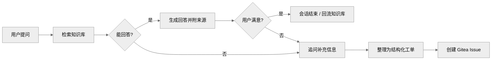
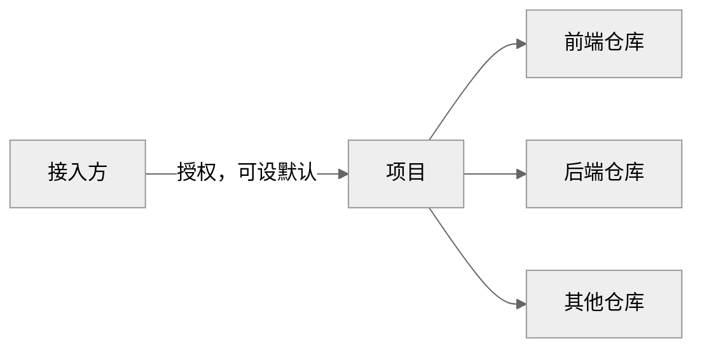
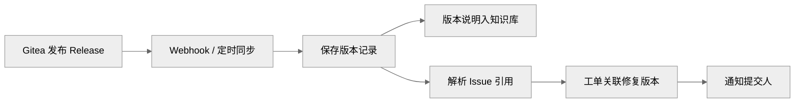
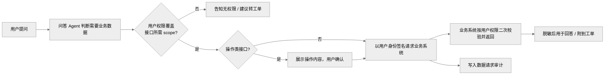
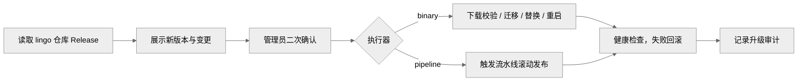
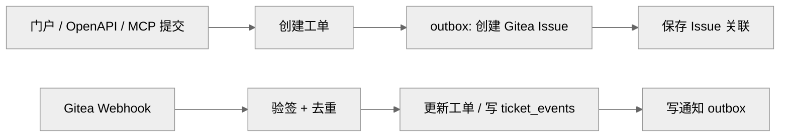

# 产品需求文档 (PRD)

| 字段 | 内容 |
|-----|------|
| 产品名称 | 灵问 Lingo（连接 Agent AI 智能开发团队与用户的知识问答 Agent） |
| 文档版本 | v1.7 |
| 创建日期 | 2026-11-13 |
| 最后更新 | 2026-11-13 |
| 文档负责人 | haiqing |
| 状态 | 草稿 |

---

## 修订历史

| 版本 | 日期 | 修改人 | 修改内容 |
|-----|------|-------|---------|
| v1.0 | 2026-11-13 | haiqing | 初始版本（模板） |
| v1.1 | 2026-11-13 | haiqing | 按现有架构设计回填概述、用户、功能、数据、技术方案等章节 |
| v1.2 | 2026-11-13 | haiqing | 调整产品定位为 Agent 研发与用户的问答平台，重写背景与用户画像；并入数据库迁移约定 |
| v1.3 | 2026-11-13 | haiqing | 研发方明确为 Agent AI 智能开发团队；灵问定位为知识问答 Agent；新增 MCP、开放接口、固定角色多用户 |
| v1.4 | 2026-11-13 | haiqing | 新增项目与对接仓库：前后端多仓库归属一个项目，按项目授权与提问，Issue 落到项目内合适仓库；新增对接版本记录：同步 Gitea Release、工单关联修复版本 |
| v1.5 | 2026-11-13 | haiqing | 新增浏览器 JS 接入：嵌入问答组件、JS API、公开 Key 与域名白名单、身份令牌 |
| v1.6 | 2026-11-13 | haiqing | 新增基于人员权限的业务数据请求：数据接口登记、代用户调用、双重权限校验、审计 |
| v1.7 | 2026-11-13 | haiqing | 新增系统在线升级（可插拔执行器）；明确可扩展部署约定 |

---

## 1. 概述

### 1.1 背景与问题

**现状**：研发由 Agent AI 智能开发团队承担：AI Agent 在 Gitea 中领取 Issue、编写代码、提交 PR，人类工程师负责评审与把关。研发速度大幅提升，但用户侧的提问、反馈与需求仍靠群聊、私信、邮件人工传递。

**问题**：
- **用户与 AI 研发团队之间没有通道**：用户没有也不需要 Gitea 账号；AI Agent 只能处理结构化的 Issue，读不懂零散的聊天记录。
- **反馈质量决定 AI 研发效率**：描述不清、缺少复现信息的反馈，AI Agent 无法直接动手，只能反复追问或交由人工整理。
- **大量提问其实不需要研发介入**：用法、限制、已知问题等咨询占比高，却同样流向研发，挤占研发容量。
- **反馈闭环断裂**：Issue 处理完毕，用户不知道结果，需要有人手工转达。
- **知识没有沉淀**：问答散落在各处，同样的问题被反复提出、反复解答。

**机会**：做一个本身就是知识问答 Agent 的平台，站在用户与 AI 研发团队之间：
- 先由灵问基于知识库直接回答，能答的当场解决；
- 答不了的，整理成结构化、带上下文的 Issue 交给 AI 研发团队，处理进展自动回传用户；
- 通过 MCP 与开放接口，让用户侧的 AI 客户端、各业务系统和研发侧的 Agent 都能直接接入；
- 每一次问答与 Issue 处理都回流知识库，让灵问越用越聪明。

### 1.2 产品愿景

灵问是连接 Agent AI 智能开发团队与用户的知识问答 Agent：用户随时提问，灵问能答即答，答不了的转成 AI 研发团队能直接处理的任务，结果自动回到用户手中，每一次问答都让知识库更完整。

### 1.3 目标与成功指标

| 目标类型 | 指标 | 当前值 | 目标值 | 衡量方式 |
|---------|-----|-------|-------|---------|
| 业务目标 | 已接入方数（业务系统 / MCP 客户端） | 0 | 待定 | 管理后台统计 tenants |
| 业务目标 | 问答直接解决率（无需转 Issue） | - | 待定 | 未转 Issue 且用户认可的会话 / 全部会话 |
| 业务目标 | 转出 Issue 被 AI Agent 直接领取处理的比例 | - | 待定 | 无需人工补充信息即开始处理的 Issue / 转出 Issue |
| 用户目标 | 问答首次响应时间 | - | P95 < 5s | 会话日志 |
| 用户目标 | 工单状态变更到提交人收到通知的延迟 | - | P95 < 1 分钟 | Webhook 接收时间 vs 通知投递时间 |
| 技术目标 | 通知投递成功率（含重试） | - | ≥ 99.9% | notifications 表状态统计 |
| 技术目标 | 门户与 Gitea 状态一致性 | - | 补偿后 100% | 同步补偿任务对账 |

### 1.4 范围定义

**包含（In Scope）**：
- 知识问答 Agent：基于知识库与 LLM 回答用户提问，答不了时引导转为工单
- 业务数据请求：以提问人员身份、基于其权限向业务系统查询数据或提交操作，用于回答与工单
- 多入口接入：Web 门户、浏览器 JS 接入（嵌入组件 + JS API）、开放接口（OpenAPI）、MCP Server
- 接入方管理：注册、AppKey/Secret 凭据、回调地址、授权可对接的项目
- 项目与对接仓库：前端、后端等多个 Gitea 仓库归属一个项目；提问 / 提交时指定项目（可选仓库），未指定时用默认项目
- 对接版本记录：同步 Gitea Release，版本说明入知识库，工单关联修复版本并通知提交人
- 工单提交：类型为咨询 / Bug / 需求，转出时自动整理为结构化 Issue（问题描述、复现信息、期望结果）
- Gitea 同步：机器人账号建 Issue、打类型标签；Webhook 接收 Issue 评论/状态/标签变更
- 信息反馈：接入方回调、邮件、站内信，失败重试
- 需求评审：内部人员评审（通过 / 驳回 / 需补充信息）与回复，结论回写 Gitea
- 知识库：结案工单与问答会话自动抽取问答对，供问答 Agent 检索
- 管理后台：接入方、用户与角色、知识库条目管理
- 系统在线升级：后台检查 lingo 新版本并发起升级，执行器可插拔（单机二进制 / 流水线滚动发布）

**不包含（Out of Scope）**：
- AI 研发 Agent 本身（领取 Issue、写代码、提 PR 由研发侧 Agent 完成，灵问只负责交付任务与回传结果）
- 替代 Gitea 的研发协作功能（看板、代码评审、CI 等）
- 支持 Gitea 以外的代码托管平台（GitHub、GitLab 等）
- 工单 SLA 计时与工时统计（后续版本再评估）
- 移动端原生 App

---

## 2. 用户研究

### 2.1 目标用户

| 用户角色 | 用户特征 | 使用场景 | 核心痛点 | 期望收益 |
|---------|---------|---------|---------|---------|
| 用户（external） | 使用研发团队交付的产品的人，无 Gitea 账号，不关心研发流程 | 不会用、遇到 Bug、希望增加功能 | 不知道找谁问；问题说不清；提了之后石沉大海 | 随时提问、即时得到答复；答不了的有人跟进，进展主动告知 |
| 接入方（tenant） | 通过浏览器 JS、开放接口或 MCP 接入灵问的业务系统、AI 客户端（如 IDE、桌面助手） | 网页中嵌入一段 JS 即有提问入口；后端经 OpenAPI 集成；用户的 AI 助手经 MCP 直接提问 | 各自搭反馈渠道，对接研发成本高 | 一段 JS / 一套 OpenAPI / MCP 即可接入，提问自动附带上下文 |
| AI 研发 Agent | Agent AI 智能开发团队中的 AI Agent，在 Gitea 领取并处理 Issue | 读取灵问转出的 Issue，开发修复后在 Issue 中回复；通过 MCP 查询知识库与问题上下文 | 需求描述模糊、缺少复现信息时无法直接动手 | 拿到结构化、可执行的任务；处理结果自动回传用户 |
| 研发负责人（reviewer） | 监督 AI 研发团队的人类工程师 / 产品 | 评审需求、把关 AI 产出、处理 AI 无法解决的问题、审核知识库 | 需求来源杂，评审结论难留痕 | 统一评审入口，结论自动同步 Gitea 与用户 |
| 管理员（admin） | 平台负责人或运维 | 管理接入方、项目与仓库、用户与角色、模型与知识库配置 | 手工维护凭据与仓库映射 | 后台集中管理 |

### 2.2 用户旅程


### 2.3 竞品分析

| 竞品 | 优势 | 劣势 | 我们的差异化 |
|-----|-----|-----|-------------|
| 直接使用 Gitea Issue | 零开发，研发习惯 | 用户需账号，无问答、无反馈通知与知识库 | 用户免账号，先问答后转 Issue，自动反馈 |
| 通用工单系统（如 Zammad、Jira Service Management） | 功能完备 | 与 Gitea 割裂，工单不面向 AI Agent 消费 | 以 Gitea 为事实来源，Issue 为 AI 研发可执行格式 |
| 通用 AI 客服 / 知识库问答 | 即时回答 | 答不了就断了，不连接研发 | 问答与研发闭环，处理结果回流知识库 |
| 各业务系统自建反馈模块 | 贴合业务 | 重复建设，数据分散 | 开放接口 + MCP 统一接入 |

---

## 3. 功能需求

### 3.1 功能概览

| 优先级 | 功能模块 | 功能描述 | 用户价值 | MVP |
|-------|---------|---------|---------|-----|
| P0 | 知识问答 Agent | 基于知识库与 LLM 回答提问，答不了时引导转工单 | 能答即答，减少研发打扰 | 是 |
| P1 | 业务数据请求 | 以人员身份、按其权限调用业务系统数据接口，结果用于回答 | 直接回答“我的数据”类问题 | 否 |
| P0 | 浏览器 JS 接入 | 引入一段 `<script>` 即嵌入问答组件，提供 JS API 与自动上下文 | 业务网页零开发接入 | 是 |
| P0 | 开放接口（OpenAPI） | AppKey 签名的 REST 接口：提问、提交工单、查询进展、回调 | 业务系统快速接入 | 是 |
| P0 | MCP Server | 以 MCP 工具暴露提问、检索知识库、提交/查询工单 | AI 客户端与研发 Agent 直接接入 | 是 |
| P0 | 接入方管理 | 注册接入方、发放 AppKey、配置回调地址、授权项目 | 多方统一接入 | 是 |
| P0 | 项目与对接仓库 | 多个仓库（前后端等）归属一个项目；按项目提问，Issue 落到项目内合适的仓库 | 用户按产品提问，问题直达对应仓库 | 是 |
| P0 | 工单提交 | 咨询、Bug、需求；转出时整理为结构化 Issue | AI 研发可直接处理 | 是 |
| P0 | Gitea 同步 | 建 Issue + 类型标签；Webhook 回流评论、状态、标签变更 | 研发留在 Gitea 工作 | 是 |
| P0 | 信息反馈 | 工单更新后回调接入方，失败重试 | 提交人及时获知进度 | 是 |
| P1 | 需求评审 | 内部人员评审需求类工单并回复，结论回写 Gitea | 评审有入口、有记录 | 是 |
| P1 | 邮件 / 站内信通知 | 回调之外的通知渠道 | 覆盖门户直接提交的用户 | 否 |
| P0 | 固定角色多用户 | 预置固定角色，每个角色下可有多个用户；按角色控制权限 | 多人协作、权限清晰 | 是 |
| P2 | 系统在线升级 | 后台检查版本、确认升级；执行器可插拔，支持单机与集群 | 免登录服务器升级，可回滚 | 否 |
| P1 | 管理后台 | 用户、角色分配、接入方、知识库管理界面 | 降低运维成本 | 是 |
| P0 | 知识库 | 结案工单与问答会话抽取问答对，供问答 Agent 检索 | 问答 Agent 的知识来源 | 是 |
| P1 | 对接版本记录 | 同步 Gitea Release，版本说明入知识库，工单关联修复版本并通知 | 用户知道问题在哪个版本解决 | 否 |

### 3.2 功能详情

#### 3.2.0 知识问答 Agent

**功能描述**：灵问本身是一个知识问答 Agent。用户从任一入口提问，灵问检索知识库并结合 LLM 生成回答；无法回答或用户不满意时，引导用户补充信息并转为工单。

**用户故事**：
> 作为用户，我希望提问后立刻得到答复；答不了时，系统帮我把问题整理清楚交给研发，而不是让我重新描述一遍。

**功能流程**：



**业务规则**：
- 回答需附知识来源（知识条目 / 历史工单），无可靠依据时不编造，直接说明并引导转工单
- 转工单前由灵问追问关键信息（Bug：复现步骤、期望与实际结果、版本；需求：场景与期望），整理成 AI 研发 Agent 可执行的 Issue 模板
- 转工单需用户确认，会话记录随工单附带
- 所用模型服务与提示词可在管理后台配置：待定

**验收标准**：
- [ ] 知识库已有答案的问题，灵问直接回答并给出来源
- [ ] 知识库无答案时不编造，引导转为工单
- [ ] 转出的 Issue 包含结构化的问题描述、复现信息与原始会话链接

#### 3.2.0.1 开放接口与 MCP

**功能描述**：灵问对外提供两类接入方式，能力一致：
- **开放接口（OpenAPI）**：RESTful JSON，AppKey 签名，供业务系统集成，支持回调通知
- **MCP Server**：以 MCP 工具形式暴露能力，供用户侧 AI 客户端（IDE、桌面助手等）和研发侧 AI Agent 直接调用

**MCP 工具（草案）**：

| 工具 | 说明 | 主要使用方 |
|-----|-----|----------|
| `list_projects` | 列出当前身份可对接的项目及其仓库 | 两侧 |
| `ask` | 向灵问提问（指定 `project`，可选 `repo`），返回回答与来源 | 用户侧 AI 客户端 |
| `search_knowledge` | 检索知识库条目（按 `project` / `repo` 过滤） | 两侧 |
| `create_ticket` | 提交咨询 / Bug / 需求工单（指定 `project`，可选 `repo`） | 用户侧 AI 客户端 |
| `get_ticket` | 查询工单状态、回复、关联 Issue 与修复版本 | 两侧 |
| `reply_ticket` | 在工单中回复用户（同步为 Issue 评论） | 研发侧 AI Agent |

**业务规则**：
- MCP 与 OpenAPI 共用同一套鉴权与租户隔离（MCP 使用接入方凭据或个人令牌，具体方式待定）
- MCP 传输方式：Streamable HTTP（是否同时支持 stdio：待定）
- 研发侧工具仅对 reviewer / AI 研发 Agent 身份开放

**验收标准**：
- [ ] 通过 MCP 客户端可完成提问、检索、提交与查询工单
- [ ] 通过 OpenAPI 可完成同样操作，并收到状态变更回调
- [ ] 未授权身份无法调用研发侧工具

#### 3.2.0.2 固定角色多用户

**功能描述**：系统预置一组固定角色，不支持自定义角色或细粒度权限配置；每个角色下可以有任意多个用户，管理员为用户分配角色。

**固定角色**：

| 角色 | 标识 | 权限 |
|-----|-----|-----|
| 用户 | `external` | 提问、提交工单、查看本人会话与工单 |
| AI 研发 Agent | `agent` | 服务账号，通过 MCP / OpenAPI 读取工单、回复用户、检索知识库 |
| 研发负责人 | `reviewer` | 在用户权限之外：查看本接入方全部工单、评审需求、回复用户、审核知识库 |
| 管理员 | `admin` | 全部权限：管理接入方、用户与角色分配、系统配置 |

**用户故事**：
> 作为管理员，我希望给团队中的多位研发负责人、多个 AI Agent 账号分别分配固定角色，以便多人协作且权限边界清晰。

**业务规则**：
- 角色集合固定，权限随角色内置，不提供角色编辑
- 一个用户在一个接入方内只有一个角色（是否允许跨接入方担任不同角色：待定）
- 同一角色的多个用户权限相同，操作记录按用户留痕
- `agent` 为服务账号，使用令牌认证，不能登录门户；每个 AI Agent 一个独立账号，便于追踪
- 至少保留一名 `admin`，不可删除最后一名管理员

**验收标准**：
- [ ] 管理员可新增多个用户并分配四种固定角色之一
- [ ] 不同角色登录后只能看到并执行其权限内的操作
- [ ] 工单回复、评审等操作记录到具体用户

#### 3.2.0.3 项目与对接仓库

**功能描述**：灵问以**项目**为对接单位。一个项目可包含多个 Gitea 仓库（如前端、后端、移动端），管理员登记项目及其仓库并授权给接入方；提问或提交工单时指定项目（可进一步指定仓库），问答在整个项目范围内进行，转出的 Issue 落到项目下合适的仓库。

**用户故事**：
> 作为用户，我只关心“哪个产品出了问题”，不想分辨是前端还是后端；我希望选择项目后提问，由灵问判断问题该交给哪个仓库。
>
> 作为管理员，我希望把一个产品的前后端仓库归到同一个项目下，统一授权给接入方，并设置默认项目和项目内的默认仓库。

**层级关系**：



**指定方式**：

| 入口 | 方式 |
|-----|-----|
| Web 门户 | 提问 / 提交页选择项目（下拉为当前用户可对接的项目），高级选项可指定仓库 |
| 开放接口 | 请求参数 `project`（项目标识），可选 `repo`（`owner/name`，须属于该项目） |
| MCP | 工具参数 `project`、可选 `repo`；可先调用 `list_projects` 获取可选项目及其仓库 |

**业务规则**：
- 项目由管理员登记（标识、名称、说明、是否启用）；仓库登记时归属一个项目，并标注类型（前端 / 后端 / 移动端 / 文档 / 其他）；一个仓库只属于一个项目
- 每个项目设一个默认仓库；机器人账号需对项目下所有仓库有 Issue 读写权限
- 接入方按项目授权，可授权多个项目并设一个默认项目；只能指定已授权的项目，否则返回 403
- 未指定 `project` 时使用接入方默认项目；无默认项目时，问答 Agent 根据问题推荐项目并请用户确认
- 问答范围：知识库检索覆盖项目下所有仓库的知识与版本说明，回答时注明来源仓库
- Issue 落库仓库的确定顺序：用户指定的 `repo` → 问答 Agent 按问题内容判断（如界面 / 交互类 → 前端仓库，接口 / 数据类 → 后端仓库），转出前请用户确认 → 项目默认仓库
- 跨仓库问题（前后端都要改）：在主要仓库创建 Issue，并在其他相关仓库创建关联 Issue 互相引用（是否自动创建：待定）
- 工单创建后仓库调整由研发负责人操作（是否支持跨仓库迁移 Issue：待定）

**验收标准**：
- [ ] 管理员可创建项目、向项目添加多个仓库并设置默认仓库
- [ ] 接入方按项目授权并可设默认项目；指定未授权项目时被拒绝
- [ ] 指定项目提问时，回答可引用该项目下任一仓库的知识，并注明来源仓库
- [ ] 未指定仓库时，问答 Agent 给出建议仓库，用户确认后 Issue 创建在该仓库
- [ ] `list_projects` 仅返回当前身份可对接的项目及其仓库

#### 3.2.0.4 对接版本记录

**功能描述**：灵问同步各对接仓库在 Gitea 中的版本记录（Release / Tag 及版本说明），用于三件事：
- **问答**：版本说明入知识库，回答“最新版本有什么变化”“这个问题在哪个版本修复了”“某功能从哪个版本开始支持”
- **关联**：解析版本说明中的 Issue 引用（如 `closes #12`、`#12`、`REQ-001`），把工单与修复 / 上线版本关联
- **通知**：包含某工单的版本发布后，通知提交人“已在 vX.Y.Z 发布”

**用户故事**：
> 作为用户，我希望知道我反馈的问题在哪个版本修复、我现在用的版本有哪些已知问题，以便决定是否升级。
>
> 作为 AI 研发 Agent，我希望发版后关联的工单自动更新并通知用户，不需要逐个回复。

**功能流程**：



**业务规则**：
- 来源：Gitea Release（标签、标题、说明、发布时间、是否预发布）；通过 `release` Webhook 实时接收，并定时全量同步兜底
- 同步项目下各仓库的版本；草稿（draft）不同步，预发布（prerelease）同步但单独标记，是否通知：待定
- 关联规则：版本说明中引用的 Issue 编号 → 对应工单标记“修复版本”；同一工单出现在多个版本时取最早的正式版本
- 提交 Bug 时可填写当前使用版本（开放接口 / MCP 参数 `version`），问答 Agent 据此判断问题是否已在更新版本修复，并提示升级
- 版本记录按仓库保存、按项目汇总：项目版本页按时间合并展示前后端各仓库的发布；问答时引用所选项目下的版本记录并注明仓库
- 项目是否需要统一的产品版本号（映射到各仓库的版本组合）：待定
- 版本格式遵循 semver（`vX.Y.Z`）；非 semver 标签按发布时间排序

**MCP 工具（新增）**：

| 工具 | 说明 |
|-----|-----|
| `list_releases` | 列出指定项目（或其下某仓库）的版本记录（可分页、可过滤预发布） |
| `get_release` | 查看某版本的说明与关联工单 |

**验收标准**：
- [ ] Gitea 发布 Release 后，灵问在 1 分钟内同步该版本记录
- [ ] 版本说明中引用的 Issue 对应的工单显示修复版本，提交人收到发布通知
- [ ] 用户问“某问题在哪个版本修复”时，问答 Agent 能给出版本号并附版本说明来源
- [ ] 提交 Bug 并填写旧版本号，若该问题已在新版本修复，问答 Agent 提示升级

#### 3.2.0.5 浏览器 JS 接入

**功能描述**：接入方在自己的网页中引入一段 JS 代码，即可嵌入灵问问答组件（悬浮按钮 + 对话面板），用户在业务页面内直接提问、提交工单、查看进展，无需跳转门户；同时提供 JS API，供页面自定义入口与上报上下文。

**用户故事**：
> 作为接入方的前端开发，我希望复制一段 `<script>` 代码就能在产品里加上“问灵问”入口，不需要自己开发界面和后端转发。
>
> 作为用户，我希望在出问题的页面直接提问，系统自动带上页面地址、版本和浏览器信息，不用我自己描述环境。

**接入示例（草案）**：

```html
<script src="https://lingo.example.com/sdk/lingo.js" async></script>
<script>
  window.lingoQueue = window.lingoQueue || [];
  lingoQueue.push(['init', {
    key: 'pk_xxx',              // 接入方公开 Key（可暴露在前端）
    project: 'crm',             // 默认项目，可选
    version: '2.3.1',           // 当前产品版本，可选，用于版本判断
    user: { id: 'u123', name: '张三', token: '<接入方后端签发的身份令牌>' }
  }]);
</script>
```

**JS API（草案）**：

| 方法 / 事件 | 说明 |
|-----|-----|
| `init(options)` | 初始化：公开 Key、项目、版本、用户身份、主题、语言、入口位置 |
| `open()` / `close()` | 打开 / 关闭对话面板，便于接入方用自有按钮触发 |
| `ask(text, context?)` | 以指定问题打开面板并提问 |
| `setContext(obj)` | 追加业务上下文（如当前订单号、页面模块），随提问附带 |
| `identify(user)` / `logout()` | 登录态变化时更新或清除用户身份 |
| `on('ticket:update', fn)` | 订阅工单进展事件，页面内提示用户 |

**业务规则**：
- **凭据分离**：前端只使用公开 Key（`pk_` 前缀，仅可调用问答与工单的用户侧能力），不得使用 AppSecret；公开 Key 可单独重置
- **来源白名单**：接入方配置允许嵌入的域名（Origin 白名单），非白名单来源的请求拒绝，CORS 只对白名单放行
- **用户身份**：
  - 已登录用户：接入方后端用 AppSecret 签发短期身份令牌（含用户 ID、姓名、部门、权限声明 `scopes`、过期时间），前端传入，灵问校验后识别为该用户，可查看本人历史会话与工单
  - 匿名用户：允许匿名提问（是否允许由接入方配置），以浏览器匿名 ID 区分会话；提交工单时需留联系方式或登录
- **自动上下文**：提问时自动附带页面 URL、页面标题、浏览器与系统信息、`version`、`setContext` 数据；可选采集最近的前端报错（默认关闭，需接入方开启并告知用户）
- **隔离**：组件运行在 Shadow DOM 或 iframe 中，不污染宿主页面样式与全局变量；脚本异步加载，加载失败不影响宿主页面
- **体积与兼容**：SDK 压缩后体积目标 < 50KB（待定），支持主流浏览器最新两个版本
- **限流**：按公开 Key + 用户 / 匿名 ID 限流，防止滥用

**验收标准**：
- [ ] 在白名单域名页面粘贴接入代码后，出现悬浮入口并可完成提问、转工单、查看进展
- [ ] 非白名单域名引入同一代码无法调用接口
- [ ] 传入有效身份令牌时识别为对应用户；令牌过期或伪造时降级为匿名或拒绝
- [ ] 提问自动附带页面 URL、版本与浏览器信息，并出现在转出的 Issue 中
- [ ] 组件样式不影响宿主页面，SDK 加载失败时宿主页面正常

#### 3.2.0.6 基于人员权限的业务数据请求

**功能描述**：问答过程中，灵问可以**以提问人员的身份**向接入方的业务系统发起数据请求（查询数据或提交业务操作），把结果用于回答或附到工单中。是否能取到数据、能取到哪些数据，由该人员在业务系统中的权限决定，灵问不持有超越用户本人的权限。

**用户故事**：
> 作为用户，我问“我昨天提交的订单 1024 为什么审批失败”，希望灵问直接查到这张订单的状态和失败原因来回答，而不是让我截图。
>
> 作为接入方，我希望灵问只能看到当前用户本人有权看到的数据，并且每一次数据请求都有记录可查。

**人员信息**：

| 来源 | 内容 |
|-----|-----|
| 浏览器 JS 身份令牌 / OpenAPI 请求 / 门户登录映射 | 用户在业务系统中的 ID（`external_id`）、姓名、部门、岗位 |
| 身份令牌中的权限声明（`scopes`） | 用户在业务系统中可用的数据权限，如 `order:read`、`order:read:dept`、`leave:apply` |

> 人员信息与权限声明由接入方后端签发（AppSecret 签名、短期有效），灵问只校验和使用，不自行修改。

**数据接口登记**：接入方在管理后台登记可供灵问调用的业务数据接口（也可导入接入方的 OpenAPI 描述或对接其 MCP Server）：

| 字段 | 说明 |
|-----|-----|
| 名称 / 说明 | 供问答 Agent 理解何时调用，如“查询订单详情” |
| 入参定义 | JSON Schema，如 `order_id` |
| 地址与方法 | 业务系统接口地址 |
| 所需权限 | 调用前用户必须具备的 scope，如 `order:read` |
| 类型 | 查询（只读） / 操作（写，如提交申请、重试任务） |
| 敏感字段 | 返回结果中需脱敏或不得展示的字段 |

**功能流程**：



**业务规则**：
- **代用户请求，双重校验**：灵问先校验用户 `scopes` 覆盖接口所需权限；请求业务系统时携带用户身份（`external_id` + 原始身份令牌或灵问签名的代理声明），业务系统必须按该用户的权限再次校验并做数据范围过滤。灵问不使用任何超级账号
- **只在本人会话内使用**：取到的数据只出现在发起人的会话中，不写入知识库，不用于回答其他用户
- **操作需确认**：操作类接口必须向用户展示将要提交的内容并经明确确认后才调用；请求带幂等键，防止重复提交
- **转工单时的数据**：业务数据随工单转给 AI 研发 Agent 前需用户同意，并按敏感字段配置脱敏
- **审计**：每次数据请求记录人员、接口、参数摘要、结果状态、耗时；研发负责人与管理员可查，用户可查看本人记录
- **失败处理**：业务系统超时或报错时如实告知用户，不编造数据；连续失败的接口自动熔断并告警（阈值：待定）
- 身份令牌过期或缺少 `scopes` 时，不发起数据请求，引导用户重新登录

**验收标准**：
- [ ] 接入方可登记数据接口并配置所需权限、类型与敏感字段
- [ ] 具备权限的用户提问时，灵问以其身份调用接口并基于返回数据回答
- [ ] 不具备权限的用户无法触发调用；业务系统拒绝时灵问如实告知
- [ ] 操作类接口未经用户确认不会被调用
- [ ] 每次请求均有审计记录；业务数据不进入知识库，转工单时按配置脱敏

#### 3.2.0.7 系统在线升级

**功能描述**：灵问自身代码托管在 Gitea 私有仓库。管理员可在管理后台检查 lingo 新版本、查看版本说明并发起升级；灵问负责发现版本、校验、确认与审计，实际升级由可插拔的**升级执行器**完成，以适配从单机到集群的不同部署方式。

**用户故事**：
> 作为管理员，我希望在后台看到 lingo 有新版本及其变更内容，一键发起升级，失败可回滚，不必登录服务器手工操作。

**升级执行器**：

| 执行器 | 适用部署 | 执行方式 |
|-----|-----|-----|
| `binary` | 早期 / 单机（二进制 + systemd） | 下载 Release 附件 → 校验 → 备份数据库 → `server migrate` → 替换二进制（保留旧版）→ 平滑重启 → 健康检查失败自动回滚 |
| `pipeline` | 规模化（容器 + K8s / 编排） | 触发 Gitea Actions `workflow_dispatch` 或 CD 流水线，传入目标版本；由编排系统滚动发布，灵问轮询并展示进度 |

**功能流程**：



**业务规则**：
- 仅 `admin` 可发起，需二次确认；每次检查、发起、结果、回滚均写审计
- 版本来源只信任配置中指定的 lingo 仓库与正式版 tag（预发布需显式开启）；读取使用独立的只读 token，与写 Issue 的机器人 token 分开
- 产物必须校验 SHA256（签名校验：待定）；不在应用内从源码编译
- 迁移由 `server migrate` 单独执行，迁移须向前兼容（见 5.4），保证滚动发布期间新旧版本可同时运行
- 多实例部署只能使用 `pipeline` 执行器；`binary` 执行器检测到多实例时拒绝执行
- 不允许跨大版本跳级升级时，提示按顺序升级（是否限制：待定）
- lingo 自身仓库可登记为灵问的一个项目，用户可直接询问 lingo 的版本变化，lingo 的问题走同一套 Issue 流程

**验收标准**：
- [ ] 后台可看到当前版本、最新可用版本与版本说明
- [ ] `binary` 执行器完成升级；健康检查失败时自动回滚到旧版本
- [ ] `pipeline` 执行器可触发流水线并展示发布结果
- [ ] 校验和不匹配或来源不在配置内的产物被拒绝
- [ ] 非管理员无法发起升级，所有升级操作有审计记录

#### 3.2.1 接入方管理

**功能描述**：管理员注册接入方（业务系统或 MCP 客户端），生成 AppKey/AppSecret（仅保存哈希），配置回调地址，并授权可对接的项目（见 3.2.0.3）。

**用户故事**：
> 作为管理员，我希望为每个业务系统分配独立凭据并授权其可对接的项目，以便各系统隔离且可追溯。

**业务规则**：
- AppSecret 只在创建时展示一次，库中仅存哈希
- 一个接入方可授权多个项目，并设置一个默认项目
- 所有业务数据带 `tenant_id` 隔离

**验收标准**：
- [ ] 可创建、禁用接入方，并重置凭据
- [ ] 使用错误或已禁用凭据调用 OpenAPI 返回 401

#### 3.2.2 工单提交与 Gitea 同步

**功能描述**：用户经门户、开放接口或 MCP 提交工单（或由问答 Agent 转出），灵问以机器人账号在项目内确定的仓库（规则见 3.2.0.3）创建 Issue，打上类型标签并保存 `repo + issue number` 关联；Gitea 侧变更经 Webhook 回流。

**用户故事**：
> 作为用户，我希望不用登录 Gitea 就能提交问题并看到处理进度。

**功能流程**：



**业务规则**：
- 工单类型：`consult`（咨询）/ `bug` / `feature`（需求），对应 Gitea 标签
- OpenAPI 请求需 AppKey 签名校验
- 对 Gitea 的写操作经 outbox + worker 异步执行，可重试；Issue 创建失败不影响工单入库
- Webhook 必须校验共享密钥签名，并按事件 ID 去重
- 定期同步补偿，修复漏收 Webhook 导致的状态不一致

**验收标准**：
- [ ] 提交工单后在指定仓库生成带类型标签的 Issue
- [ ] Gitea 中评论、关闭/重开、改标签后，门户工单状态与事件记录同步更新
- [ ] 签名错误的 Webhook 被拒绝；重复投递的事件只处理一次

**边界情况**：
| 场景 | 处理方式 |
|-----|---------|
| Gitea 不可用 | 工单正常创建，Issue 创建任务进入 outbox 重试 |
| Issue 在 Gitea 被删除 | 工单标记异常，待定是否通知提交人 |
| Webhook 乱序到达 | 以事件时间与 Issue 当前状态为准，待定具体策略 |

#### 3.2.3 信息反馈

**功能描述**：工单状态变化或有新回复时，按渠道通知提交人：接入方 `callback_url`、邮件、站内信。

**业务规则**：
- 通知先写 `notifications` outbox，再由 worker 投递，失败指数退避重试，记录尝试次数
- 回调请求需带签名，便于接入方校验来源
- 哪些事件触发通知（内部评论是否外发）：待定

**验收标准**：
- [ ] 工单状态变更后接入方收到回调
- [ ] 回调失败按策略重试，超过上限标记失败并可在后台查看

#### 3.2.4 需求评审

**功能描述**：需求类工单进入评审，内部人员在门户给出结论（`approve` 通过 / `reject` 驳回 / `need_info` 需补充）并回复，结论同步为 Gitea 评论与标签。

**用户故事**：
> 作为评审人，我希望在门户集中查看待评审需求并给出结论，结论自动同步到 Gitea 和提交人。

**验收标准**：
- [ ] 仅 reviewer / admin 角色可评审
- [ ] 评审结论在 Gitea Issue 中生成评论并更新标签
- [ ] `need_info` 时提交人收到补充信息通知

#### 3.2.5 知识库

**功能描述**：知识库是问答 Agent 的知识来源。工单结案后，worker 从工单正文、评论与评审记录抽取问答对；被用户认可的问答会话、各仓库的版本说明同样入库。研发负责人可在后台审核、编辑条目。

**业务规则**：
- 知识库按 `tenant_id` 隔离（是否支持跨租户共享：待定）
- 自动抽取的条目可设为“待审核”，审核通过后才用于回答（是否强制审核：待定）
- 抽取与检索方式（LLM 抽取、向量检索）及所用模型服务：待定

**验收标准**：
- [ ] 结案工单自动生成问答条目并关联来源工单
- [ ] 新条目入库后，问答 Agent 能检索并引用

---

## 4. 非功能需求

### 4.1 性能需求

| 场景 | 指标 | 目标值 | 测量方法 |
|-----|-----|-------|---------|
| 页面加载 | 首屏时间 | < 2s | 浏览器性能面板 |
| API 响应 | P95 延迟 | < 200ms（不含异步 Gitea 调用） | 服务端日志 |
| Webhook 处理 | 接收到工单更新 | < 1s | ticket_events 时间戳 |
| 并发能力 | QPS | 待定 | 压测 |

### 4.2 可用性需求

- 系统可用性：99.9%
- Gitea 故障时门户可继续受理工单，恢复后由 outbox 补齐
- 故障恢复时间（RTO）：待定
- 数据恢复点（RPO）：待定

### 4.3 安全需求

| 类别 | 需求 | 优先级 |
|-----|-----|-------|
| 认证 | 门户登录；浏览器 JS 使用公开 Key + 接入方签发的短期身份令牌；OpenAPI 使用 AppKey + 签名；MCP 使用接入方凭据或用户令牌；AI Agent 使用服务账号令牌 | P0 |
| 授权 | 固定角色 external / agent / reviewer / admin，多用户；用户仅能访问本人会话与工单 | P0 |
| 模型安全 | 回答仅基于本租户知识库；防提示词注入；不在回答中泄露其他用户数据 | P0 |
| 业务数据权限 | 代用户请求业务系统，灵问预校验 scope + 业务系统二次校验；业务数据不入知识库；操作需确认；全量审计 | P0 |
| 数据安全 | 多租户按 `tenant_id` 隔离；AppSecret 仅存哈希；Gitea token 与 Webhook 密钥只放本地配置 | P0 |
| 集成安全 | Webhook 验签；回调请求签名 | P0 |
| 审计日志 | 工单事件全量记录于 ticket_events | P1 |

### 4.4 兼容性需求

**Web 端**：
- 浏览器：Chrome、Firefox、Safari、Edge（最新两个版本）

**其他**：
- Gitea 版本：待定（需支持 Issue / Label / Webhook API）
- 部署环境：内网

---

## 5. 数据需求

### 5.1 数据模型

> 草案见 `migrations/0001_init.sql`

| 实体 | 描述 | 关键字段 |
|-----|-----|---------|
| tenants | 接入方（业务系统 / MCP 客户端） | name, app_key, app_secret_hash, public_key, allowed_origins, allow_anonymous, callback_url |
| projects | 项目（新增） | key, name, description, default_repo_id, enabled |
| repos | Gitea 仓库（新增），归属一个项目 | project_id, owner, name, kind(frontend/backend/mobile/docs/other), enabled |
| tenant_projects | 接入方授权项目（新增） | tenant_id, project_id, is_default |
| users | 用户 | tenant_id, external_id, name, email, dept, title, role(external/agent/reviewer/admin) |
| biz_tools | 业务数据接口（新增） | tenant_id, name, description, input_schema, endpoint, method, required_scope, mode(read/write), sensitive_fields, enabled |
| data_requests | 业务数据请求审计（新增） | tenant_id, user_id, conversation_id, tool_id, params_digest, status, latency_ms, idempotency_key |
| conversations | 问答会话（新增） | tenant_id, user_id, project_id, channel(web/openapi/mcp), status, ticket_id |
| messages | 会话消息（新增） | conversation_id, role(user/assistant), content, sources |
| tickets | 工单 | tenant_id, user_id, project_id, repo_id, type(consult/bug/feature), title, body, status, gitea_issue_number, reported_version, fixed_release_id |
| releases | 版本记录（新增） | repo_id, tag, name, body, prerelease, published_at, gitea_release_id |
| release_tickets | 版本关联工单（新增） | release_id, ticket_id, ref(引用原文) |
| ticket_events | 工单事件 | ticket_id, source(portal/gitea), kind, payload |
| reviews | 需求评审 | ticket_id, reviewer_id, verdict(approve/reject/need_info), comment |
| notifications | 通知 outbox | ticket_id, channel, target, payload, status, attempts |
| kb_entries | 知识库问答 | tenant_id, project_id, repo_id(可空), question, answer, source_ticket_id, tags, embedding |

### 5.2 数据采集

| 数据点 | 采集时机 | 用途 | 保留期限 |
|-------|---------|-----|---------|
| 工单事件 | 门户操作 / Webhook 到达 | 审计、状态追溯 | 待定 |
| 通知投递记录 | 每次投递尝试 | 排障、成功率统计 | 待定 |
| 问答会话 | 每次提问与回答 | 评估直接解决率、回流知识库 | 待定 |
| 用户反馈（满意/不满意） | 回答后 | 评估回答质量 | 待定 |

### 5.3 数据报表

| 报表名称 | 维度 | 指标 | 更新频率 |
|---------|-----|-----|---------|
| 工单概览 | 接入方、类型、状态 | 工单数、平均处理时长 | 待定 |
| 通知投递 | 渠道 | 成功率、重试次数 | 待定 |

### 5.4 数据库迁移约定

- 迁移 SQL 目录：`migrations/`，数据库 PostgreSQL
- 文件命名：`NNNN_<snake_case_name>.sql`，编号四位递增（现有 `0001_init.sql`），新文件取当前最大编号 + 1
- 已发布的迁移文件不得修改，结构变更一律新增文件
- 每个迁移需可在已有数据上执行（加列给默认值或允许 NULL，避免锁大表的操作）
- 业务表包含 `tenant_id`，时间列用 `timestamptz`
- 回滚：`/rd:release` 会为本版本迁移生成回滚 SQL，编写时保证每条变更可逆

---

## 6. 技术方案

### 6.1 系统架构

> 详见 [docs/prompt/architecture.md](../prompt/architecture.md) 与 [docs/architecture/overview.md](../architecture/overview.md)

**前端**：
- 框架：Vue 3 + Vite 7（pnpm）
- 状态管理：待定
- UI 组件库：待定

**后端**：
- 语言/框架：Go 1.24，标准库 `net/http`
- 数据库：PostgreSQL
- 缓存：暂无
- 消息队列：不引入，使用数据库 outbox + 后台 worker
- 问答 Agent：LLM + 知识库检索（RAG），模型服务可配置
- MCP Server：与 HTTP API 同进程，复用鉴权与领域服务

**基础设施**：
- 部署方式：单一二进制，按角色启动（API / Worker / 全部）；早期单机（systemd 或单容器），规模化后容器镜像 + K8s 滚动发布
- 可扩展约定：服务无状态、迁移单独执行（`server migrate`）、Worker 多实例安全、`/healthz` + `/readyz`、优雅停机、环境变量覆盖配置（详见 [architecture.md](../prompt/architecture.md#可扩展部署约定)）
- 监控告警：待定
- 日志系统：待定

### 6.2 第三方依赖

| 服务类型 | 服务商 | 用途 | 备选方案 |
|---------|-------|-----|---------|
| 代码托管 / Issue | Gitea（自建） | 工单的事实来源，机器人账号读写 | - |
| 邮件 | 待定 | 邮件通知 | - |
| 大模型服务 | 待定 | 问答生成、追问、Issue 整理、知识抽取 | 可切换多家模型 |
| 向量检索 | 待定（如 PostgreSQL pgvector） | 知识库语义检索 | 关键词检索 |
| MCP | MCP 协议（Streamable HTTP） | 对 AI 客户端与研发 Agent 暴露工具 | - |

### 6.3 接口设计

| 接口 | 方法 | 描述 |
|-----|-----|-----|
| `/healthz` | GET | 存活检查（已实现） |
| `/readyz` | GET | 就绪检查（数据库可连、迁移版本匹配），待实现 |
| `/api/admin/upgrade/...` | - | 在线升级：检查版本、发起升级、查询进度，待设计 |
| `/api/...` | - | 门户 API（登录、问答会话、工单、评审），待设计 |
| `/openapi/...` | - | 开放接口（AppKey 签名）：提问、工单、查询、回调，待设计 |
| `/sdk/lingo.js` | GET | 浏览器 JS SDK（静态资源，带版本号与缓存） |
| `/sdk/api/...` | - | 浏览器组件专用接口（公开 Key + 身份令牌，CORS 白名单），待设计 |
| `/mcp` | POST/GET | MCP Server（Streamable HTTP），工具见 3.2.0.1、3.2.0.4；提问 / 工单接口支持 `project`、`repo`、`version` 参数 |
| `/api/admin/...` | - | 管理后台 API，待设计 |
| `/webhooks/gitea` | POST | Gitea Webhook 接收 |

---

## 7. 发布计划

### 7.1 版本规划

| 版本 | 目标 | 核心功能 | 预计时间 |
|-----|-----|---------|---------|
| MVP | 跑通“问答 → 转 Issue → 回传”闭环 | 知识问答 Agent、知识库、浏览器 JS 接入、开放接口、MCP Server、固定角色多用户、项目与对接仓库、工单与 Gitea 双向同步、回调通知 | 待定 |
| v1.0 | 正式上线 | 需求评审、管理后台、邮件/站内信、同步补偿、知识库审核、对接版本记录、业务数据请求 | 待定 |
| v1.x | 持续迭代 | 报表、回答质量评估、更多 MCP 工具、系统在线升级 | 待定 |

### 7.2 里程碑

| 里程碑 | 计划时间 | 实际时间 | 状态 | 备注 |
|-------|---------|---------|-----|-----|
| 项目骨架搭建 | 2026-11-13 | 2026-11-13 | 已完成 | 目录、包职责、迁移草案 |
| 需求评审通过 | | | 待开始 | |
| 技术方案确定 | | | 待开始 | |
| UI/UX 设计完成 | | | 待开始 | |
| 开发完成 | | | 待开始 | |
| 测试通过 | | | 待开始 | |
| 上线发布 | | | 待开始 | |

### 7.3 灰度策略

先接入 1 个内部系统试运行，验证同步与通知闭环后再逐步开放其他系统。

---

## 8. 风险管理

### 8.1 风险识别

| 风险 | 类型 | 可能性 | 影响 | 应对措施 | 负责人 |
|-----|-----|-------|-----|---------|-------|
| Webhook 丢失或乱序导致状态不一致 | 技术 | 中 | 高 | 事件去重 + 定期同步补偿 | |
| Gitea API 限流或不可用 | 技术 | 低 | 中 | outbox 异步重试 | |
| 机器人 token 泄露 | 技术 | 低 | 高 | 本地配置不入库，最小权限，定期轮换 | |
| 内部评论误外发给用户 | 业务 | 中 | 中 | 明确外发规则（待定） | |
| 知识库抽取质量差 | 技术 | 中 | 低 | 人工审核或可编辑条目 | |

### 8.2 依赖项

| 依赖项 | 类型 | 状态 | 风险 |
|-------|-----|-----|-----|
| Gitea 实例与机器人账号 | 内部 | 待确认 | 权限范围需覆盖所有项目下的仓库 |
| PostgreSQL | 内部 | 待确认 | - |
| 邮件服务 | 内部/外部 | 待确认 | - |
| 模型/向量服务 | 内部/外部 | 待确认 | 仅影响知识库 |

### 8.3 假设与约束

**假设**：
- 研发团队以 Gitea 为日常工作平台，愿意在 Issue 中回复
- 接入方能提供稳定的用户标识（external_id）

**约束**：
- Gitea 为工单事实来源，门户不承载研发协作
- 不引入独立消息队列，异步依赖数据库 outbox

---

## 9. 需求追踪

> 本章节由 `/rd:new` 和 `/rd:done` 命令自动维护，记录所有从本 PRD 派生的需求。

| 编号 | 标题 | 模块 | 状态 | 创建日期 | 完成日期 |
|-----|------|------|------|---------|---------|
| - | 暂无需求 | - | - | - | - |

---

## 10. 附录

### 10.1 术语表

| 术语 | 定义 |
|-----|-----|
| 接入方 / 租户（tenant） | 通过开放接口或 MCP 接入灵问的业务系统或 AI 客户端 |
| Agent AI 智能开发团队 | 由 AI Agent 承担开发、人类工程师评审把关的研发团队 |
| 知识问答 Agent | 灵问自身：基于知识库回答提问，答不了时转为工单 |
| MCP | Model Context Protocol，AI 客户端调用外部工具的开放协议 |
| 工单（ticket） | 门户中的咨询 / Bug / 需求记录，与一个 Gitea Issue 关联 |
| 机器人账号 | 门户用于调用 Gitea API 的专用账号 |
| outbox | 先写库再由 worker 异步投递的任务表，保证可重试 |
| 同步补偿 | 定期比对 Gitea 与门户状态，修复不一致 |

### 10.2 参考资料

- Gitea API 文档：https://docs.gitea.com/api
- Gitea Webhook 文档：https://docs.gitea.com/usage/webhooks

### 10.3 相关文档

| 文档 | 链接 |
|-----|-----|
| 架构概览 | [docs/architecture/overview.md](../architecture/overview.md) |
| 项目架构（开发规范） | [docs/prompt/architecture.md](../prompt/architecture.md) |
| 数据库草案 | [migrations/0001_init.sql](../../migrations/0001_init.sql) || 原型设计 | 待补充 |
| 测试用例 | 待补充 |

---

## 审批记录

| 角色 | 姓名 | 意见 | 日期 |
|-----|-----|-----|-----|
| 产品负责人 | | | |
| 技术负责人 | | | |
| 业务负责人 | | | |

---

> 下一步：完善 PRD 后，可使用 `/rd:new <标题>` 创建具体需求
