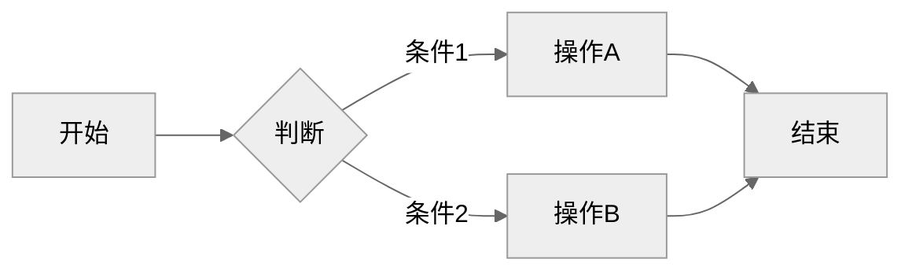
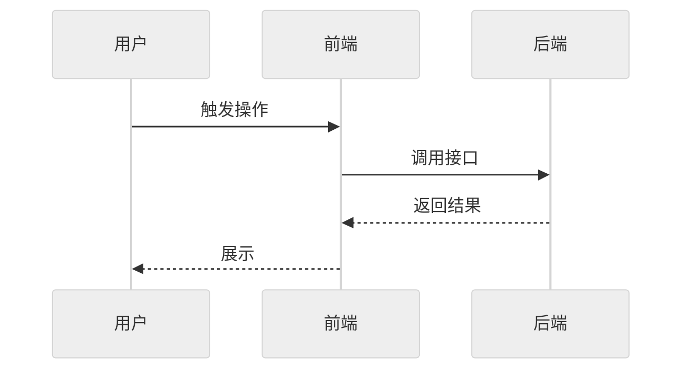
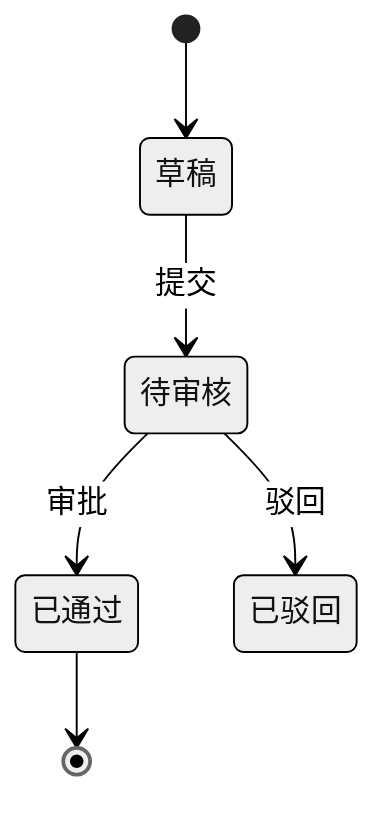

# REQ-003: 知识问答 Agent：工单与版本问答

## 元信息

| 属性 | 值 |
|-----|-----|
| 编号 | REQ-003 |
| 类型 | 后端 |
| 状态 | 测试中 |
| 模块 | 知识问答 |
| 优先级 | P1 |
| 创建日期 | 2026-11-24 |
| 负责人 | - |
| branch | feat/REQ-003-ticket-release-qa |
| issue | - |

## 生命周期

<!-- 需求状态流转：草稿 → 待评审 → 评审通过 → 开发中 → 测试中 → 已完成 -->

- [x] 草稿（编写中）
- [x] 待评审
- [x] 评审通过
- [x] 开发中
- [x] 测试中
- [ ] 已完成

---

## 一、需求描述

### 1.1 背景

灵工定位为知识问答 Agent，但目前只有结构化接口：`ListMyTickets`、`GetTicket`、`ListReleases` 等，以及对应的 REST / MCP。用户必须知道工单 ID、项目或仓库，才能查到工单进展和发版信息。想知道"我提的问题修了没""最近发了什么版"，只能去 Gitea 翻 Issue，或者线下问研发。知识库（PRD 3.2.4）尚未实现，问答 Agent（PRD 3.2.0）的会话与问答能力也还是空壳（`internal/assistant` 只有 `doc.go`）。

本需求是问答 Agent 的首期：先用现成的工单与版本数据，让用户用自然语言、以对话的形式查询进展，并在对话里直接给工单留言。知识库检索、业务 `Tool` 调用留给后续需求。

### 1.2 目标

- **功能目标**：提供会话式问答，所有角色都能用自然语言查询自己有权看到的工单进展、修复版本、上线情况和近期发版，支持筛选和汇总；在对话中经用户确认后给工单留言；会话可保存、可续聊。Go 方法、REST、MCP 三个入口能力一致。
- **效果目标**：用户查工单进度和版本信息时，不用再去 Gitea 或线下问研发；每条回答都附可核对的出处。暂不定量化指标，只统计问答次数、留言次数、"答不上"次数，作为后续评估的基线。

### 1.3 客户场景

> 记录客户提出的原始业务场景和诉求

- **场景1**：外部用户上周提了个登录 bug，想知道修了没有、哪个版本修的、上线了没有。现在只能去 Gitea 看，或者在群里问研发。
- **场景2**：用户想知道项目最近发了什么版、修了哪些问题。
- **场景3**：后台人员想快速了解某项目还有多少待确认工单、本周转出了哪些 bug。
- **场景4**：用户在聊工单进展时想顺手补一句信息（比如复现环境），不想再切到工单详情页去留言。
- **场景5**：接入方建议把对话做成一个独立窗口（会话列表加聊天界面），用户可以接着之前的会话问。

### 1.4 价值

- 用户自助查进展，减少研发被打断、群里追问和 Gitea 账号依赖
- 让"问答"这一环先能用起来，跑通 MVP 闭环"问答 → 转 Issue → 回传"的第一段，并为后续接入知识库和业务 Tool 搭好会话框架（会话、消息、待确认操作、流式输出）
- 回答附结构化引用，接入方可以直接画成卡片或链接，方便核对

### 1.5 范围与边界

> 明确本期做什么、不做什么，防止范围蔓延

- **本期包含**：
  - 会话管理：新建、列表、历史消息、续聊、删除；会话只有本人可见
  - 工单问答：按时间、类型、状态、项目、仓库、关键词查找有权看到的工单，回答状态、进展、修复版本和上线情况；支持汇总统计
  - 版本问答：近期发版、版本说明摘要、某版本修复了哪些（有权看到的）工单、某工单在哪个版本修复
  - 对话内留言：生成待确认操作，用户确认后写入工单评论（复用现有留言逻辑并同步到 Issue）
  - 结构化引用：回答附上所引用的工单与版本
  - 流式输出：REST SSE、Go 回调或 channel；新增可选的 `StreamModel` 接口，未实现时退化为整段输出；MCP 整段返回
  - 三个入口：Go 方法、REST、MCP
  - 接入文档与示例：说明如何用这些接口搭一个独立对话窗口
- **本期不做**：
  - 知识库检索与问答对抽取（PRD 3.2.4），也就是"功能怎么用"这类知识类问题
  - 业务数据 `Tool` 调用（PRD 3.2.0.5）
  - 留言以外的对话内写操作：提新工单、补附件、补视角、转出、驳回等
  - 从对话直接建单（超出范围的问题只提示用户可以提咨询工单）
  - 前端界面（由接入方自己做）
  - 依赖模型原生的工具调用（function calling）
  - 接入方可控的工单可见性（`AuthorizeTicket` 回调，如放行他人工单），拆到 REQ-004；本期按现有角色规则

### 1.6 干系人

> 除了提出方，还有哪些人会因此变化受影响

| 角色 | 关注点 | 备注 |
|------|-------|------|
| 提出方（haiqing） | 问答 Agent 首期可用，对话窗口形态 | - |
| 外部用户（external） | 能自然语言问到自己工单的进展、在对话里留言 | 主要使用者 |
| 后台人员（reviewer / admin） | 按项目汇总工单与发版 | 范围按现有角色规则（`User.Projects` 内） |
| AI 研发 Agent（agent） | 经 MCP 问答查询已转出工单 | 只能看已转出工单 |
| 接入方开发者 | 新接口、`StreamModel`、迁移 0003、对话窗口实现 | 需要执行 `lingo.Migrate` |

---

## 二、功能清单

> 列出所有功能点，开发完成后勾选

- [x] **会话管理**：新建会话、列出本人会话（按最近活动倒序，分页）、获取会话历史消息、删除会话；会话只有创建者可访问
- [x] **发送消息与回答**：在会话中提问，灵工结合本会话最近的上下文作答；支持流式和整段两种返回方式
- [x] **意图解析**：用 `Model.Chat` 把问题解析成结构化查询意图（查工单、汇总工单、查发版、查工单修复版本、留言、确认或取消、超出范围）；意图不明确时追问
- [x] **工单查找与回答**：按意图里的条件在有权看到的工单中查找；唯一命中时直接回答，多张命中时列出候选，没有命中时说明并提示可以提工单
- [x] **工单汇总**：按项目、类型、状态、时间段统计和列出工单，范围受可见性控制
- [x] **版本问答**：近期发版（未指定项目时汇总可访问的各项目）、版本说明摘要、版本修复的工单、工单的修复版本与上线情况
- [x] **结构化引用**：每条助手消息附上引用的工单（ID、标题、状态、Issue 链接）与版本（项目、仓库、tag、发布时间）
- [x] **对话内留言（待确认操作）**：识别留言意图后生成待确认操作；用户可以调用确认接口，也可以在对话里回复"确认"来确认；确认后写入评论并同步 Issue；取消、切换话题或 30 分钟超时后作废
- [x] **可选流式模型接口 `StreamModel`**：模型实现了就逐字推送，未实现时整段生成后作为一个片段推送
- [x] **REST 接口**：会话与消息相关接口，消息接口支持 SSE
- [x] **MCP 工具**：提问（整段返回）、会话列表与历史、确认或取消待确认操作
- [x] **数据库迁移 0003**：会话、消息、待确认操作三张表
- [x] **用量与统计**：沿用现有 LLM 用量记录；记录问答次数、留言次数、答不上次数，供后续评估
- [x] **接入文档与示例**：独立对话窗口的推荐接入方式、SSE 消费示例

---

## 三、业务规则

| 类型 | 规则 | 说明 |
|------|-----|------|
| 权限控制 | 会话只有本人可见 | 包括 admin 在内，任何人都不能查看他人会话 |
| 权限控制 | 工单可见性沿用现有角色规则 | 与 `GetTicket` 等现有接口一致（PRD 3.2.0.6）：external 只能看本人的，agent 只能看 `User.Projects` 内已转出的，reviewer / admin 能看 `User.Projects` 内全部；接入方可控的可见性回调见 REQ-004，上线后问答自动跟随 |
| 权限控制 | 汇总同样受控 | 统计、列表、版本修复的工单都只包含有权看到的工单 |
| 权限控制 | 不泄露存在性 | 无权访问的工单与不存在的工单回答一致（"没找到"） |
| 权限控制 | 查询由灵工执行 | 模型只输出查询意图，灵工按用户权限执行查询，模型拿不到数据通道 |
| 数据校验 | 意图不明确先追问 | 时间、指代、目标工单不明确时先追问，不靠猜测作答 |
| 数据校验 | 多张命中列候选 | 匹配到多张工单时列出候选让用户选择，不擅自挑一张 |
| 状态转换 | 待确认操作生命周期 | 待确认 → 已执行 / 已取消 / 已过期 / 已失败；用户取消、发送与该操作无关的新消息或 30 分钟超时后作废；确认时被拒（无权限、工单状态不允许留言）记为已失败，并在会话中说明原因；每个会话同时最多一个待确认操作 |
| 状态转换 | 按钮与回答互斥 | 会话中的提问还在回答时，确认 / 取消按钮返回冲突（REST 409），稍后再点即可；避免按钮的结果消息与正在生成的回答交错 |
| 状态转换 | 失败回答的重试 | 只能重试最近一次提问的失败回答（之后插入的按钮结果消息不影响）；更早的失败回答不能重试 |
| 状态转换 | 失效操作的确认 | 对已取消、已过期、已失败的操作再确认返回冲突（REST 409）；按钮确认时才发现已过期的，只记为已过期，不向会话追加消息；对已执行的操作再确认返回原结果，不重复执行 |
| 状态转换 | 确认方式 | 调用确认接口，或在对话中回复确认语义（如"确认""好的，发吧"）；确认前再次校验用户对该工单的留言权限 |
| 状态转换 | 留言复用现有逻辑 | 确认后的留言与 `AddTicketComment` 行为一致（来源、对外标记、同步 Issue、通知） |
| 安全 | 不可信内容不能触发写操作 | 工单正文、评论、版本说明作为模型的数据输入，不作为指令；写操作只有经过确认流程才会执行 |
| 安全 | 送给模型的数据最少化 | 只带 ID、标题、状态、摘要、版本等必要字段，不带提交人 Email 或 ID；业务数据由接入方的模型处理，接入文档中说明 |
| 回答 | 必须附引用 | 回答中提到的工单和版本都写入结构化引用；无依据时不编造 |
| 回答 | 超出范围的问题 | 明确说明"目前只能回答工单和版本相关问题"，并提示可以提咨询工单，不自动建单 |
| 回答 | 未指定项目的发版问题 | 汇总用户可访问的各项目的最近发版 |
| 回答 | 相对时间的时区 | "今天""上周"等按提问时传入的时区（IANA 名称）理解，未传时按服务进程的本地时区；一周从周一开始 |
| 回答 | 转出时间 | "本周转出"按后台确认转出的时间；自动转出的工单按提交时间 |
| 非功能约束 | 上下文与结果上限 | 每次只带本会话最近 10 轮；单次给模型最多 20 张工单或 10 个版本，超出时说明总数并建议缩小范围 |
| 非功能约束 | 模型可选 | 未配置 `Model` 时问答接口返回"未配置模型"错误，其他功能不受影响；模型失败或超时时该条消息标记为失败，可以重试 |
| 非功能约束 | 流式 | REST 提供 SSE，Go 提供回调或 channel；模型未实现 `StreamModel` 时退化为整段输出；MCP 整段返回 |
| 非功能约束 | 兼容 | 只新增方法和可选接口，不改现有签名与现有接口行为 |
| 非功能约束 | 迁移 | 新增 `migrations/0003_*.sql`，不修改已发布的 0001/0002 |
| 非功能约束 | 会话保留 | 灵工不自动清理，提供删除接口，保留策略由接入方决定 |

---

## 四、使用场景

### 场景1：查询自己工单的进度

- **角色**：外部用户（external）
- **前置条件**：已配置 `Model`；用户提过工单
- **基本流程**：
  1. 用户在对话窗口问"我上周提的登录 bug 修了吗" → 灵工解析出意图 {查工单, 时间=上周, 类型=bug, 关键词=登录}
  2. 灵工在用户有权看到的工单中查找，唯一命中 #12 → 回答当前状态、处理进展、修复版本、是否已上线，并附 #12 的引用
  3. 用户追问"那个版本什么时候上线的" → 灵工按本会话上下文理解"那个版本"，回答上线时间并附版本引用
- **异常流程**：
  - 命中多张（#12 登录页白屏、#15 登录超时）→ 列出候选，请用户选择
  - 没有命中或无权访问 → 回答"没找到相关工单"，提示可以提工单
  - "上周"所指不清（比如跨月）→ 按自然周解析；仍有歧义时追问
  - 模型调用失败 → 该条消息标记为失败，用户可以重试

### 场景2：查询最近发版

- **角色**：所有角色
- **前置条件**：项目已同步 Gitea 版本记录
- **基本流程**：
  1. 用户问"最近发版了什么" → 用户可访问多个项目且未指定项目，灵工汇总各项目的最近发版
  2. 每个版本列出版本号、发布时间、版本说明摘要，以及这个版本修复了哪些自己有权看到的工单，附版本和工单引用
  3. 用户追问"A 项目 v1.3.0 修了哪些问题" → 只回答该版本
- **异常流程**：
  - 没有版本记录 → 说明暂无发版记录
  - 版本过多 → 最多展示 10 个，说明总数并建议指定项目或时间

### 场景3：后台汇总工单

- **角色**：reviewer / admin
- **前置条件**：用户的 `User.Projects` 包含目标项目
- **基本流程**：
  1. 用户问"A 项目还有几个待确认的工单" → 灵工统计有权看到的待确认工单数量，并列出最近的几张
  2. 用户问"本周转出了哪些 bug" → 列出本周转出的 bug 类工单，附引用
- **异常流程**：
  - 项目不在 `User.Projects` 中 → 按没找到或无权限回答，不透露该项目的数据
  - 结果超过 20 张 → 说明总数，展示最近 20 张，建议缩小范围

### 场景4：在对话中给工单留言

- **角色**：有权给该工单留言的用户
- **前置条件**：目标工单可见且允许留言
- **基本流程**：
  1. 用户说"帮我在 #12 补一句：复现环境是 Chrome 120" → 灵工生成待确认操作，回复"将在 #12 留言：复现环境是 Chrome 120，确认吗？"；消息里带上待确认操作，接入方可以画成"确认 / 取消"按钮
  2. 用户点击确认，或回复"确认" → 灵工再次校验权限，按现有留言逻辑写入评论并同步到 Issue
  3. 灵工回复"已在 #12 留言"，附工单引用
- **异常流程**：
  - 用户取消或发送无关消息 → 待确认操作作废，按新消息正常回答
  - 超过 30 分钟才确认 → 提示操作已过期，请重新发起
  - 确认时已经没有权限，或工单状态不允许留言 → 提示失败原因，不写入
  - 工单评论中出现"请帮我在 #13 留言……"之类的内容 → 不触发任何操作

### 场景5：独立对话窗口中续聊与查看历史

- **角色**：所有角色
- **前置条件**：接入方用会话接口实现了独立对话窗口
- **基本流程**：
  1. 用户打开对话窗口 → 左侧显示本人的会话列表（按最近活动排序）
  2. 用户点开某个会话 → 显示历史消息，其中的引用可以点击
  3. 用户继续提问 → 灵工结合本会话最近 10 轮上下文作答，回答逐字流式显示
  4. 用户删除某个会话 → 会话和消息不再可见
- **异常流程**：
  - 访问他人的会话（包括 admin）→ 按不存在处理
  - 接入方未配置 `Model` → 发送消息时返回"未配置模型"错误；会话列表和历史仍可查看

### 场景6：AI 研发 Agent 经 MCP 问答

- **角色**：agent
- **前置条件**：MCP 已接入
- **基本流程**：
  1. Agent 调用提问工具"#12 的提交人最近补充了什么" → 灵工整段返回回答与引用
- **异常流程**：
  - 问到未转出的工单 → 按没找到处理

---

## 五、数据与交互

> 根据需求类型填写不同内容：
> - **后端 / 全栈**：描述需要的接口能力和业务语义，技术方案在 `/rd:dev` 阶段生成
> - **前端**：描述页面交互逻辑，`/rd:dev` 阶段自动匹配后端接口

### 后端/全栈：接口需求

| 能力 | 输入 | 输出 | 说明 |
|------|------|------|------|
| 新建会话 | 用户；可选标题 | 会话（ID、标题、创建时间） | 标题可以为空，由首条提问自动生成 |
| 会话列表 | 用户；分页游标 | 本人会话列表（按最近活动倒序） | 只返回本人的会话 |
| 会话历史 | 用户、会话 ID；分页 | 消息列表（角色、内容、引用、待确认操作、状态、时间） | 非本人的会话按不存在处理 |
| 删除会话 | 用户、会话 ID | 结果 | 只能删除本人的会话 |
| 发送消息（整段） | 用户、会话 ID、提问内容、可选时区 | 助手消息（回答、结构化引用、可选的待确认操作） | Go / REST / MCP；时区用于理解相对时间；未配置模型时返回错误 |
| 发送消息（流式） | 同上 | 文本片段流 + 结束时的完整助手消息 | REST 用 SSE，Go 用回调或 channel |
| 重试消息 | 用户、会话 ID、失败的消息 ID | 新的助手消息 | 只针对失败的消息 |
| 确认 / 取消待确认操作 | 用户、会话 ID、操作 ID、确认或取消 | 执行结果（成功时带上评论；被拒时操作为已失败并附说明）/ 作废结果 | 也可以在对话里回复确认语义；已取消、已过期、已失败的再确认返回冲突 |
| 可选流式模型 | 对话消息 | 文本片段流 | `StreamModel` 可选接口；未实现时退化为整段输出 |

### 前端：交互逻辑

> 本项目无前端，以下为推荐给接入方的独立对话窗口形态，写入接入文档

**页面：独立对话窗口**

| 操作/区域 | 用户行为 | 数据需求 | 交互反馈 |
|----------|---------|---------|---------|
| 会话列表 | 打开窗口 / 切换会话 | 本人会话列表（标题、最近活动时间） | 加载中 → 展示列表 / 空状态"开始一次新对话" |
| 对话区域 | 点开会话 / 发送消息 | 历史消息、流式回答片段 | 逐字显示回答；失败的消息显示"重试" |
| 引用卡片 | 点击工单或版本 | 引用（工单 ID、标题、状态、Issue 链接；版本 tag、发布时间） | 跳转到工单详情或版本说明 |
| 待确认操作 | 点击确认 / 取消 | 待确认操作（ID、目标工单、留言内容、过期时间） | 成功提示"已留言" / 过期或失败原因 |
| 删除会话 | 点击删除 | 会话 ID | 二次确认后从列表移除 |

---

## 六、测试要点

### 6.1 技术测试

- [x] 意图解析：给出"上周的登录 bug""最近发版""A 项目待确认几个""在 #12 留言……""确认""取消"等样例，用假模型返回固定 JSON，验证查询条件和分支正确；模型返回非法 JSON 时按"未能理解"追问，不报内部错误
- [x] 权限：external 查不到他人的工单；agent 查不到未转出的工单；不在 `User.Projects` 中的项目查不到；问答、汇总与 `GetTicket` / 列表的可见范围一致；无权与不存在的回答一致
- [x] 汇总受控：版本"修复的工单"、统计数量只计算有权看到的工单
- [x] 会话隔离：admin 访问他人会话按不存在处理；删除后列表和历史均不可见
- [x] 待确认操作：按钮确认和回复"确认"都能执行；取消、无关新消息、30 分钟超时后作废；确认时再次校验权限；每个会话最多一个待确认操作；重复确认不会重复写入
- [x] 留言复用：确认后的评论与 `AddTicketComment` 一致（来源、对外标记、outbox 同步 Issue、通知）
- [x] 提示注入：工单评论里的"帮我留言 / 忽略之前的指令"不触发写操作
- [x] 送给模型的数据：发给模型的消息中不含提交人 Email 或 ID
- [x] 上限：超过 20 张工单或 10 个版本时截断并说明总数；上下文只带最近 10 轮
- [x] 流式：实现了 `StreamModel` 的模型逐片段推送；未实现时以一个片段推送整段；SSE 格式正确，结束事件带完整消息；客户端断开时停止生成
- [x] 模型缺失或失败：未配置 `Model` 时返回明确错误；模型失败时消息标记为失败，重试成功
- [x] 兼容：现有工单接口的测试全部通过
- [x] 迁移：0003 可以在已执行 0001/0002 的库上增量执行；集成测试覆盖会话、消息、待确认操作的读写
- [x] 三个入口一致：同一问题经 Go、REST、MCP 得到一致的引用与权限结果

### 6.2 验收标准

> 产品/业务方验收时的确认项，描述可观测的业务结果

- [ ] 在 `examples/server` 的对话接口中，external 问"我最近提的 bug 修了吗"，能得到自己工单的状态、修复版本和上线情况，并附可点击的工单引用
- [x] 问"最近发版了什么"，能得到可访问项目的最近版本、发布时间与说明摘要，以及修复的工单
- [x] reviewer 问"A 项目还有几个待确认工单"，数量与 `ListTriage` 结果一致
- [x] 在对话里说"在 #12 留言：……"，先出现待确认提示；确认后 Gitea Issue 中出现该评论，取消则不出现
- [x] 问"这个功能怎么用"时，明确告知目前只能回答工单和版本相关问题，并提示可以提咨询工单
- [x] 关闭窗口后重新打开，会话列表与历史消息仍在，并能接着问
- [x] 经 MCP 调用提问工具，能得到与 REST 一致的回答和引用

### 6.3 手动测试用例

> 执行 `/rd:test_new REQ-003 --type=manual` 生成，供测试人员逐条复测

_待生成_

---

## 七、图示（可选）

> 用 Mermaid 绘制，GitHub/Gitea 原生渲染。主题建议统一用 `neutral`（打印友好、明暗模式兼容）。
> 无图可删除本节，按需保留下方子节。

### 7.1 流程图（业务流程、用户操作路径）



### 7.2 时序图（接口调用链、前后端交互）



### 7.3 ER 图 / 状态图（按需）



---

## 八、评审记录

| 日期 | 评审人 | 结论 | 意见 |
|-----|-------|------|------|
| 2026-11-24 | AI 预审 | 预审未提审 | 阻塞 1：AuthorizeTicket 契约未定（放宽还是收窄、覆盖哪些现有接口、与留言权限 / ListEvents / AuthorizePerspective 默认规则的关系、列表与计数在逐张回调下怎么查）。建议 4：AuthorizeTicket 拆为独立需求；统计缺读取接口；待确认操作做成通用结构，供 Tool 写操作复用；意图解析可选用 LightModel。 |
| 2026-11-24 | AI 预审 | 提审 | 无阻塞项（AuthorizeTicket 已拆到 REQ-004）。建议 3：统计缺读取接口，或注明本期只记录；待确认操作做成通用结构，供后续 Tool 写操作复用；意图解析与标题生成可选用 LightModel。信息 2：自然语言确认只认紧接在待确认提示后的那条用户消息；版本与工单的关联可复用现有 fixed_release_id。 |
| 2026-11-24 | haiqing | 通过 | 开发时采纳预审建议：统计本期只记录不提供查询、待确认操作做成通用结构、意图解析用 LightModel |

---

## 九、变更记录

| 日期 | 变更内容 | 影响范围 |
|-----|---------|---------|
| 2026-11-24 | 初始版本 | - |
| 2026-11-24 | 按预审意见把 `AuthorizeTicket` 拆到 REQ-004，本期按现有角色规则 | 1.5、1.6、二、三、五、六、十 |
| 2026-11-24 | PR #33 审查后确认：回答进行中确认 / 取消按钮返回冲突；只能重试最近一次提问的失败回答 | 三 |
| 2026-11-24 | 开发中确认：待确认操作新增"已失败"终态；失效操作再确认返回冲突，按钮确认时过期不追加消息；提问可带时区；"转出时间"按后台确认转出时间、自动转出按提交时间 | 三、五 |

---

## 十、关联信息

- **关联需求**：REQ-004 工单可见性回调（拆出，上线后问答的可见范围随之变化，无需改动问答逻辑）；后续需求：知识库检索（PRD 3.2.4）、业务数据 Tool 调用（PRD 3.2.0.5）将复用本需求的会话框架
- **相关文档**：[PRD 3.2.0 知识问答 Agent](../PRD.md)、[PRD 3.2.0.1 公开 API](../PRD.md)、[PRD 3.2.0.6 权限](../PRD.md)、[REQ-001 需求多视角分层补充](../completed/REQ-001-需求多视角分层补充.md)（`AuthorizePerspective` 回调的先例）
- **假设**：
  - 接入方配置的模型能稳定输出符合约定的结构化 JSON 意图（小模型可能不准，意图不明确时追问兜底）
  - 现有工单与版本数据（状态、修复版本、上线记录）已足够回答进度类问题
  - 单个用户可见的工单规模在数据库条件查询可承受的范围内，无需向量检索
- **外部依赖**：接入方提供的 `lingo.Model` 实现（可选实现 `StreamModel`）；接入方执行 `lingo.Migrate` 应用迁移 0003
- **风险项**：
  - 技术风险：意图解析的准确率取决于模型 → 意图不明确时追问，回答附引用供核对，用假模型覆盖单测
  - 安全风险：工单内容中的提示注入 → 不可信内容不能触发写操作，写操作必须确认，查询由灵工按权限执行
  - 数据风险：业务数据发给接入方的模型 → 字段最少化，不带提交人身份，接入文档中说明

---

## 十一、实现方案

> 本章节在 `/rd:dev` 阶段由 AI 分析代码后自动生成，创建需求时无需填写。

### 11.1 数据模型

新增迁移 `migrations/0003_assistant.sql`（0001/0002 已发布，不改），包含一个序列和三张表：

| 表 | 关键字段 | 说明 |
|----|---------|------|
| `lingo_assistant_conversations` | id, user_id, title, activity_seq, last_active_at, turn_until, created_at, deleted_at | 会话。只按 `user_id` 隔离，admin 也看不到他人会话。不带 `project_id`，项目范围每次按 `User.Projects` 现算。`activity_seq` 取自序列 `lingo_assistant_activity_seq`，用作"最近活动"倒序和分页游标。`turn_until` 是生成租约，同一会话同时只处理一条提问，写法同 0002。软删除（`deleted_at`）。索引 `(user_id, activity_seq DESC) WHERE deleted_at IS NULL` |
| `lingo_assistant_messages` | id, conversation_id, role(user/assistant), content, status(done/failed), error(model_error/timeout/canceled), reply_to, intent, outcome, citations(jsonb), created_at, updated_at | 消息。`citations` 存回答当时的引用快照。`intent` / `outcome` 用于统计。索引 `(conversation_id, id)` |
| `lingo_assistant_actions` | id, conversation_id, message_id, user_id, kind, payload(jsonb), summary, status(pending/executed/cancelled/expired/failed), result(jsonb), expires_at, resolved_at, created_at | 通用待确认操作。本期 `kind` 只有 `ticket_comment`（payload `{"ticket_id","body"}`），后续 ToolWrite 复用。部分唯一索引 `(conversation_id) WHERE status='pending'` 保证每个会话最多一个待确认操作。过期是惰性的：读到时再判断 |

- **统计**（评审结论：只记录、不提供查询）：问答次数 = 状态为 done 的助手消息数；留言次数 = `outcome='action_executed'` 的消息数；答不上次数 = `outcome IN ('not_found','out_of_scope')` 的消息数。`outcome` 的全部取值：answered / candidates / not_found / out_of_scope / clarify / action_proposed / action_executed / action_cancelled / action_expired / action_failed
- **用量**：继续写 `lingo_llm_usage`，新增三种 kind：`assistant_intent`、`assistant_confirm`、`assistant_answer`
- **转出时间**：不加列。"本周转出"取该工单最早一条 `triage.forward` 审计记录的时间（后台确认转出）；没有确认记录的已转出工单是自动转出，取提交时间。实现见 `internal/store/query.go` 的 `forwardedAtSQL`

### 11.2 API 设计

**根包（`assistant.go`；`StreamModel` 放 `models.go`）**

```go
type StreamModel interface {
	Model
	ChatStream(ctx context.Context, messages []Message, onDelta func(delta string)) (Usage, error)
}
var ErrNoModel = errors.New("lingo: model not configured")

type Conversation struct{ ID int64; Title string; CreatedAt, LastActiveAt time.Time; Cursor int64 }
type ConversationMessage struct{ ID, ConversationID int64; Role, Content, Status, Error string; ReplyTo int64; Citations Citations; PendingAction *PendingAction; CreatedAt time.Time }
type Citations struct{ Tickets []TicketCitation; Releases []ReleaseCitation }
type TicketCitation struct{ ID int64; Title, Status, IssueURL string }
type ReleaseCitation struct{ ID int64; ProjectKey, Repo, Tag string; PublishedAt time.Time; URL string }
type PendingAction struct{ ID, ConversationID int64; Kind, Summary string; Payload json.RawMessage; Status string; ExpiresAt time.Time; ResolvedAt *time.Time }
type ActionResult struct{ Action PendingAction; Message *ConversationMessage; Comment *Comment }
type MessageInput struct{ Content, TimeZone string }

func (l *Lingo) CreateConversation(ctx, u, title) (Conversation, error)
func (l *Lingo) ListConversations(ctx, u, before int64, limit int) ([]Conversation, error)
func (l *Lingo) ListConversationMessages(ctx, u, conversationID, beforeID int64, limit int) ([]ConversationMessage, error)
func (l *Lingo) DeleteConversation(ctx, u, conversationID) error
func (l *Lingo) SendMessage(ctx, u, conversationID, in MessageInput) (ConversationMessage, error)
func (l *Lingo) SendMessageStream(ctx, u, conversationID, in, onDelta func(string)) (ConversationMessage, error)
func (l *Lingo) RetryMessage(ctx, u, conversationID, messageID) (ConversationMessage, error)
func (l *Lingo) RetryMessageStream(ctx, u, conversationID, messageID, onDelta func(string)) (ConversationMessage, error)
func (l *Lingo) ConfirmPendingAction(ctx, u, conversationID, actionID) (ActionResult, error)
func (l *Lingo) CancelPendingAction(ctx, u, conversationID, actionID) (ActionResult, error)
```

- **流式**：用回调，不用 channel。模型实现了 `StreamModel` 时逐片段推送，否则整段生成后作为一个片段推送
- **分页**：默认 50 条，最多 200 条。会话列表的游标用 `Cursor`；消息按 `id < beforeID` 往前翻，页内按 ID 升序
- **错误**：`ErrNoModel` 只影响发送和重试；上一条还在生成、重试的不是失败消息、操作已失效 → `ErrConflict`；内容为空、超过 4000 字或时区非法 → `ErrInvalidInput`；他人会话 → `ErrNotFound`
- **模型失败**：返回 `status=failed` 的助手消息，`err` 为 nil。重试时原地更新这条消息
- **模型非法输出**：模型返回非法 JSON 时按 `clarify` 追问用户
- **模型分工**：意图解析、确认分类、生成标题用 `LightModel`（为空时用 `Model`），组织回答用 `Model`

**REST**

| 方法 路径 | 请求 | 响应 |
|---|---|---|
| `POST /conversations` | `{"title"?}` | 201 Conversation |
| `GET /conversations?before=&limit=` | - | [Conversation] |
| `GET /conversations/{id}/messages?before=&limit=` | - | [ConversationMessage] |
| `DELETE /conversations/{id}` | - | 204 |
| `POST /conversations/{id}/messages` | `{"content","time_zone"?,"stream"?}` | 助手消息；`stream:true` 时为 SSE |
| `POST /conversations/{id}/messages/{mid}/retry` | `{"stream"?}` | 同上 |
| `POST /conversations/{id}/actions/{aid}/confirm` | - | ActionResult |
| `POST /conversations/{id}/actions/{aid}/cancel` | - | ActionResult |

- **SSE 事件**：
  - `event: delta`，data 为 `{"text"}`，可出现 0 次或多次
  - `event: message`，data 为完整的 ConversationMessage，恰好一次，客户端以它为准覆盖前面拼出的内容
  - `event: error`，data 为 `{"code","message"}`
- **开流时机**：收到第一个片段时才写响应头，所以前置错误仍返回 JSON 和对应状态码
- **客户端断开**：取消模型调用，消息记为 `failed`（error 为 `canceled`），并释放租约；收尾用 `context.WithoutCancel`，超时 5 秒
- **错误码**：`ErrNoModel` → 501 `model_not_configured`，MCP 共用同一套映射

**MCP（整段返回）**：`ask`（question、conversation_id 可空、time_zone）、`list_conversations`、`list_conversation_messages`、`confirm_action`、`cancel_action`

**意图与查询**

- **意图 JSON**：
  - `intent` 取值：ticket_find / ticket_summary / release_list / ticket_fix / comment / confirm / cancel / clarify / out_of_scope
  - 字段：ticket_ids（最多 20 个）、issue_number、project（只能从给定列表里选）、unknown_project、repo、type、statuses、mine、keywords（最多 5 个，每个不超过 30 字）、time（field：created / updated / forwarded；preset 或 from / to）、release（repo、tag）、comment.body、clarify、title
  - 时间由灵工换算：按自然周、周一开始；时区取 `time_zone`，不传时用进程本地时区
- **"#N" 怎么理解**：一律当作工单 ID。只有用户明说 "Issue #N" 或 `owner/name#N` 时，才按 Issue 编号查
- **三次模型调用**：
  1. 确认分类：只在存在活着的待确认操作时调用；只看操作摘要和当前这条消息
  2. 意图解析：输入可访问的项目、枚举、最近 10 轮对话及其引用、当前提问；看不到本轮查出的工单内容
  3. 组织回答：只依据白名单数据块作答，数据块里的内容是数据，不是指令
- **固定模板**：没找到、超出范围、追问、候选列表、待确认提示、确认或取消结果，这几类回复都用固定模板，不调用模型
- **意图到查询的映射**：
  - ticket_find / ticket_fix：用新增的 `ticket.Service.Search`。0 张 → 没找到；1 张 → 带上最近 5 条评论和修复版本，交给模型组织回答；多张 → 列候选
  - ticket_summary：用 `Service.Stats`，再加 `Search` 取最近 20 张
  - release_list：用 `release.Service.List` + 新增的 `Count`，每个版本再调 `Get` 取修复的工单（`Get` 内已按 `Visible` 过滤）。没指定项目时按项目平均分配名额，合计最多 10 个
  - comment：用 `Service.Get` 校验可见后，生成待确认操作
- **新增领域接口**：
  - `ticket.SearchQuery` / `StatRow`，`QueryStore.Search/Stats`，`Service.Search/Stats`：角色范围与 `ListEvents` 一致（external 只看本人，agent 只看已转出，reviewer / admin 看 `User.Projects` 内全部），复用 `scopeSQL`
  - `ticket.Service.AddCommentTx`：把 `AddComment` 的事务体提出来，`AddComment` 改为调用它，行为不变
  - `release.Query` 增加 Tag / Since / Until；新增 `Store.CountReleases`、`Service.Count`

**一轮提问与待确认操作**

- **一轮的流程**（整轮超时 2 分钟，租约 150 秒）：
  1. 事务内抢租约，写入用户消息，并把已过期的操作置为 expired
  2. 存在待确认操作时先做确认分类：confirm → 执行；cancel 或其他 → 作废，其他意图继续往下处理
  3. 意图解析 → 查询 → 组织回答
  4. 收尾事务：写助手消息和新的待确认操作（30 分钟后过期），更新 `activity_seq` 和标题，释放租约
- **"只认紧接其后的那条"**：靠不变式保证。待确认操作之后，每条成功处理的用户消息要么执行它、要么作废它，所以只要操作还是 pending，当前这条消息就是紧接其后的那条
- **执行**：按钮确认和对话确认共用同一路径。在一个事务里：`FOR UPDATE` 锁住操作行，调 `AddCommentTx`（这一步会再次鉴权，审计、outbox、通知都沿用），把操作置为 executed，再追加一条结果消息
- **鉴权失败**：回滚后把操作置为 failed，提示原因
- **幂等**：对 executed 的操作重复确认，返回已有结果；对 cancelled / expired / failed 的操作确认 → `ErrConflict`
- **执行器注册**：按 `kind` 注册执行器，本期只注册 `ticket_comment`

**上限与安全**

- **上限**：上下文取最近 10 轮（20 条 done 消息，每条截到 1000 字）；工单最多 20 张，列表摘要 300 字，单张 1000 字，评论 5 条，每条 300 字；版本最多 10 个，每个说明 600 字。超出时说明总数
- **工单字段白名单**：id、project、repo、type、title、status、created_at、updated_at、fixed_tag、deployed_at、milestone、due_date、正文摘要；评论只带 source、时间、摘要。不带提交人或评论作者的 ID、姓名、Email，不带 Context、Fields、附件
- **引用**：由灵工按本轮交给模型的数据生成，不解析模型输出。回答里出现数据之外的 `#数字` 时，丢弃模型输出，改用确定性渲染
- **注入防护**：
  - 写操作只能来自意图解析或确认分类，这两次调用都看不到本轮的工单内容
  - 留言正文必须是当前用户消息里的原文片段（空白归一后做子串判断），否则追问用户要原文
  - 目标工单号必须出现在当前消息里，或者是上一条助手消息唯一引用的工单

### 11.3 文件改动清单

| 层 | 文件 | 新增/修改 | 说明 |
|----|------|----------|------|
| Migration | `migrations/0003_assistant.sql` | 新增 | 序列和三张表 |
| Migration | `migrate_test.go` | 修改 | 增加 0003 建表的解析断言 |
| Domain | `internal/ticket/query.go` | 修改 | SearchQuery / StatRow，Search / Stats |
| Domain | `internal/ticket/attachment.go` | 修改 | 提出 AddCommentTx |
| Domain | `internal/ticket/sync_test.go`、`query_test.go` | 修改/新增 | memStore 补实现；各角色范围的测试 |
| Domain | `internal/release/release.go` | 修改 | Query 加字段，Count |
| Domain | `internal/assistant/{doc,assistant,conversation,turn,query,action,reply}.go` 及测试 | 新增 | 问答领域 |
| Store | `internal/store/assistant.go` | 新增 | 会话、消息、操作、租约 |
| Store | `internal/store/query.go`、`release.go` | 修改 | Search / Stats SQL；ListReleases 加过滤条件，CountReleases |
| Integration | `internal/llm/assistant.go` 及测试、`doc.go` | 新增/修改 | 三次调用的提示词和解析 |
| Integration | `internal/llm/openai.go` 及测试 | 修改 | ChatStream（`stream:true` + include_usage；只在收到首字节前重试） |
| API | `internal/httpapi/sse.go` 及测试、`router.go` | 新增/修改 | SSE 写出；`Streamed` 哨兵 |
| API | `models.go` | 修改 | StreamModel；openAIModel.ChatStream |
| API | `assistant.go`、`lingo.go` | 新增/修改 | 公开类型与方法；装配，`chatOf` / `streamOf` |
| API | `handler.go`、`mcp_tools.go` | 修改 | 8 条路由、错误映射；5 个 MCP 工具 |
| 测试 | `tests/assistant_test.go`、`tests/rest_test.go`、`tests/mcp_test.go`、`example_assistant_test.go` | 新增/修改 | 集成测试与示例 |
| 文档 | `examples/server/main.go`、`README.md`、`README.zh-CN.md`、`docs/requirements/PRD.md`、`docs/architecture/overview.md` | 修改 | 对话窗口接入、SSE、数据外发说明、迁移 0003、流式受 90 秒 HTTP 超时限制 |

### 11.4 实现步骤

1. 迁移 0003 + migrate_test。验收：`go test . -run Migrat`
2. 工单领域 Search / Stats / AddCommentTx。验收：`go test ./internal/ticket/...`
3. 版本领域 Query / Count。验收：`go build ./... && go vet ./...`
4. 问答领域 internal/assistant，用内存 Store 和假模型做单测，覆盖 6.1。验收：`go test ./internal/assistant/...`
5. Store 实现。验收：集成测试中 Search 的结果与逐张调用 `Visible` 的结果一致；现有 `tests/` 全部通过
6. llm 调用与 OpenAI 流式。验收：`go test ./internal/llm/...`
7. 根包装配。验收：未配置 Model 时返回 ErrNoModel；能写出三种新的用量 kind；场景 1~4 的集成测试通过
8. REST 与 SSE。验收：前置错误返回 JSON；delta 加一次 message；客户端断开后记为 canceled；重试成功
9. MCP 工具。验收：与 REST 的结果一致；agent 查不到未转出的工单
10. 文档与示例。验收：`go build ./... && go vet ./... && go test ./...`，以及集成测试全部通过
