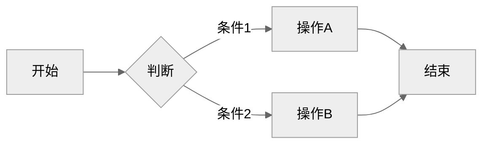
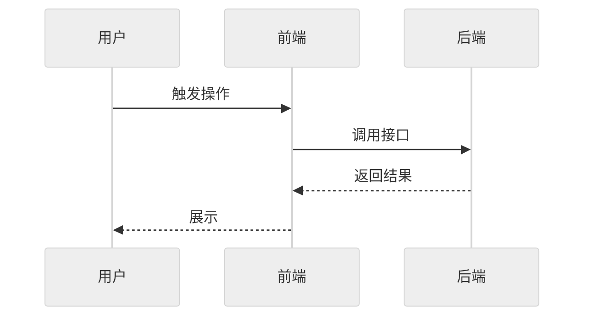
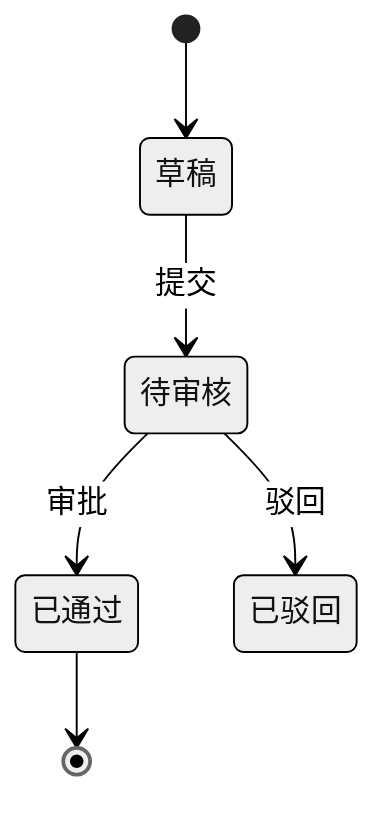

# REQ-007: 知识库二期：工单抽取、回答反馈与审核

## 元信息

| 属性 | 值 |
|-----|-----|
| 编号 | REQ-007 |
| 类型 | 后端 |
| 状态 | 草稿 |
| 模块 | 知识问答 |
| 优先级 | P2 |
| 创建日期 | 2026-11-24 |
| 负责人 | - |
| branch | - |
| issue | - |

## 生命周期

<!-- 需求状态流转：草稿 → 待评审 → 评审通过 → 开发中 → 测试中 → 已完成 -->

- [x] 草稿（编写中）
- [ ] 待评审
- [ ] 评审通过
- [ ] 开发中
- [ ] 测试中
- [ ] 已完成

---

## 一、需求描述

### 1.1 背景

从 REQ-006 拆出的二期。一期建立知识条目的存储、检索与问答作答，知识只来自后台答复时主动勾选与手动新建。二期让知识自动增长：模型从结案的 Bug / 需求工单抽取原因与解决办法，用户认可的问答回答进入候选；这两类可能出错或被投毒，须经 reviewer 审核后才生效。同时统计问答没答上的问题，供 reviewer 补充知识。

### 1.2 目标

- **功能目标**：结案工单自动抽取知识（待审核）；问答回答"有帮助 / 没帮助"反馈，"有帮助"的进入候选（待审核）；审核流程与"可能重复"提示；未答上的问题统计
- **效果目标**：修复过的问题审核后可在问答中查到原因、解决办法与修复版本；reviewer 能按未答上的问题补充知识

### 1.3 客户场景

> 记录客户提出的原始业务场景和诉求

- **场景1**：研发修复过的问题再次被问到时，用户与研发 Agent 希望直接查到原因、解决办法与修复版本
- **场景2**：reviewer 想知道用户都问了哪些问答答不上来，优先补这部分知识

### 1.4 价值

知识随工单处理自动积累，减少人工整理；审核保证质量与安全；未答上统计让知识补充有的放矢。

### 1.5 范围与边界

> 明确本期做什么、不做什么，防止范围蔓延

- **本期包含**：
  - 来源 b：Bug / 需求工单结案（已上线 / 已关闭）后，worker 用轻量模型从正文与对外评论抽取"现象 → 原因 / 解决办法 / 修复版本"，待审核
  - 来源 d：问答回答"有帮助 / 没帮助"反馈接口；"有帮助"的入库为待审核
  - 审核：待审核列表、通过 / 编辑后通过 / 驳回；入库时检索相似条目标"可能重复"
  - 未答上的问题：记录脱敏后的提问，按全文相似度归并计数，保留 90 天
  - 已转研发工单上的后台评论"加入知识库"（入库为待审核或直接生效，dev 阶段定）
- **本期不做**：自动合并重复条目、自动删除过时条目；批量导入；pgvector；多语言

### 1.6 干系人

> 除了提出方，还有哪些人会因此变化受影响

| 角色 | 关注点 | 备注 |
|------|-------|------|
| 提出方（接入方） | 模型抽取的成本可控；审核积压不影响正确性 | 新增迁移 0006（如需） |
| external 用户 | 能反馈回答是否有帮助 | 反馈只针对本人会话 |
| reviewer / admin | 审核抽取的条目、查看未答上的问题 | 范围限 `User.Projects` |

---

## 二、功能清单

> 列出所有功能点，开发完成后勾选

- [ ] **待审核状态**：条目状态新增待审核、已驳回（迁移 0006 如需）；待审核 / 已驳回条目不参与检索
- [ ] **来源 b 抽取**：工单结案后经 outbox / worker 用轻量模型抽取，脱敏后入库为待审核；每张工单最多抽取一次；未配置模型时跳过
- [ ] **回答反馈**：问答消息"有帮助 / 没帮助"接口（Go / REST / MCP），同一消息以最后一次为准
- [ ] **来源 d 入库**：回答被标为"有帮助"后，以提问与回答原文入库为待审核
- [ ] **可能重复提示**：入库时检索相似条目，相似度高的标"可能重复"并关联候选
- [ ] **审核接口**：待审核列表（含可能重复、来源）、通过 / 编辑后通过 / 驳回（reviewer / admin）
- [ ] **未答上的问题**：记录脱敏后的提问、归并计数、最近时间，保留 90 天；列表接口（reviewer / admin）
- [ ] **文档**：README（中英文）、PRD 3.2.5

---

## 三、业务规则

| 类型 | 规则 | 说明 |
|------|-----|------|
| 状态转换 | 必须审核 | b（模型抽取）、d（用户认可的回答）入库为待审核，reviewer 通过后才生效；驳回的不参与检索 |
| 状态转换 | 可能重复 | 只提示，不自动合并；审核时可选择驳回或编辑后通过 |
| 数据校验 | 只取对外内容 | 抽取只用工单正文与对外评论；研发内部讨论、后台备注、附件不入库 |
| 数据校验 | 脱敏 | 去除提交人与评论作者身份；正则兜底清理邮箱、手机号；抽取时要求模型把个别用户的细节泛化 |
| 数据校验 | 抽取次数 | 每张结案工单最多抽取一次；失败按 outbox 退避重试，超过上限记失败，不影响工单 |
| 权限控制 | 反馈 | 只能对本人会话中的助手消息反馈；"没帮助"只记录不入库 |
| 权限控制 | 审核与统计 | 只允许 reviewer / admin，范围限 `User.Projects` |
| 数据校验 | 未答上 | 只存脱敏后的提问；按全文相似度归并计数（相似阈值 dev 阶段定）；超过 90 天的记录清理 |
| 非功能约束 | 安全 | d 来源必须审核（防投毒）；条目作为数据交给模型 |
| 非功能约束 | 成本 | 抽取用轻量模型；用量计入 `GET /usage`（用途 `knowledge_extract`） |
| 非功能约束 | 兼容 | 只新增；不配置模型时 b 跳过，其余照常 |

---

## 四、使用场景

### 场景1：结案工单沉淀知识并审核

- **角色**：系统（worker）、reviewer
- **前置条件**：已配置模型；REQ-006 已上线
- **基本流程**：
  1. Bug 工单已上线 → worker 抽取"现象 → 原因 / 解决办法 / 修复版本"，脱敏后入库为待审核，相似条目标"可能重复"
  2. reviewer 查看待审核列表 → 编辑措辞后通过
  3. 之后有人问到同类问题 → 检索命中该条目作答
- **异常流程**：
  - 抽取失败 → 退避重试，超过上限记失败
  - reviewer 驳回 → 条目不参与检索

### 场景2：用户反馈与未答上统计

- **角色**：external 用户、reviewer
- **基本流程**：
  1. 用户对回答点"有帮助" → 入库为待审核候选
  2. 问答无命中 → 记一条未答上（脱敏、归并计数）
  3. reviewer 查看未答上的问题 → 手动新建条目补充
- **异常流程**：
  - 对他人会话的消息反馈 → not_found
  - 重复反馈 → 以最后一次为准，不重复入库

---

## 五、数据与交互

> 根据需求类型填写不同内容：
> - **后端 / 全栈**：描述需要的接口能力和业务语义，技术方案在 `/rd:dev` 阶段生成
> - **前端**：描述页面交互逻辑，`/rd:dev` 阶段自动匹配后端接口

### 后端/全栈：接口需求

| 能力 | 输入 | 输出 | 说明 |
|------|------|------|------|
| 回答反馈 | 会话 ID、消息 ID、有帮助 / 没帮助 | 结果 | 本人会话；Go / REST / MCP |
| 待审核列表 | 项目、来源类型、游标 | 待审核条目（含可能重复） | reviewer / admin |
| 审核条目 | 条目 ID、通过 / 驳回、可选编辑后的问题与答案 | 条目 | reviewer / admin |
| 未答上的问题 | 项目、时间范围、游标 | 脱敏提问、次数、最近时间 | reviewer / admin |

### 前端：交互逻辑

> 按页面/模块描述用户操作和数据流转，不指定具体接口

**页面：无**（灵工不提供前端，界面由接入方实现）

| 操作/区域 | 用户行为 | 数据需求 | 交互反馈 |
|----------|---------|---------|---------|
| - | - | - | - |

---

## 六、测试要点

### 6.1 技术测试

- [ ] 来源 b：结案后抽取入库为待审核；只用对外内容；每张工单只抽取一次；失败重试；未配置模型时跳过
- [ ] 脱敏：条目中不含身份信息、邮箱、手机号、附件与内部讨论
- [ ] 来源 d：有帮助入库为待审核，没帮助只记录；重复反馈以最后一次为准；他人会话返回 not_found
- [ ] 可能重复：相似内容入库时标记，不合并
- [ ] 审核：通过 / 编辑后通过 / 驳回的状态流转；待审核 / 已驳回不参与检索；非 reviewer / admin 返回 forbidden
- [ ] 未答上：脱敏存储、归并计数、90 天清理、权限范围
- [ ] 安全：待审核条目中的注入内容不影响回答（不参与检索）
- [ ] 用量按 `knowledge_extract` 计入；回归：一期功能不变

### 6.2 验收标准

> 产品/业务方验收时的确认项，描述可观测的业务结果

- [ ] 修复上线的 Bug，审核通过后能在问答中查到原因、解决办法与修复版本
- [ ] 用户标为"有帮助"的回答出现在待审核列表，未审核前不影响任何人的回答
- [ ] reviewer 能看到未答上的问题及次数，并据此补充知识

### 6.3 手动测试用例

> 执行 `/rd:test_new REQ-XXX --type=manual` 生成，供测试人员逐条复测

_待生成_

---

## 七、图示（可选）

> 用 Mermaid 绘制，GitHub/Gitea 原生渲染。主题建议统一用 `neutral`（打印友好、明暗模式兼容）。
> 无图可删除本节，按需保留下方子节。

### 7.1 流程图（业务流程、用户操作路径）

### 7.2 时序图（接口调用链、前后端交互）

### 7.3 ER 图 / 状态图（按需）

---

## 八、评审记录

| 日期 | 评审人 | 结论 | 意见 |
|-----|-------|------|------|
| - | - | - | - |

---

## 九、变更记录

| 日期 | 变更内容 | 影响范围 |
|-----|---------|---------|
| 2026-11-24 | 初始版本（从 REQ-006 拆出的知识库二期） | - |

---

## 十、关联信息

- **关联需求**：REQ-006（知识库一期，本需求依赖其存储、检索与维护接口）；REQ-003（问答消息与会话）
- **相关文档**：PRD 3.2.0.6（数据隔离与脱敏）、3.2.5 知识库
- **假设**：接入方的轻量模型能稳定输出结构化抽取结果；reviewer 有精力定期审核
- **外部依赖**：接入方提供的 `Model` / `LightModel`
- **风险项**：模型抽取错误（审核后才生效）；审核积压（未审核不参与回答，不影响正确性；列表按相似问题被问次数排序）；未答上记录含个人信息（脱敏 + 90 天保留）

---

## 十一、实现方案

> 本章节在 `/rd:dev` 阶段由 AI 分析代码后自动生成，创建需求时无需填写。

### 11.1 数据模型

_开发阶段填充_

### 11.2 API 设计

> 基于第五章接口需求，结合项目代码和 CLAUDE.md API 风格，生成具体技术方案

_开发阶段填充_

### 11.3 文件改动清单

_开发阶段填充_

### 11.4 实现步骤

_开发阶段填充_
