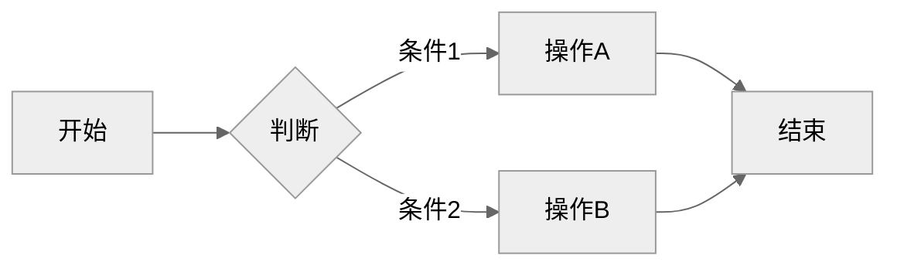
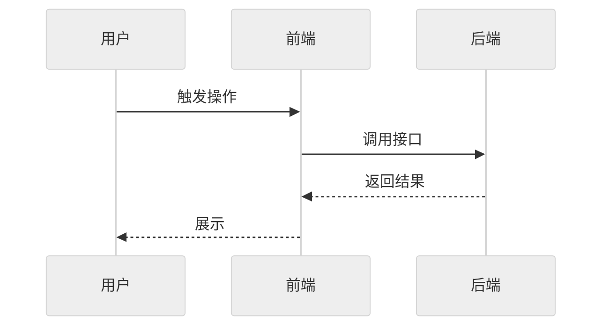
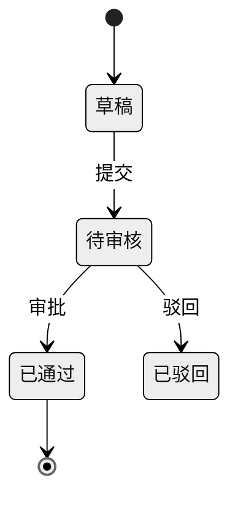

# REQ-007: 知识库二期：工单抽取、回答反馈与审核

## 元信息

| 属性 | 值 |
|-----|-----|
| 编号 | REQ-007 |
| 类型 | 后端 |
| 状态 | 测试中 |
| 模块 | 知识问答 |
| 优先级 | P2 |
| 创建日期 | 2026-11-24 |
| 负责人 | - |
| branch | feat/REQ-007-knowledge-phase2 |
| issue | - |

## 生命周期

<!-- 需求状态流转：草稿 → 待评审 → 评审通过 → 开发中 → 测试中 → 已完成 -->

- [x] 草稿（编写中）
- [x] 待评审
- [x] 评审通过
- [x] 开发中
- [x] 测试中
- [ ] 已完成

---

## 一、需求描述

### 1.1 背景

从 REQ-006 拆出的二期。一期建立知识条目的存储、检索与问答作答，知识只来自后台答复时主动勾选与手动新建。二期让知识自动增长：模型从结案的 Bug / 需求工单抽取原因与解决办法，用户认可的问答回答进入候选；这两类可能出错或被投毒，须经 reviewer 审核后才生效。同时统计问答没答上的问题，供 reviewer 补充知识。

### 1.2 目标

- **功能目标**：结案工单自动抽取知识（待审核）；问答回答"有帮助 / 没帮助"反馈，"有帮助"的进入候选（待审核）；审核流程与"可能重复"提示；未答上的问题统计
- **效果目标**：修复过的问题审核后可在问答中查到原因、解决办法与修复版本；reviewer 能按未答上的问题补充知识

### 1.3 客户场景

> 记录客户提出的原始业务场景和诉求

- **场景1**：研发修复过的问题再次被问到时，用户与研发 Agent 希望直接查到原因、解决办法与修复版本
- **场景2**：reviewer 想知道用户都问了哪些问答答不上来，优先补这部分知识

### 1.4 价值

知识随工单处理自动积累，减少人工整理；审核保证质量与安全；未答上统计让知识补充有的放矢。

### 1.5 范围与边界

> 明确本期做什么、不做什么，防止范围蔓延

- **本期包含**：
  - 来源 b：Bug / 需求工单首次进入 released（已发布）、deployed（已上线）或 closed（已关闭未修复）后，worker 用轻量模型从正文与对外评论抽取"现象 → 原因 / 解决办法 / 修复版本"（closed 带"未修复"语境），待审核
  - 来源 d：问答回答"有帮助 / 没帮助"反馈接口；知识类问题的回答被标为"有帮助"时入库为待审核
  - 审核：待审核列表、通过 / 编辑后通过 / 驳回；入库时检索相似条目标"可能重复"
  - 未答上的问题：知识类问题无命中时记录脱敏后的提问，按切词重合度归并计数，保留 90 天
  - 来源 e：后台（reviewer / admin）在工单上发表对外评论时可勾选"加入知识库"，直接生效（与 REQ-006 答复时入库一致）
- **本期不做**：自动合并重复条目、自动删除过时条目；批量导入；pgvector；多语言

### 1.6 干系人

> 除了提出方，还有哪些人会因此变化受影响

| 角色 | 关注点 | 备注 |
|------|-------|------|
| 提出方（接入方） | 模型抽取的成本可控；审核积压不影响正确性 | 新增迁移 0006 |
| external 用户 | 能反馈回答是否有帮助 | 反馈只针对本人会话 |
| reviewer / admin | 审核抽取的条目、查看未答上的问题 | 范围限 `User.Projects` |

---

## 二、功能清单

> 列出所有功能点，开发完成后勾选

- [x] **迁移 0006**：放宽条目 `status`（新增待审核、已驳回）与 `source`（新增工单抽取、回答反馈、工单评论）约束；新增回答反馈与未答上记录；待审核 / 已驳回条目不参与检索
- [x] **来源 b 抽取**：Bug / 需求工单首次进入 released / deployed / closed 后，worker 用轻量模型抽取，脱敏后入库为待审核；每张工单最多抽取一次；未配置模型时跳过
- [x] **回答反馈**：问答消息"有帮助 / 没帮助"接口（Go / REST / MCP），同一消息以最后一次为准
- [x] **来源 d 入库**：知识类问题（`knowledge_ask`）的回答被标为"有帮助"后，以提问与回答（去掉 `#N` 工单号与 `K` 知识编号、脱敏）入库为待审核；其他回答的反馈只记录
- [x] **来源 e 入库**：后台在工单上发表对外评论（`AddTicketComment` 及 REST / MCP 对应接口）时可勾选"加入知识库"，可改写问题与答案，直接生效；默认不入库
- [x] **可能重复提示**：入库时按切词重合度（REQ-006 的排序方式）检索相似条目，超过阈值的标"可能重复"并关联候选
- [x] **审核接口**：待审核列表（含可能重复、来源）、通过 / 编辑后通过 / 驳回（reviewer / admin）
- [x] **未答上的问题**：知识类问题无命中时记录脱敏后的提问、归并计数、最近时间，保留 90 天；列表接口（reviewer / admin）
- [x] **没帮助可见**：条目列表返回"有帮助 / 没帮助"次数（按回答引用的条目计）
- [x] **文档**：README（中英文）、PRD 3.2.5

---

## 三、业务规则

| 类型 | 规则 | 说明 |
|------|-----|------|
| 状态转换 | 必须审核 | b（模型抽取）、d（用户认可的回答）入库为待审核，reviewer 通过后才生效；驳回的不参与检索；e（后台评论勾选入库）直接生效 |
| 状态转换 | 抽取时机 | Bug / 需求工单首次进入 released、deployed、closed 任一状态时抽取（不跟踪上线的接入方停在 released 也能抽取）；closed 为"已关闭未修复"，抽取时带此语境 |
| 状态转换 | 可能重复 | 只提示，不自动合并；审核时可选择驳回或编辑后通过 |
| 数据校验 | 只取对外内容 | 抽取只用工单正文与对外评论；研发内部讨论、后台备注、附件不入库 |
| 数据校验 | 脱敏 | 去除提交人与评论作者身份；正则兜底清理邮箱、手机号；抽取时要求模型把个别用户的细节泛化 |
| 数据校验 | 抽取次数 | 每张结案工单最多抽取一次；失败按 outbox 退避重试，超过上限记失败，不影响工单 |
| 权限控制 | 反馈 | 只能对本人会话中的助手消息反馈；只有知识类问题的回答被标为"有帮助"才进入候选，其他回答与"没帮助"只记录；反馈按回答引用的条目计入"有帮助 / 没帮助"次数 |
| 数据校验 | 回答入库前处理 | 去掉 `#N` 工单号与 `K` 知识编号，正则脱敏；问题取用户提问 |
| 权限控制 | 评论入库 | 只有 reviewer / admin 的对外评论可勾选入库；研发内部评论与提交人补充不可入库 |
| 权限控制 | 审核与统计 | 只允许 reviewer / admin，范围限 `User.Projects` |
| 数据校验 | 未答上 | 只统计知识类问题无命中的情况；只存脱敏后的提问；按切词重合度归并计数（阈值 dev 阶段定）；超过 90 天的记录清理 |
| 数据校验 | 可能重复 | 按切词重合度判断，阈值 dev 阶段定并写入测试 |
| 非功能约束 | 安全 | d 来源必须审核（防投毒）；条目作为数据交给模型 |
| 非功能约束 | 成本 | 抽取用轻量模型；用量计入 `GET /usage`（用途 `knowledge_extract`） |
| 非功能约束 | 兼容 | 只新增；新增迁移 0006（0001–0005 不改）；不配置模型时 b 跳过，其余照常 |
| 非功能约束 | 历史工单 | 升级到本版本时已结案（released / deployed / closed）的 Bug / 需求工单登记为已跳过、不抽取，避免一次性大量调用模型；回填历史工单另行提供 |
| 数据校验 | 检索相关度 | 检索只返回至少命中 20% 检索词的条目（只因"怎么""为什么"等常用词重合的不算相关），同时影响一期的检索与未答上统计 |

---

## 四、使用场景

### 场景1：结案工单沉淀知识并审核

- **角色**：系统（worker）、reviewer
- **前置条件**：已配置模型；REQ-006 已上线
- **基本流程**：
  1. Bug 工单已上线 → worker 抽取"现象 → 原因 / 解决办法 / 修复版本"，脱敏后入库为待审核，相似条目标"可能重复"
  2. reviewer 查看待审核列表 → 编辑措辞后通过
  3. 之后有人问到同类问题 → 检索命中该条目作答
- **异常流程**：
  - 抽取失败 → 退避重试，超过上限记失败
  - reviewer 驳回 → 条目不参与检索

### 场景2：用户反馈与未答上统计

- **角色**：external 用户、reviewer
- **基本流程**：
  1. 用户对知识类问题的回答点"有帮助" → 入库为待审核候选，回答引用条目的"有帮助"次数 +1
  2. 问答无命中 → 记一条未答上（脱敏、归并计数）
  3. reviewer 查看未答上的问题 → 手动新建条目补充
- **异常流程**：
  - 对他人会话的消息反馈 → not_found
  - 重复反馈 → 以最后一次为准，不重复入库
  - 对工单进展类回答点"有帮助" → 只记录，不入库

### 场景3：后台评论沉淀知识

- **角色**：reviewer
- **前置条件**：工单已转研发
- **基本流程**：
  1. reviewer 在工单上发表对外评论，勾选"加入知识库"并改写为通用问答 → 评论照常同步，同时入库一条已生效条目，关联来源工单
- **异常流程**：
  - 未勾选 → 不入库
  - 内容为空或超长 → invalid_input，评论不发表
  - 非 reviewer / admin 勾选 → forbidden

---

## 五、数据与交互

> 根据需求类型填写不同内容：
> - **后端 / 全栈**：描述需要的接口能力和业务语义，技术方案在 `/rd:dev` 阶段生成
> - **前端**：描述页面交互逻辑，`/rd:dev` 阶段自动匹配后端接口

### 后端/全栈：接口需求

| 能力 | 输入 | 输出 | 说明 |
|------|------|------|------|
| 回答反馈 | 会话 ID、消息 ID、有帮助 / 没帮助 | 结果 | 本人会话；Go / REST / MCP |
| 待审核列表 | 项目、来源类型、游标 | 待审核条目（含可能重复） | reviewer / admin |
| 审核条目 | 条目 ID、通过 / 驳回、可选编辑后的问题与答案 | 条目 | reviewer / admin |
| 未答上的问题 | 项目、时间范围、游标 | 脱敏提问、次数、最近时间 | reviewer / admin |
| 评论并入库 | 工单 ID、评论、加入知识库（可选问题 / 答案） | 评论 | 扩展现有评论接口（Go / REST / MCP），reviewer / admin，默认不入库 |
| 条目反馈统计 | 现有条目列表 | 增加"有帮助 / 没帮助"次数 | reviewer / admin |

### 前端：交互逻辑

> 按页面/模块描述用户操作和数据流转，不指定具体接口

**页面：无**（灵工不提供前端，界面由接入方实现）

| 操作/区域 | 用户行为 | 数据需求 | 交互反馈 |
|----------|---------|---------|---------|
| - | - | - | - |

---

## 六、测试要点

### 6.1 技术测试

> 2026-11-25 /rd:test：单测 `internal/knowledge/review_test.go`；集成 `tests/knowledge_review_test.go`（TestKnowledgeExtractAndReview、TestKnowledgeFeedbackCommentsAndMisses、TestKnowledgeReviewMigrationIncremental、TestKnowledgeExtractRetryNoModelAndPurge）；全量单测与集成测试通过

- [x] 迁移 0006 在已执行 0001–0005 的库上增量执行；新状态与来源可写入
- [x] 来源 b：首次进入 released / deployed / closed 时抽取入库为待审核（closed 带未修复语境）；只用对外内容；每张工单只抽取一次；失败重试；未配置模型时跳过
- [x] 脱敏：条目中不含身份信息、邮箱、手机号、附件与内部讨论
- [x] 来源 d：知识类回答"有帮助"入库为待审核（去掉 #N / K 编号）；其他回答与"没帮助"只记录；重复反馈以最后一次为准；他人会话返回 not_found；引用条目的有帮助 / 没帮助次数正确
- [x] 来源 e：后台对外评论勾选入库直接生效；未勾选不入库；非法内容评论不发表；非 reviewer / admin 返回 forbidden
- [x] 可能重复：重合度超过阈值时标记，低于阈值不标记，不合并
- [x] 审核：通过 / 编辑后通过 / 驳回的状态流转；待审核 / 已驳回不参与检索；非 reviewer / admin 返回 forbidden
- [x] 未答上：只记录知识类无命中；脱敏存储、归并计数、90 天清理、权限范围
- [x] 安全：待审核条目中的注入内容不影响回答（不参与检索）
- [x] 用量按 `knowledge_extract` 计入；回归：一期功能不变

### 6.2 验收标准

> 产品/业务方验收时的确认项，描述可观测的业务结果

- [x] 修复上线的 Bug，审核通过后能在问答中查到原因、解决办法与修复版本
- [x] 用户标为"有帮助"的回答出现在待审核列表，未审核前不影响任何人的回答
- [x] reviewer 能看到未答上的问题及次数，并据此补充知识

### 6.3 手动测试用例

> 执行 `/rd:test_new REQ-XXX --type=manual` 生成，供测试人员逐条复测

_待生成_

---

## 七、图示（可选）

> 用 Mermaid 绘制，GitHub/Gitea 原生渲染。主题建议统一用 `neutral`（打印友好、明暗模式兼容）。
> 无图可删除本节，按需保留下方子节。

### 7.1 流程图（业务流程、用户操作路径）

### 7.2 时序图（接口调用链、前后端交互）

### 7.3 ER 图 / 状态图（按需）

---

## 八、评审记录

| 日期 | 评审人 | 结论 | 意见 |
|-----|-------|------|------|
| 2026-11-25 | AI 预审 | 预审未提审 | 阻塞：范围含"已转研发工单的后台评论入库"但功能清单、接口、测试未覆盖。建议：d 只收知识类回答并去编号；明确结案状态（released/deployed/closed 首次进入）；未答上口径与"没帮助"可见；可能重复沿用切词重合度。信息：须新增迁移 0006 放宽 status/source 约束 |
| 2026-11-25 | AI 预审 | 提审 | 无阻塞项。信息：来源 e 需扩展 AddTicketComment（新增方法或选项，保持原签名）；抽取任务可沿用 REQ-006 的"扫描待处理 + 租约"方式，避免放宽 outbox kind 约束 |
| 2026-11-25 | haiqing | 通过 | 预审建议已全部采纳 |

---

## 九、变更记录

| 日期 | 变更内容 | 影响范围 |
|-----|---------|---------|
| 2026-11-24 | 初始版本（从 REQ-006 拆出的知识库二期） | - |
| 2026-11-25 | 采纳 AI 预审：补齐来源 e（后台评论勾选入库，直接生效）的功能、接口、场景与测试；d 只收知识类回答并去编号；抽取时机改为首次进入 released/deployed/closed；未答上口径与"没帮助"次数可见；可能重复按切词重合度；明确迁移 0006 | 一~六 |
| 2026-11-25 | 开发中确认：升级时已结案的工单不抽取；检索至少命中 20% 检索词（开发中发现常用词导致无关命中，未答上无法记录） | 三 |

---

## 十、关联信息

- **关联需求**：REQ-006（知识库一期，本需求依赖其存储、检索与维护接口）；REQ-003（问答消息与会话）
- **相关文档**：PRD 3.2.0.6（数据隔离与脱敏）、3.2.5 知识库
- **假设**：接入方的轻量模型能稳定输出结构化抽取结果；reviewer 有精力定期审核
- **外部依赖**：接入方提供的 `Model` / `LightModel`
- **风险项**：模型抽取错误（审核后才生效）；审核积压（未审核不参与回答，不影响正确性；列表按相似问题被问次数排序）；未答上记录含个人信息（脱敏 + 90 天保留）

---

## 十一、实现方案

> 本章节在 `/rd:dev` 阶段由 AI 分析代码后自动生成，创建需求时无需填写。

### 11.1 数据模型

迁移 `0006_knowledge_review.sql`：
- `lingo_knowledge`：`status` 增加 `pending` / `rejected`；`source` 增加 `ticket_extract` / `assistant_feedback` / `ticket_comment`；新增 `source_message_id`（唯一，一条回答一个候选）、`duplicate_of`、`helpful_count`、`unhelpful_count`
- `lingo_assistant_feedback`：`message_id`（主键）、`user_id`、`helpful`
- `lingo_knowledge_extractions`：`ticket_id`（主键）、`status`（pending / done / failed / skipped）、`attempts`、`locked_until`、`last_error`；升级时已结案的登记为 skipped
- `lingo_knowledge_misses`：`projects text[]`、`question`、`tokens text[]`、`hits`、`first_at`、`last_at`

### 11.2 API 设计

> 基于第五章接口需求，结合项目代码和 CLAUDE.md API 风格，生成具体技术方案

- **Go**：`RateMessage(ctx, u, convID, msgID, helpful)`；`AddTicketCommentWith(ctx, u, id, CommentInput{Body, Attachments, Knowledge})`（`AddTicketComment` 不变）；`ApproveKnowledge(ctx, u, id, *KnowledgeDraft)`、`RejectKnowledge`；`ListUnansweredQuestions(ctx, u, UnansweredFilter)`；`KnowledgeEntry` 新增 `DuplicateOf`、`HelpfulCount`、`UnhelpfulCount`；常量 `KnowledgePending` / `KnowledgeRejected` 与新来源
- **REST**：`POST /conversations/{id}/messages/{mid}/feedback`（`{"helpful":bool}`）；`POST /tickets/{id}/comments` 可带 `knowledge`；`POST /knowledge/{id}/approve|reject`；`GET /knowledge/unanswered`；待审核列表用 `GET /knowledge?status=pending`
- **MCP**：`rate_message`；`reply_ticket` 新增 `add_to_knowledge` 等参数
- **抽取**：`Run` 的知识库循环登记新结案工单并领取（租约 5 分钟、每批 4 张），`llm.Extractor` 输出 `{skip, question, answer}`，失败最多 3 次（间隔 10 分钟）；用量 `knowledge_extract`
- **可能重复 / 未答上**：重合比例 = 重合词数 / 新内容词数，阈值 0.6；未答上按项目相交与同一阈值归并，只列近 90 天，循环中清理过期记录
- **检索相关度**：切词检索要求至少命中 20% 检索词

### 11.3 文件改动清单

| 层 | 文件 |
|---|---|
| 迁移 | `migrations/0006_knowledge_review.sql`（新） |
| knowledge | `knowledge.go`（状态 / 来源、接口扩展、相关度阈值）、`review.go`（新：审核、候选、反馈计数、未答上、抽取）、`review_test.go`（新） |
| store | `knowledge.go`（新列、状态流转、相似、反馈计数、未答上、抽取任务）、`assistant.go`（`SetFeedback`） |
| ticket | `attachment.go`（`AddCommentWith`） |
| assistant | `assistant.go`（接口）、`conversation.go`（`Rate`）、`query.go`（记录未答上） |
| llm | `knowledge.go`（新：`Extractor`） |
| 根包 | `knowledge.go`、`tickets.go`、`assistant.go`、`lingo.go`、`handler.go`、`mcp_tools.go` |
| 测试 | `tests/knowledge_review_test.go`（新）、`tests/migrate_test.go`、`tests/assistant_acceptance_test.go` |
| 文档 | README（中英文）、PRD（v1.32、3.2.5、数据模型） |

### 11.4 实现步骤

1. 迁移 0006 与 store
2. knowledge 领域层与 llm 抽取
3. ticket 评论入库、assistant 反馈与未答上
4. 根包 API、REST、MCP、后台循环
5. 测试与文档
