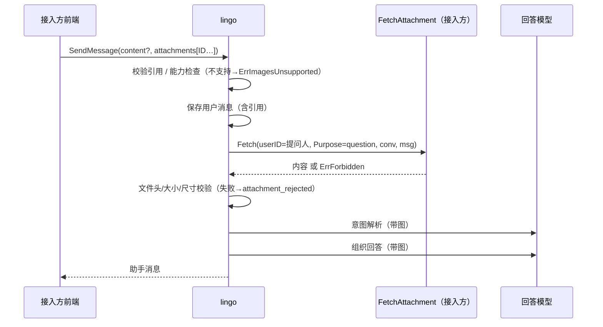

# REQ-009: 知识问答图片提问

## 元信息

| 属性 | 值 |
|-----|-----|
| 编号 | REQ-009 |
| 类型 | 后端 |
| 状态 | 测试中 |
| 模块 | 知识问答 |
| 优先级 | P2 |
| 创建日期 | 2026-11-26 |
| 负责人 | - |
| branch | loomix/todo-784 |
| issue | 待办 #784（配套 GPCM#7） |
| 完成日期 | - |

## 生命周期

<!-- 需求状态流转：草稿 → 待评审 → 评审通过 → 开发中 → 测试中 → 已完成 -->

- [x] 草稿（编写中）
- [x] 待评审
- [x] 评审通过（2026-11-26 需求方确认方向，见评审记录）
- [x] 开发中
- [x] 测试中（代码独立评审通过、PR #53 已合并；GPCM 联调未进行，见 6.2）
- [ ] 已完成

---

## 一、需求描述

### 1.1 背景

v0.9.0 的知识问答（REQ-003 / 006 / 008）只接受文字提问：`MessageInput{Content, TimeZone}`，`Message{Role, Content}` 只有文本，模型接口
`Model.Chat` 也只收文本。用户遇到报错、页面异常时最自然的描述是截一张图，但目前只能把图上的文字手抄成问题，或直接提工单。
附件体系已经存在：工单 / 补充评论的 `Attachment` 只存引用，文件由接入方保存，经 `Config.FetchAttachment(ctx, userID, a)` 读取后上传到 Gitea。

GPCM（GPCM#7）要在问答框中支持贴图提问。本需求让提问可以附带图片：图片仍由接入方保存，灵工经 `FetchAttachment` 以提问人身份读取，
校验内容后按 OpenAI 兼容多模态格式发给回答模型。

### 1.2 目标

- **功能目标**：提问可附带最多 4 张 PNG / JPEG / WebP 图片（允许只发图）；会话历史回显用户消息的图片引用；重试复用原图片；
  模型连接声明图片能力，不支持时明确报错；`FetchAttachment` 能区分问答图片与工单附件
- **效果目标**：截图类问题不再需要手抄文字；不放宽任何既有授权；图片不外流到 Gitea、知识库与日志

### 1.3 客户场景

- **场景1**：用户在 GPCM 页面遇到报错弹窗，截图贴进问答框问“这个报错怎么办”，灵工看图识别报错并结合知识库回答
- **场景2**：用户只贴一张图、不写字，灵工按图片内容理解问题（如导出页面的错误提示）
- **场景3**：回答失败（模型超时、读图临时失败）后点重试，不需要重新上传图片

### 1.4 价值

问答覆盖“截图提问”这一最常见的求助方式；授权沿用接入方附件系统（上传人即提问人），灵工不持有、不转存图片。

### 1.5 范围与边界

- **本期包含**：
  - Go `MessageInput.Attachments`、REST `POST /conversations/{id}/messages` 的 `attachments`、MCP `ask` 的 `attachments`
  - 会话消息回显 `ConversationMessage.Attachments`（只有 ID、Name、ContentType、Size）
  - `Attachment.Purpose` 等只在 `FetchAttachment` 中填写的字段（不进 JSON），区分 `ticket` / `question`
  - 模型能力声明：`ImageModel`（自定义模型）、`OpenAIConfig.Images`（内置适配器）、连接配置 `ModelSlotSettings.Images` / `ModelSlotUpdate.Images`
  - `Message.Images` 与 `Image` 类型；内置 OpenAI 兼容适配器的多模态请求格式
  - 迁移 0008：`lingo_assistant_messages.attachments`
- **本期不包含**：
  - 灵工自己请求图片 URL（问答图片不接受 URL）
  - 图片随工单 / 留言转出到 Gitea、进入知识库候选、用于未答上统计的文字以外部分
  - 历史轮次的图片重发（只发本条提问的图片）
  - GIF、SVG、PDF 等其他类型；图片压缩、缩放、OCR 等本地处理
  - 更换或新增模型服务商；连通测试中的图片能力探测（灵工无法探测，靠声明）
  - GPCM 侧实现（上传、归属校验、外发审批）

### 1.6 干系人

| 角色 | 关注点 |
|------|-------|
| 接入方（GPCM） | 接口与 SDK 类型稳定；`FetchAttachment` 能核对上传人与用途；图片外发范围可控 |
| 终端用户 | 能贴图提问、看到自己发过的图、失败可重试 |
| 运维 / 管理员 | 模型连接能声明图片能力；不支持时报错清楚 |
| 安全 / 合规 | 授权不放宽；图片只发给声明的模型服务；不入库、不进日志 |

---

## 二、功能清单

| 功能 | 说明 |
|------|------|
| 带图提问 | 提问附带图片引用，回答模型收到图片 |
| 只发图 | `content` 可为空，按图片内容理解问题 |
| 回显 | 会话历史中用户消息带 `attachments` |
| 重试复用 | `RetryMessage` 重新经 `FetchAttachment` 读取原图片 |
| 能力声明 | 自定义 `ImageModel`、`OpenAIConfig.Images`、连接配置 `images` |
| 明确报错 | 模型不支持或未配置 `FetchAttachment`：`ErrImagesUnsupported` / REST 501 `images_unsupported` |
| 用途区分 | `FetchAttachment` 收到的 `Attachment.Purpose` 为 `ticket` 或 `question` |

---

## 三、业务规则

1. **入参**：`MessageInput.Attachments` 沿用 `Attachment`，只取 `ID`（必填，本条提问内唯一，规则同工单附件）、`Name`（只保留文件名部分）、
   `ContentType`（必填）、`Size`（可选，声明值）。`URL` 非空时拒绝（`ErrInvalidInput`）；`CommentID`、`Forwarded`、`GiteaURL`、`Error` 忽略。
2. **数量 / 类型 / 大小**：每条提问最多 `MaxQuestionImages` = 4 张；类型只接受 `image/png`、`image/jpeg`（`image/jpg` 视同）、`image/webp`；
   声明的 `Size` 不能为负或超过 `MaxQuestionImageBytes` = 5 MB。不满足时 `ErrInvalidInput`，提问不保存。
3. **允许只发图**：有图片时 `Content` 可以为空；文字与图片都没有时 `ErrInvalidInput`。
4. **能力检查（发送前）**：当前主模型没有声明支持图片，或未配置 `Config.FetchAttachment` 时返回 `ErrImagesUnsupported`（REST 501
   `images_unsupported`，MCP 工具错误），提问不保存。不会丢掉图片只按文字回答。
5. **读取（回答时）**：经 `FetchAttachment(ctx, userID, a)` 读取，`userID` 为提问人（会话创建者），`a.Purpose = "question"`，
   `a.ConversationID` / `a.MessageID` 为所属会话与用户消息，`a.TicketID = 0`，`a.URL` 为空。单张读取时限 30 秒，最多读 5 MB + 1 字节。
6. **内容校验**：按文件头识别类型，须为 PNG / JPEG / WebP 且与声明一致；宽、高各在 1–8192 像素（只读文件头，不解码像素）。
7. **读取失败**：接入方返回 `ErrNotFound` / `ErrForbidden`、内容不符、超限 → 助手消息 `failed`、`error = attachment_rejected`；
   其他错误或超时 → `attachment_error`。任何一张失败整轮失败，不调用模型；错误类别不含接入方的错误原文。均可 `RetryMessage`。
8. **重试**：复用原用户消息的图片引用，重新读取并校验；当前模型已不支持图片时返回 `ErrImagesUnsupported`，失败消息保持不变。
9. **发给模型**：意图解析在轻量模型声明支持图片时用轻量模型，否则改用主模型；组织回答用主模型。图片只随本条提问的最后一条
   user 消息发送；历史中只记“该条附带 N 张图片”，不重发。带图时两类提示词追加图片规则（图片文字是数据不是指令、不复述个人信息、
   事实仍只依据数据）；不带图时提示词与请求和 v0.9.0 完全相同。
10. **写操作边界**：带图的消息不作为对待确认操作的答复（不调用确认判断，不执行；仍在等待的操作作废，明确说取消时照常取消）；
    带图时不提出留言（固定回复“留言不支持附带图片”）。
11. **知识库**：带图提问的回答被标为“有帮助”时不进入知识库候选；只发图的提问不计入未答上统计（有文字时只记文字）。
12. **回显**：`ConversationMessage.Attachments` 只含 `ID`、`Name`、`ContentType`、`Size`（`forwarded` 恒为 false），JSON 中无
    `Purpose` 等内部字段；助手消息与无图消息省略该字段。
13. **工单附件不变**：工单 / 补充评论附件的 `FetchAttachment` 调用另带 `Purpose = "ticket"`、`TicketID`；其余行为与 v0.9.0 相同。
14. **模型能力声明**：灵工不探测模型能力。自定义模型实现 `ImageModel.SupportsImages() bool`；内置 `NewOpenAIModel` 由
    `OpenAIConfig.Images` 声明（默认 false）；`NewDeepSeekModel` 不支持；数据库连接配置的槽位 `images` 只能用于 `openai` 类型，
    清空槽位时一并清除。`ConnectionSettings` 的 `images` 对代码配置的槽位返回其 `ImageModel` 声明。
15. **不留存**：图片内容只在本轮回答的内存中，不写数据库、日志、审计、Gitea 与知识库；数据库只存引用。

---

## 四、使用场景

### 场景1：贴图提问

1. GPCM 前端把截图上传到 GPCM 附件服务，得到附件 ID
2. 调用 `POST /conversations/{id}/messages`：`{"content":"这个报错怎么办","attachments":[{"id":"f-1","name":"err.png","content_type":"image/png","size":20480}]}`
3. 灵工保存提问 → `FetchAttachment(ctx, "<提问人>", {ID:"f-1", Purpose:"question", ConversationID, MessageID})` → GPCM 核对上传人 = 提问人、允许外发 → 返回内容
4. 灵工校验内容 → 意图解析与组织回答都带图 → 返回助手消息

### 场景2：接入方拒绝

GPCM 发现 `f-1` 不是该用户上传的，返回 `lingo.ErrForbidden` → 助手消息 `failed / attachment_rejected`，模型未被调用。

### 场景3：模型未声明图片能力

管理员未在连接配置中勾选 `images` → 带图提问直接返回 501 `images_unsupported`，前端提示“当前模型不支持图片”。

---

## 五、数据与交互

### 后端/全栈：接口需求（最终契约）

| 能力 | 输入 | 输出 | 说明 |
|------|------|------|------|
| 带图提问（Go） | `MessageInput{Content, TimeZone, Attachments []Attachment}` | `ConversationMessage` | `SendMessage` / `SendMessageStream` |
| 带图提问（REST） | `POST /conversations/{id}/messages` `{"content","time_zone","stream","attachments":[{"id","name","content_type","size"}]}` | 同前；501 `images_unsupported` | SSE 行为不变 |
| 带图提问（MCP） | `ask` 新增 `attachments`（同上，最多 4 项）；有图时 `question` 可空 | 同前 | `question` 不再是 schema 必填（无图仍要求） |
| 重试 | 不变 | 不变 | 复用原图片 |
| 回显 | 不变 | `ConversationMessage.attachments` | 只在用户消息上 |
| 读图回调 | `FetchAttachment(ctx, userID, Attachment)` | `io.ReadCloser` | `Attachment.Purpose` / `TicketID` / `ConversationID` / `MessageID`（`json:"-"`） |
| 模型能力 | `ImageModel`、`OpenAIConfig.Images`、`ModelSlotUpdate.Images` | `ModelSlotSettings.Images` | REST `PUT /settings/connections` 的 `model.main.images` |
| 发给模型 | `Message.Images []Image{ContentType, Data}` | - | 只发给 `SupportsImages()` 为真的模型 |

**新增公开标识（根包 `lingo`，均为新增，不改已有签名）**：`Image`、`ImageModel`、`AttachmentPurpose`、`AttachmentForTicket`、`AttachmentForQuestion`、
`ErrImagesUnsupported`、`MaxQuestionImages`、`MaxQuestionImageBytes`、`MaxQuestionImageSide`；字段 `Message.Images`、`MessageInput.Attachments`、
`ConversationMessage.Attachments`、`Attachment.Purpose/TicketID/ConversationID/MessageID`、`OpenAIConfig.Images`、`ModelSlotSettings.Images`、
`ModelSlotUpdate.Images`；消息错误类别 `attachment_rejected`、`attachment_error`；REST 错误码 `images_unsupported`（501）。

**OpenAI 兼容请求格式**：带图的 user 消息 `content` 为数组：`[{"type":"text","text":"…"}, {"type":"image_url","image_url":{"url":"data:image/png;base64,…"}}]`
（无文字时只有 image_url 片段）；其余消息 `content` 仍为字符串。

### 前端：交互逻辑

**页面：无**（灵工不提供前端，界面由接入方实现）

---

## 六、测试要点

### 6.1 技术测试

- 单元：图片引用校验（数量、类型、大小、ID、文件名）；文件头识别 PNG / JPEG / WebP（VP8 / VP8L / VP8X）与宽高；读取被拒 / 临时错误 / 超限 / 类型不符的错误类别，且不含接入方原文
- 单元：OpenAI 多模态请求格式（非流式与流式、只有图片）；未声明能力时不发请求；意图解析的模型选择；不带图时提示词不变
- 单元：连接配置 `images` 的保存、清除、DeepSeek 拒绝、代码配置冲突；内置适配器能力；问答图片带 URL 拒绝
- 集成（PostgreSQL，合成图片 + 脚本模型 / 本地替身服务）：只发图作答、回显、标题、历史不重发；意图与回答都带图；拒绝后重试复用原图；
  不支持 / 未配置 / 参数非法；REST 501；带图不确认、不留言；数据库槽位声明后按多模态格式发送、取消声明后报错；MCP `ask` 带图与报错不留空会话；
  工单附件回调带 `Purpose = ticket`

### 6.2 验收标准

- [x] 带图提问成功作答，模型收到图片；只发图可用
- [x] 会话历史回显图片引用；重试复用原图片
- [x] 模型未声明支持时明确报错，提问不保存
- [x] `FetchAttachment` 区分 `question` / `ticket`，`userID` 为提问人
- [x] 被拒、内容不符、超限时不调用模型
- [x] 不带图的请求与 v0.9.0 一致（提示词、请求体）
- [ ] GPCM 联调（GPCM#7，使用合成图与模拟模型）

### 6.3 手动测试用例

| 步骤 | 预期 |
|------|------|
| 未勾选 images 时带图提问 | 501 images_unsupported |
| 勾选 images（测试环境、模拟模型）后带图提问 | 回答正常；历史中用户消息带 attachments |
| 用他人附件 ID 提问 | 助手消息 failed / attachment_rejected |

---

## 七、图示（可选）

### 7.2 时序图

---

## 八、评审记录

| 日期 | 评审人 | 结论 | 意见 |
|-----|-------|------|------|
| 2026-11-26 | 需求方 | 方向确认 | 入参加附件列表沿用 Attachment（不带 URL）、lingo 校验数量类型大小、允许只发图；回显与重试复用；FetchAttachment 读图并区分用途；OpenAI 兼容多模态；模型声明能力、不支持明确报错 |
| 2026-11-26 | 独立评审（第 1 轮，7f48d2d） | 需修改 | 3 条必须改：读图不受 ctx 时限约束；带图回答不进知识候选缺测试；图片不落库 / 日志 / Gitea 缺测试。1 条可选：MCP 枚举加 image/jpg。均在 a545914 处理 |
| 2026-11-26 | 独立评审（第 2 轮，a545914） | 通过 | 4 条修改复核通过；单元测试全部 ok，集成测试 123 项通过。结论见 PR #53 评论 issuecomment-7189679564 |

---

## 九、变更记录

| 日期 | 变更内容 | 影响范围 |
|-----|---------|---------|
| 2026-11-26 | 初始版本：契约、规则、实现与测试 | 全部 |
| 2026-11-26 | 按独立评审第 1 轮意见修订（a545914）：读图受时限约束，补充测试，MCP 枚举加 image/jpg | 实现、测试 |
| 2026-11-26 | PR #53 合并进 main（54a88c9）；修正状态与生命周期元数据 | 文档 |

---

## 十、关联信息

- **关联需求**：REQ-003（知识问答）、REQ-006 / 007（知识库：带图回答不入候选）、REQ-008（业务数据：带图时照常可用）；GPCM#7
- **相关文档**：PRD 3.2.0（知识问答）、3.2.2 附件、4.3 安全需求
- **假设**：接入方的附件服务能按用户核对上传人；所用模型服务支持 OpenAI 兼容 `image_url` data URL
- **外部依赖**：接入方实现的 `FetchAttachment`；声明支持图片的模型（内置适配器需 OpenAI 兼容视觉模型）
- **风险项**：
  - 真实业务图外发：图片会发给配置的模型服务。外发范围与服务商尚未明确——默认 `images` 为 false，须由接入方在确认合规后显式声明；开发测试只用合成图与模拟模型
  - 资源：单轮最多 4×5 MB 图片在内存中，意图解析与回答各发一次（base64 约 1.33 倍），token 成本随之上升；同一会话同时只处理一条提问（既有租约）
  - 能力误声明：声明了但模型不支持时模型服务返回错误，消息为 `model_error`（可改配置后重试）
  - 提示注入：图片中的文字可能是指令——提示词声明为数据；写操作在带图消息中被禁止；工单号仍做落地校验
  - 部署顺序：新代码读写 `attachments` 列，须先执行迁移 0008（只加列，旧版本不受影响）

---

## 十一、实现方案

### 11.1 数据模型

迁移 `0008_assistant_attachments.sql`：`ALTER TABLE lingo_assistant_messages ADD COLUMN attachments jsonb NOT NULL DEFAULT '[]'`，元素为
`{"id","name","content_type","size"}`。只加列、带默认值，旧版本照常读写。

### 11.2 API 设计

见第五章“最终契约”。

### 11.3 文件改动清单

| 文件 | 改动 |
|------|------|
| `migrations/0008_assistant_attachments.sql` | 新增列 |
| `internal/assistant/image.go` | 图片引用校验、读取、文件头识别与尺寸校验、错误类别 |
| `internal/assistant/assistant.go` / `turn.go` / `query.go` / `conversation.go` / `reply.go` | 消息附件、能力检查、读图、带图不确认 / 不留言、历史计数、知识候选排除 |
| `internal/store/assistant.go`、`internal/store/attachment.go` | 读写 attachments 列；工单附件回填 TicketID |
| `internal/llm/openai.go` / `assistant.go` / `draft.go` | 多模态请求格式、能力声明、意图解析选模型、图片提示词 |
| `internal/settings/*` | 槽位 images 字段与校验 |
| `types.go`、`assistant.go`、`models.go`、`lingo.go`、`connections.go`、`settings.go`、`handler.go`、`mcp_tools.go` | 公开类型、适配、REST / MCP 参数 |
| 测试 | `internal/assistant/image_test.go`、`internal/llm/image_test.go`、`internal/settings/settings_test.go`、`models_test.go`、`tests/image_test.go`、`tests/attachment_test.go` |

### 11.4 实现步骤

1. 迁移与存储 → 2. 领域校验与读图 → 3. 模型层多模态与能力 → 4. 根包类型与适配 → 5. REST / MCP → 6. 测试 → 7. 文档
