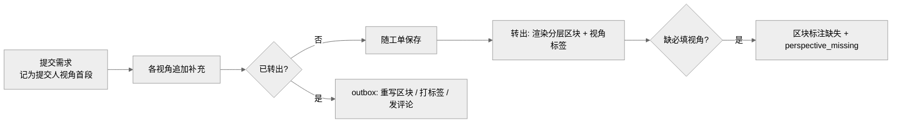
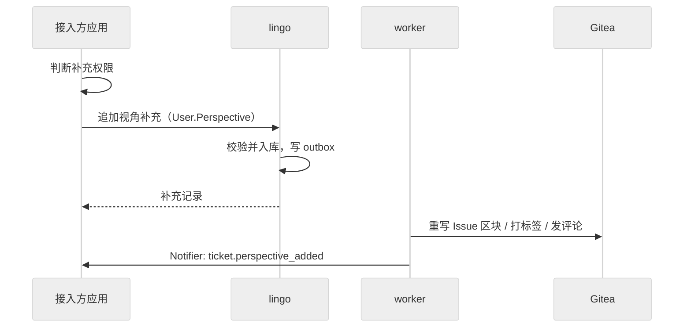

# REQ-001: 需求多视角分层补充

## 元信息

| 属性 | 值 |
|-----|-----|
| 编号 | REQ-001 |
| 类型 | 后端 |
| 状态 | 已完成 |
| 模块 | 工单 |
| 优先级 | P2 |
| 创建日期 | 2026-11-21 |
| 负责人 | - |
| branch | feat/REQ-001-requirement-perspectives |
| issue | - |
| 完成日期 | 2026-11-21 |

## 生命周期

<!-- 需求状态流转：草稿 → 待评审 → 评审通过 → 开发中 → 测试中 → 已完成 -->

- [x] 草稿（编写中）
- [x] 待评审
- [x] 评审通过
- [x] 开发中
- [x] 测试中
- [x] 已完成

---

## 一、需求描述

### 1.1 背景

目前灵工的身份只有固定权限角色（`external` / `agent` / `reviewer` / `admin`），只决定"能看什么、能做什么"，不体现提出人在业务中的身份。一条需求往往需要不同身份的人共同完善：使用者说现象与诉求，业务方说影响范围，专家给方案建议，决策者定做不做、先后与期限。现状下这些信息要么缺失，要么散落在评论流里，转出到 Gitea 后开发者（AI 研发 Agent 与 reviewer）难以区分哪句话出自谁、分量如何、还缺什么。

### 1.2 目标

- **功能目标**：在权限角色之外引入固定的"视角"（Perspective）：使用者 / 业务方 / 专家 / 决策者。同一条需求类工单可由不同视角的人分别追加补充，转出后仍可补充；Issue 正文按视角分层呈现，并打上对应视角标签；缺少必填视角时在 Issue 中标明并通知接入方。
- **效果目标**：开发者打开 Issue 即可看清各视角意见；缺失视角可被识别并提醒补充，减少因信息不全导致的返工与来回追问。

### 1.3 客户场景

> 记录客户提出的原始业务场景和诉求

- **场景1**：使用者提了一个需求，业务方希望补充影响多少人、哪些流程，专家希望补充方案建议，领导要给出优先级——希望这些内容在同一条需求中按身份分层，而不是混在评论里。
- **场景2**：需求已转到 Gitea，开发中业务方又补充了新信息，希望 Issue 同步更新，开发者能看到。
- **场景3**：开发者拿到需求时，希望一眼知道是否还缺某个视角（如没有决策意见），以便先提醒补充。

### 1.4 价值

- 需求信息按视角结构化，AI 研发 Agent 能更准确地理解诉求、范围与约束，减少误判
- 决策意见显式化，开发者不用猜优先级和取舍
- 缺失视角可见、可提醒，需求在进入开发前更完整

### 1.5 范围与边界

> 明确本期做什么、不做什么，防止范围蔓延

- **本期包含**：
  - 固定视角集合与 `User.Perspective` 字段（由接入方在 `Authenticate` 中提供）
  - 需求类工单（`feature`）的视角补充：仅追加，转出前后均可
  - 转出时与转出后按视角渲染 Issue 正文分层区块、打视角标签、补充后发 Issue 评论提示
  - 必填视角配置（全局默认 + 按项目覆盖）与缺失提示（Issue 区块内标注 + Notifier 事件）
  - Go 方法、REST、MCP 三个入口同时提供补充与查询能力
- **本期不做**：
  - 视角补充的修改与撤回（数据结构预留版本字段）
  - 补充时的 AI 追问引导（直接提交文本）
  - 咨询、Bug 类工单的视角分层
  - 谁可以补充哪条需求的权限判断（由接入方应用处理）
  - 自定义视角或视角标签（固定不可修改）
  - 视角补充携带附件
  - 必填视角补齐后的"已补齐"事件
  - 从 Issue 正文回读视角补充（单向同步）

### 1.6 干系人

> 除了提出方，还有哪些人会因此变化受影响

| 角色 | 关注点 | 备注 |
|------|-------|------|
| 提出方（产品负责人） | 需求按视角分层，便于分析 | - |
| 接入开发者 | 在 `Authenticate` 中映射视角；在应用内判断补充权限；处理新增 Notifier 事件 | 需在接入文档中重点说明 |
| 使用者 / 业务方 / 专家 / 决策者 | 能以各自视角补充需求，补充内容在 Issue 中可见（含姓名） | - |
| AI 研发 Agent / reviewer | Issue 中分层阅读需求、识别缺失视角 | - |
| Gitea 机器人账号 | 需具备创建标签、编辑 Issue 正文的权限 | - |

---

## 二、功能清单

> 列出所有功能点，开发完成后勾选

- [x] **视角定义**：根包新增固定视角类型与 4 个取值 `user`（使用者）、`business`（业务方）、`expert`（专家）、`leader`（决策者）；`lingo.User` 新增 `Perspective` 字段，为空视为 `user`，非法值拒绝
- [x] **提交即首段**：需求类工单提交时，提交内容记为提交人视角的第一段补充
- [x] **追加视角补充**：对需求类工单追加一段补充，视角取调用者 `User.Perspective`，记录视角、姓名、时间与内容；只追加，不修改、不撤回
- [x] **查询视角补充**：按工单返回全部补充，按视角分组、组内按时间排序，并给出缺失的必填视角；只返回视角补充，不含工单其他评论与附件
- [x] **Issue 分层渲染**：转出时把各视角补充渲染进 Issue 正文的标记区块；转出后每次补充都重写该区块。首段原始提交已按表单模板渲染在正文中，区块内首段只标注"原始提交见正文"及提交人、时间，不重复内容
- [x] **视角标签**：Issue 中出现过的视角各打一个固定标签 `lingo/视角/使用者`、`lingo/视角/业务方`、`lingo/视角/专家`、`lingo/视角/决策者`；仓库中不存在时由 lingo 自动创建
- [x] **补充评论提示**：转出后每次补充，在 Issue 下发一条评论提示（如"业务方 · 张三 补充了内容"）
- [x] **必填视角配置**：`Config` 配置默认必填视角集合，`Project` 可覆盖；未配置即不检查
- [x] **缺失提示**：Issue 区块末尾标注"缺少：xxx"，随每次重写更新（补齐后标注消失）；转出时若缺必填视角，发出 Notifier 事件
- [x] **新增事件**：`ticket.perspective_added`（有新补充）、`ticket.perspective_missing`（缺必填视角），同时进入变更流
- [x] **多入口**：Go 方法、REST Handler、MCP 工具同步提供补充与查询

---

## 三、业务规则

| 类型 | 规则 | 说明 |
|------|-----|------|
| 数据校验 | 视角取值固定 | 只接受 `user` / `business` / `expert` / `leader`；`Perspective` 为空按 `user`，其他值返回参数错误 |
| 数据校验 | 仅需求类工单 | 只有 `feature` 类型工单可补充；咨询、Bug 调用补充返回参数错误 |
| 数据校验 | 内容长度 | 单段补充非空、不超过 10000 字 |
| 状态转换 | 关闭后不可补充 | 工单关闭后不能再追加补充 |
| 状态转换 | 转出前后均可补充 | 转出前补充随工单保存，转出时一并渲染；转出后补充经 outbox 同步到 Issue |
| 状态转换 | 只追加 | 补充不可修改、撤回；同一视角多次补充按时间依次列出 |
| 权限控制 | 补充权限 | lingo 先校验工单存在、属于调用者可访问的项目（`User.Projects`）且为需求类型，再交给 `Config.AuthorizePerspective(ctx, u, ticket, write=true)` 判断；未配置时按工单可见范围（external 只能是本人的需求，agent 只能是已转出的，reviewer / admin 为项目内全部）。Go 方法、REST、MCP 统一经过该判断 |
| 权限控制 | 查询可见范围 | 查询视角补充与追加补充采用同一校验：工单属于调用者 `User.Projects` 且为需求类型，"谁能看哪条需求"由 `AuthorizePerspective(write=false)` 判断，默认规则同上；返回内容仅限视角补充（视角、姓名、时间、内容），不含工单其他评论、附件与提交人 Email / ID。此为 PRD 3.2.0.6 数据隔离的例外 |
| 权限控制 | 视角与权限角色独立 | 视角只影响补充内容的归类，不授予任何权限；`admin` 不是视角，管理员补充时同样使用其 `Perspective` |
| 数据外传 | 姓名写入 Issue | 作为 PRD 3.2.0.6"个人信息不外传 Gitea"的例外，Issue 中每段补充标注补充人 `User.Name`，首段标注提交人姓名；补充内容渲染为引用块并转义行首 `#`，不能伪造其他视角的标题与署名；Email、`User.ID` 仍不外传；`User.Name` 为空时只显示视角与时间 |
| 标签 | 视角标签固定 | 标签名为 `<GiteaConfig.LabelPrefix>/视角/<视角名>`（默认前缀 `lingo`，如 `lingo/视角/业务方`），与其他 lingo 标签同一前缀；视角名固定，不可配置或修改；Issue 中出现某视角即打对应标签 |
| 缺失提示 | 必填视角 | 未配置必填视角时不做缺失检查；配置后 Issue 区块标注缺失项并随每次重写更新；转出时若缺失发 `ticket.perspective_missing`；本期不发"已补齐"事件，补齐时只有 `ticket.perspective_added` |
| 非功能约束 | 兼容性 | 根包只新增类型、字段与方法，不做破坏性变更 |
| 非功能约束 | 异步可重试 | 重写 Issue 正文、打标签、发评论均经 outbox + worker 异步执行、失败可重试；并发补充以数据库最新状态渲染 |
| 非功能约束 | 不覆盖他人编辑 | 只重写 Issue 正文中 `<!-- lingo:perspectives -->…<!-- /lingo:perspectives -->` 区块，区块外内容保持不变；区块被删除时下次补充插在工单标记之前（工单标记须是正文最后一个） |
| 非功能约束 | 单向同步 | 视角补充以 lingo 数据库为准，单向渲染到 Issue；lingo 不从 Issue 正文回读区块内容，Webhook 收到 `issues` edited 事件时不做视角相关处理，避免自身改动形成回环；在 Gitea 中手改区块内容会在下次重写时被覆盖 |
| 状态转换 | 转出时修改 | reviewer 经 `forward_ticket` 修改标题、类型或备注转出时，区块照常生成（`forward_ticket` 不支持改正文，Issue 正文始终由 lingo 生成）；用户内容中伪造的区块标记被清除 |

---

## 四、使用场景

### 场景1：使用者提交需求，业务方与决策者补充

- **角色**：使用者、业务方、决策者（均由接入方 `Authenticate` 提供视角）
- **前置条件**：项目已配置必填视角 `business`、`leader`
- **基本流程**：
  1. 使用者经问答或直接接口提交需求类工单 → 系统创建工单，提交内容记为"使用者"首段
  2. 业务方在接入方应用中打开该需求，应用判断其有补充权限后调用补充接口 → 系统按"业务方"视角追加一段（含姓名、时间）
  3. 决策者补充"本月内做，P1" → 系统按"决策者"视角追加
  4. 工单转出到 Gitea → Issue 正文区块按视角分层展示三段内容，打上 `lingo/视角/使用者`、`lingo/视角/业务方`、`lingo/视角/决策者` 标签
- **异常流程**：
  - 转出时缺决策者补充 → Issue 区块末尾标注"缺少：决策意见"，并发出 `ticket.perspective_missing`
  - 调用者 `Perspective` 为非法值 → 返回参数错误，不记录补充
  - 补充内容为空或超过 10000 字 → 返回参数错误

### 场景2：需求转出后专家补充方案建议

- **角色**：专家
- **前置条件**：需求已转出到 Gitea，工单未关闭
- **基本流程**：
  1. 专家调用补充接口提交方案建议 → 系统记录"专家"视角补充，发出 `ticket.perspective_added`
  2. worker 异步处理 → 重写 Issue 正文中的分层区块，打 `lingo/视角/专家` 标签，并在 Issue 下发评论"专家 · 李四 补充了内容"
- **异常流程**：
  - Gitea 暂时不可用 → outbox 重试，最终一致
  - 有人删掉了 Issue 正文中的区块 → 下次重写时把区块插在工单标记之前
  - 工单已关闭 → 返回错误，不记录补充

### 场景3：开发者阅读分层需求

- **角色**：AI 研发 Agent / reviewer
- **前置条件**：Issue 已带分层区块
- **基本流程**：
  1. 打开 Issue 或经 MCP 查询视角补充 → 看到按"使用者反馈 / 业务补充 / 专家意见 / 决策意见"分段的内容，每段注明姓名与时间，以及缺失的必填视角
  2. 按视角标签在 Gitea 中筛选（如筛出有决策意见的需求）
- **异常流程**：
  - 某视角无补充 → 区块中不出现该段；若为必填，标注缺失
  - 补齐缺失视角后 → 区块中"缺少"标注随重写消失

---

## 五、数据与交互

> 根据需求类型填写不同内容：
> - **后端 / 全栈**：描述需要的接口能力和业务语义，技术方案在 `/rd:dev` 阶段生成
> - **前端**：描述页面交互逻辑，`/rd:dev` 阶段自动匹配后端接口

### 后端/全栈：接口需求

| 能力 | 输入 | 输出 | 说明 |
|------|------|------|------|
| 身份提供视角 | `Authenticate` 返回的 `lingo.User` 新增 `Perspective` | - | 接入方把自身用户映射为 4 个视角之一，为空视为 `user` |
| 追加视角补充 | 调用者、工单 ID、补充内容（纯文本 / Markdown，本期不带附件） | 补充记录（视角、姓名、时间、内容） | 仅需求类、未关闭工单；转出后触发 Issue 同步；Go / REST / MCP 三入口 |
| 查询视角补充 | 调用者、工单 ID | 按视角分组的补充列表 + 缺失的必填视角 | 校验同追加补充（项目内需求类工单，可见性由 `AuthorizePerspective` 判断）；仅返回视角补充；供接入方界面展示与 AI Agent 读取；Go / REST / MCP 三入口 |
| 必填视角配置 | `Config` 默认必填视角集合；`Project` 覆盖 | - | 代码声明，与现有 Projects 配置方式一致 |
| 视角事件 | - | `ticket.perspective_added`、`ticket.perspective_missing` | 经 Notifier 推送并进入变更流，可见范围同现有 ticket 事件 |

### 前端：交互逻辑

> 按页面/模块描述用户操作和数据流转，不指定具体接口

不涉及（lingo 无前端，界面由接入方实现）。

---

## 六、测试要点

### 6.1 技术测试

- [x] `Perspective` 为空按 `user` 记录；非法值返回参数错误（TestAddPerspectiveRules、TestCreateValidatesPerspective）
- [x] 咨询 / Bug 工单调用补充返回参数错误；已关闭工单补充返回错误（TestAddPerspectiveRules、TestPerspectivesREST）
- [x] 内容为空、超过 10000 字返回参数错误（TestAddPerspectiveRules）
- [x] 同一视角多次补充全部保留，按时间排序（TestPerspectiveSection）
- [x] 能否补充由 `AuthorizePerspective` 判断：未配置时同工单可见范围（external 只能是本人的需求），配置后按接入方规则；`User.Projects` 之外项目的工单返回 404（TestPerspectiveAuthorization、TestPerspectivesREST、TestPerspectivesFlow）
- [x] 转出时 Issue 正文包含分层区块，区块外原有内容不变，且标注补充人姓名，不含 Email 与 `User.ID`（TestPerspectivesFlow）
- [x] 转出后补充经 outbox 重写区块、打视角标签、发评论；Gitea 失败可重试（TestPerspectivesFlow、TestSyncPerspectives）
- [x] 区块被删除后再次补充，区块插在工单标记之前（TestWithPerspectives）
- [x] 并发多次补充后 Issue 区块与数据库内容一致（TestPerspectivesConcurrentWebhookAndEvents）
- [x] 仓库缺视角标签时自动创建（TestPerspectivesFlow）
- [x] 必填视角：未配置不提示；全局配置生效；项目覆盖优先；转出时缺失发 `ticket.perspective_missing`（TestRequiredPerspectivesOverride、TestForwardWithoutRequiredEmitsNoMissing、TestPerspectivesFlow）
- [x] 新增事件进入变更流，可见范围符合 3.2.0.6（TestPerspectivesConcurrentWebhookAndEvents）
- [x] 查询视角补充：能否查看由 `AuthorizePerspective(write=false)` 判断，`User.Projects` 外返回 404；返回不含其他评论、附件、Email、`User.ID`（TestPerspectiveAuthorization、TestPerspectivesREST）
- [x] Issue 区块首段只标注"原始提交见正文"，不重复正文内容（TestPerspectiveSection、TestPerspectivesFlow）
- [x] 补齐必填视角后区块"缺少"标注消失（TestPerspectivesFlow）
- [x] lingo 重写正文触发的 Webhook edited 事件不引起视角数据变化或再次重写（TestPerspectivesConcurrentWebhookAndEvents）
- [x] reviewer 改标题 / 类型 / 备注转出后区块存在；内容中伪造的区块起止标记被清除（TestPerspectivesConcurrentWebhookAndEvents、TestForwardEmitsPerspectiveMissing、TestIssueBodyPerspectivesBeforeMeta）
- [x] `User.Name` 为空时区块只显示视角与时间（TestPerspectiveSection）
- [x] REST 与 MCP 入口与 Go 方法行为一致（TestPerspectivesREST、TestPerspectivesMCP）

### 6.2 验收标准

> 产品/业务方验收时的确认项，描述可观测的业务结果

- [x] 使用者提交需求、业务方与决策者补充后转出，Gitea Issue 中按视角分段展示，每段有姓名与时间，并带对应视角标签（TestPerspectivesFlow，模拟 Gitea）
- [x] 转出后专家补充，Issue 正文分层区块自动更新、出现 `lingo/视角/专家` 标签，Issue 下有补充提示评论（TestPerspectivesFlow，模拟 Gitea）
- [x] 配置必填视角后，缺少决策意见的需求在 Issue 中标注"缺少：决策意见"，接入方收到 `ticket.perspective_missing` 事件（TestPerspectivesFlow）
- [x] 经 MCP 可查询某需求的分层补充与缺失视角（TestPerspectivesMCP）

### 6.3 手动测试用例

> 执行 `/rd:test_new REQ-001 --type=manual` 生成，供测试人员逐条复测

_待生成_

---

## 七、图示（可选）

> 用 Mermaid 绘制，GitHub/Gitea 原生渲染。主题建议统一用 `neutral`（打印友好、明暗模式兼容）。
> 无图可删除本节，按需保留下方子节。

### 7.1 流程图（业务流程、用户操作路径）

### 7.2 时序图（接口调用链、前后端交互）

### 7.3 ER 图 / 状态图（按需）

_无_

---

## 八、评审记录

| 日期 | 评审人 | 结论 | 意见 |
|-----|-------|------|------|
| 2026-11-21 | AI 预审 | 预审未提审 | 阻塞1：查询视角补充未定义可见范围，与 PRD 3.2.0.6 冲突且未列入待同步。建议：附件引用来源不明；首段与 Issue 正文重复；lingo 改正文触发 Webhook 回环；补齐必填视角后无更新；forward_ticket 改正文与区块关系未定 |
| 2026-11-21 | AI 预审 | 提审 | 无阻塞项。上轮阻塞与建议已按修改落实；信息：单模块、11 个功能点，粒度合适；PRD 3.2.0.2 / 3.2.0.6 / 3.2.2 / 3.2.3 待评审通过后同步 |
| 2026-11-21 | haiqing | 通过 | - |

---

## 九、变更记录

| 日期 | 变更内容 | 影响范围 |
|-----|---------|---------|
| 2026-11-21 | 初始版本 | - |
| 2026-11-21 | 按 AI 预审修改：明确查询可见范围与返回内容；去掉附件引用；首段不重复正文；Issue 区块单向同步不回读；缺失标注随补充更新；转出时 reviewer 改正文后区块由 lingo 追加；姓名为空的展示规则 | 三、五、二、四、六、十章 |
| 2026-11-21 | 评审通过后同步 PRD v1.24 | 十章 |
| 2026-11-21 | 代码审查修改：新增 `Config.AuthorizePerspective`（未配置时同工单可见范围），REST / MCP / Go 统一鉴权；补充内容以引用块渲染防伪造；区块缺失时插在工单标记之前；首段标注提交人姓名；有 Issue 的 abnormal 工单补充也入队同步 | 三、四、五、六、十章 |
| 2026-11-21 | 开发方案确认：`forward_ticket` 不支持改正文，"转出时改正文"规则改为"修改标题 / 类型 / 备注转出时区块照常生成、伪造标记被清除"；首段由工单派生（正文空时拼接表单字段）；已答复 / 合并 / 驳回 / 关闭不可补充 | 三、六章 |
| 2026-11-21 | 视角标签加 `GiteaConfig.LabelPrefix` 前缀（默认 `lingo/视角/<视角名>`），与现有标签一致、避免与仓库已有标签重名 | 二、三、四、六章 |

---

## 十、关联信息

- **关联需求**：无
- **相关文档**：[PRD 3.2.0.2 身份与固定角色](../PRD.md)、PRD 3.2.0.6 提交人身份与数据隔离、PRD 3.2.2 工单提交与 Gitea 同步、PRD 3.2.3 信息反馈（Notifier）
- **假设**：接入方能够在自身用户体系中区分使用者 / 业务方 / 专家 / 决策者并在 `Authenticate` 中映射；每个用户同一时刻只有一个视角
- **外部依赖**：Gitea 机器人账号需有创建标签、编辑 Issue 正文、发评论的权限
- **PRD 同步**：已于 2026-11-21 同步至 PRD v1.24（新增 3.2.2.1，并改 3.2.0.2 / 3.2.0.6 / 3.2.2 / 3.2.3 / 6.3）。原计划：评审通过后修改 PRD 3.2.0.2（新增视角概念）；3.2.0.6 增加两条例外：补充人姓名写入 Issue、项目内需求类工单的视角补充可由接入方判定的人员追加与查询；3.2.3 新增事件；3.2.2 说明 Issue 正文视角区块与单向同步
- **风险项**：
  - 安全风险：已由 `Config.AuthorizePerspective` 收口；未配置时按工单可见范围（安全默认），接入方放宽规则时需自行把关
  - 数据风险：Issue 正文区块可能被人工改动，需以标记定位、缺失时追加，避免覆盖区块外内容；区块内手改会被下次重写覆盖
  - 回环风险：lingo 改 Issue 正文会触发 Webhook，需确保视角处理不响应 edited 事件
  - 扩展风险：后续支持修改 / 撤回需给补充记录加版本，本期数据结构预留；0001 迁移尚未发布，可直接调整

---

## 十一、实现方案

> 本章节在 `/rd:dev` 阶段由 AI 分析代码后自动生成，创建需求时无需填写。

### 11.1 数据模型

直接修改 `migrations/0001_init.sql`（尚未发布）：

- `lingo_tickets` 增加 `user_perspective text NOT NULL DEFAULT 'user' CHECK (IN user/business/expert/leader)`：提交人视角快照，即首段视角
- 新表 `lingo_ticket_perspectives`：`id`、`ticket_id`（FK，级联删除）、`perspective`（CHECK 4 值）、`author_id`（仅留痕，不外传）、`author_name`（姓名快照，写入 Issue）、`body`、`version`（预留修改）、`gitea_posted_id`（提示评论 ID，非空即已发、重试不重发）、`created_at` / `updated_at` / `deleted_at`（预留撤回）；索引 `(ticket_id, id)`
- 首段不单独存行：由工单派生（视角 `user_perspective`、姓名 `user_name`、时间 `created_at`、内容为正文，正文为空时拼接表单字段），`Forward` 把咨询改为需求时首段天然存在
- 不复用 `lingo_ticket_comments`（评论有对外可见、转发与查询语义）；`lingo_events` / `lingo_outbox` 不改表，新字段放 payload

### 11.2 API 设计

> 基于第五章接口需求，结合项目代码和 CLAUDE.md API 风格，生成具体技术方案

- 根包类型：`Perspective` 及 `PerspectiveUser/Business/Expert/Leader`；`User.Perspective`；`Config.RequiredPerspectives`、`Project.RequiredPerspectives`（nil 继承 Config，非 nil 含空切片覆盖）；`PerspectiveEntry{ID, Perspective, AuthorName, Content, At, Original}`、`PerspectiveGroup{Perspective, Title, Entries}`、`TicketPerspectives{TicketID, Groups, Missing}`；`Event.Perspectives`；`New` 校验必填视角取值
- Go：`l.AddPerspective(ctx, u, ticketID, content) (PerspectiveEntry, error)`、`l.ListPerspectives(ctx, u, ticketID) (TicketPerspectives, error)`
- REST：`POST /tickets/{id}/perspectives` `{"content"}` → 201 `PerspectiveEntry`；`GET /tickets/{id}/perspectives` → 200 `TicketPerspectives`
- MCP：`add_perspective {id, content}`、`list_perspectives {id}`
- 鉴权：`Config.AuthorizePerspective func(ctx, u User, t Ticket, write bool) error`，经 context 传入完整 `User`；未配置时按 `ticket.Visible`；鉴权在事务外执行
- 错误：视角非法 / 内容空或超 10000 rune / 非 feature → 400 `invalid_input`；不存在 / 项目外 / 默认规则不可见 → 404；无 ID、角色未知或回调返回 `ErrForbidden` → 403；已答复 / 合并 / 驳回 / 关闭 → 409
- 事件：`ticket.perspective_added`（每次追加，`Perspectives`=[本次视角]，`Body`="业务方 · 张三 补充了内容"，不含补充内容）；`ticket.perspective_missing`（转出时 feature 缺必填视角，`Perspectives`=缺失列表，`Body`="缺少：…"）；可见范围同现有 ticket 事件
- Issue 区块：`<!-- lingo:perspectives -->` … `<!-- /lingo:perspectives -->`，标题"需求视角补充"，按 使用者反馈 / 业务补充 / 专家意见 / 决策意见 分组，每段 `**姓名 · 时间 UTC**`（姓名空时只写时间）；首段写"原始提交见正文"；缺失时末行 `> 缺少：…`；建单时写在元信息 `---` 之前，重写时只替换区块，区块缺失时插到工单标记之前；`markerRe` 改为同时匹配结束标记
- 标签：`gitea.PerspectiveLabel(prefix, p)` → `<前缀>/视角/<视角名>`，并入 `LingoLabels` 由自检补齐；提示评论"业务方 · 张三 补充了内容"
- 异步：新 op `sync_perspectives`（Key `sync_perspectives:perspective:<ID>`），转出后每段补充入队一条；读当前 Issue 正文替换区块（无变化不 PATCH）→ 补标签 → 未发过则发提示评论并记 `gitea_posted_id`

### 11.3 文件改动清单

| 层 | 文件 | 改动 |
|----|------|------|
| Migration | `migrations/0001_init.sql` | `user_perspective` 列、`lingo_ticket_perspectives` 表 |
| Domain | `internal/auth/auth.go` | `Principal.Perspective` |
| Domain | `internal/notify/event.go` | 新 Kind、`Event.Perspectives` |
| Domain | `internal/perspective/`（新增） | 视角取值、顺序、中文名的唯一定义，ticket / gitea / store 共用 |
| Domain | `internal/ticket/perspective.go`（新增） | 视角常量与校验、`Service.AddPerspective` / `ListPerspectives` / `Perspectives`、`emitMissing` |
| Domain | `internal/ticket/ticket.go`、`store.go`、`query.go`、`service.go`、`doc.go` | `UserPerspective`、`ended()`、仓储接口、`OpSyncPerspectives`、`Create` / `Forward` 接入 |
| Store | `internal/store/perspective.go`（新增）、`ticket.go`、`query.go`、`outbox.go` | 视角读写、工单列、事件 payload |
| Integration | `internal/gitea/lingo_labels.go` | `PerspectiveLabel`、`LingoLabels` |
| Async | `internal/worker/perspective.go`（新增）、`issue.go`、`doc.go` | 区块渲染与替换、`syncPerspectives`、建单带区块与标签、`markerRe` |
| API | `types.go`、`lingo.go`、`tickets.go`、`perspectives.go`（新增）、`handler.go`、`mcp_tools.go` | 公开类型、配置、方法、路由、MCP 工具 |
| 文档 | `README.md`、`docs/architecture/overview.md` | 工具与事件清单、权限提示 |
| 测试 | `internal/ticket/perspective_test.go`（新增）、`sync_test.go`、`internal/worker/issue_test.go`、`tests/*` | 单测与集成测试 |

### 11.4 实现步骤

1. Migration：改 `0001_init.sql`
2. Domain 基础：Principal / notify / ticket 类型与接口；`go build ./... && go vet ./...`
3. Domain 逻辑：`Create` 校验视角、`AddPerspective`、`Perspectives`、`emitMissing`；领域单测
4. Store：视角读写、工单列、事件 payload
5. Integration：视角标签
6. Async：区块渲染 / 替换、`syncPerspectives`、建单接入；worker 单测
7. API：根包类型与方法、REST、MCP、文档
8. 收尾：`go test ./...` 与 `tests/` 集成测试
