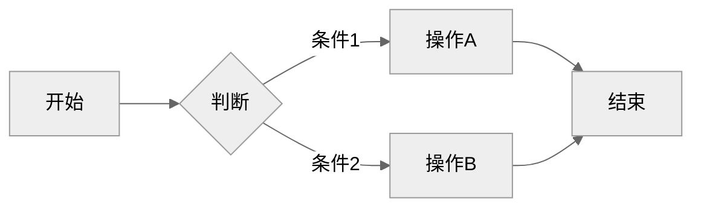
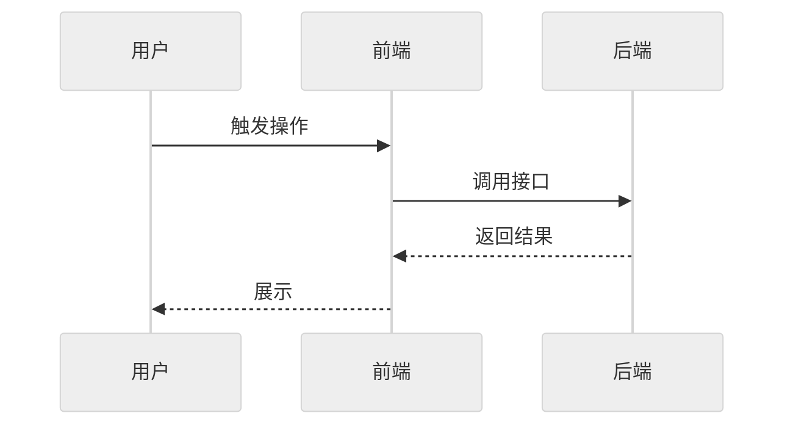
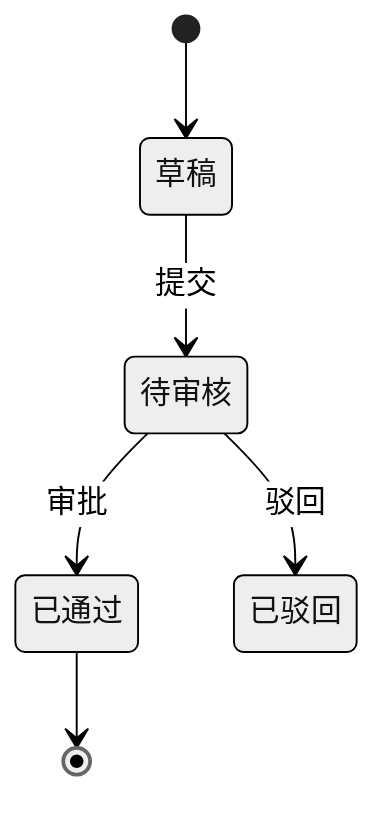

# REQ-004: 工单可见性回调

## 元信息

| 属性 | 值 |
|-----|-----|
| 编号 | REQ-004 |
| 类型 | 后端 |
| 状态 | 已完成 |
| 模块 | 工单 |
| 优先级 | P2 |
| 创建日期 | 2026-11-24 |
| 负责人 | - |
| branch | feat/REQ-004-ticket-audience |
| issue | - |
| 完成日期 | 2026-11-24 |

## 生命周期

<!-- 需求状态流转：草稿 → 待评审 → 评审通过 → 开发中 → 测试中 → 已完成 -->

- [x] 草稿（编写中）
- [x] 待评审
- [x] 评审通过
- [x] 开发中
- [x] 测试中
- [x] 已完成

---

## 一、需求描述

### 1.1 背景

从 REQ-003 预审拆出。工单可见范围目前由 `ticket.Visible` 按固定角色写死（PRD 3.2.0.6）：external 只能看本人的，agent 只能看已转出的，reviewer / admin 能看 `User.Projects` 内全部。接入方希望自己控制"能不能看别人的工单"，典型是同部门、同团队的人互看进度，问答（REQ-003）的查找与汇总也要跟着放宽。

已讨论确定（原 REQ-003 预审阻塞项）：

1. **只放宽、按提交人放宽**：新增范围回调 `Config.TicketAudience`，返回调用者额外可见的提交人；不做逐张回调，列表、分页、计数与问答汇总都能在查询里过滤
2. **放宽后只读**：被放宽看到的工单不能留言、补附件、补充需求视角，避免同事的留言同步到 Issue、通知提交人
3. **覆盖范围**：查看、列表、问答查找与汇总、版本"修复的工单"、对外评论跟随放宽；附件、`ListEvents` / Notifier、需求视角（REQ-001，`AuthorizePerspective`）不跟随

### 1.2 目标

- **功能目标**：接入方经一个回调声明 external 用户额外可见哪些提交人的工单；灵工在查看、列表、问答汇总与版本问答中按此放宽，写操作与通知仍只对本人
- **效果目标**：同部门成员不必逐个转问就能查到彼此工单的进度；问答能回答"我们组最近提的 bug 修了吗"这类问题；不配置回调时行为与现在完全一致

### 1.3 客户场景

> 记录客户提出的原始业务场景和诉求

- **场景1**：同一业务部门的几位客服都会提工单，组长或同事想看"部门里谁提过这个问题、修了没有"，避免重复提交
- **场景2**：用户在问答窗口问"我们组最近提的问题处理到哪了"，希望答案覆盖同组成员的工单，而不只是自己的

### 1.4 价值

减少重复工单与线下转问；问答从"只回答本人的"扩展到"回答团队的"，提高知识问答的实用性；可见范围的业务规则（部门、团队）留在接入方，灵工不引入组织架构概念。

### 1.5 范围与边界

> 明确本期做什么、不做什么，防止范围蔓延

- **本期包含**：
  - `Config.TicketAudience` 范围回调（返回额外可见的提交人 ID 列表）
  - 工单查看、可见工单列表（新增）、问答查找与汇总、版本"修复的工单"、对外评论列表按放宽后的范围
  - 工单返回字段 `mine`（是否本人提交）
- **本期不做**：
  - 收窄（让某角色看得更少）与逐张工单判断
  - 放宽对 agent / reviewer / admin 生效
  - 被放宽者的写操作（留言、补附件、补充视角、确认留言）
  - 附件、`ListEvents`、Notifier、需求视角跟随放宽
  - 回调结果缓存（由接入方自行缓存）

### 1.6 干系人

> 除了提出方，还有哪些人会因此变化受影响

| 角色 | 关注点 | 备注 |
|------|-------|------|
| 提出方（接入方） | 用自己的部门/团队数据决定可见范围；回调简单、不影响性能 | 回调每次请求调用一次 |
| external 用户 | 能看到同事的工单与进度；自己的工单可能被同事看到 | 同事看不到附件、收不到通知 |
| 后台（reviewer / admin） | 行为不变 | - |
| AI 研发（agent） | 行为不变 | - |

---

## 二、功能清单

> 列出所有功能点，开发完成后勾选

- [x] **范围回调**：`Config.TicketAudience(ctx, u) (TicketAudience, error)`，返回 `UserIDs`（额外可见的提交人）；未配置或返回空时行为不变
- [x] **查看放宽**：`GetTicket`（Go / REST / MCP）对 external 放行被放宽可见的工单（仍限 `User.Projects`）
- [x] **可见工单列表**：新增 Go `ListVisibleTickets`、REST `GET /tickets/visible`、MCP `list_visible_tickets`，返回本人提交的 + 被放宽可见的，可按状态、项目筛选，分页同 `ListMyTickets`
- [x] **问答跟随**：知识问答的工单查找、统计与汇总按放宽后的范围；回答引用可指向同事的工单
- [x] **版本问答跟随**：版本"修复的工单"中，对 external 额外列出被放宽可见的工单
- [x] **对外评论**：`ListTicketComments` 对被放宽可见的工单返回对外评论（与本人看到的一致）
- [x] **`mine` 标记**：工单返回新增 `mine` 字段
- [x] **写操作保持只对本人**：留言、补附件、补充视角、确认留言、附件读取、`ListEvents` 不跟随放宽，对同事的工单返回 not_found
- [x] **文档**：README（中英文，含告知用户的建议文案）、PRD 3.2.0.6 可见范围、`Config` 字段注释

---

## 三、业务规则

| 类型 | 规则 | 说明 |
|------|-----|------|
| 权限控制 | 只对 external 生效 | agent 仍只看已转出的；reviewer / admin 本来就可见项目内全部，不调用回调 |
| 权限控制 | 不超出 `User.Projects` | 被放宽的工单仍须属于调用者的项目，否则不可见 |
| 权限控制 | 放宽只读 | 留言、补附件、补充视角、确认留言只允许本人或后台；同事尝试时返回 not_found，不暴露工单存在 |
| 权限控制 | 不跟随的能力 | 附件读取、`ListEvents` 变更流、Notifier 通知只对提交人本人；需求视角未配置 `AuthorizePerspective` 时仍按固定角色规则，不跟随放宽 |
| 数据校验 | 回调返回 | `UserIDs` 为接入方用户 ID；去重；包含调用者本人时忽略；为空等同未放宽 |
| 数据校验 | 名单上限 | 去重后最多取前 1000 个，超出部分丢弃并记一条 Warn 日志 |
| 权限控制 | 无用户 ID | `User.ID` 为空的 external 不调用回调（现在本来看不到任何工单） |
| 权限控制 | 合并工单 | 严格按提交人判断：同事的工单被合并进主工单时，同事那张仍可见；主工单的提交人不在名单内时，主工单不自动可见 |
| 权限控制 | 历史会话 | 问答会话中引用的同事工单，每次打开或查看时按当前范围重新判断；同事已不在名单内时不可见（引用只显示编号，不返回内容） |
| 状态转换 | 状态范围 | 被放宽可见的工单与本人工单的可见状态一致（含待后台确认、已驳回） |
| 数据校验 | 返回字段 | 同事的工单只返回提交人姓名，不返回邮箱等联系方式（与现有一致）；新增 `mine` 区分本人提交 |
| 非功能约束 | 回调调用 | 每次请求最多调用一次，不缓存；回调返回错误时按未放宽处理（只看本人），记一条 Warn 日志，请求不失败 |
| 非功能约束 | 性能 | 放宽在查询条件中过滤（提交人 ∈ 本人 + UserIDs），列表分页与计数准确，不逐张判断 |
| 非功能约束 | 兼容 | 只新增配置字段、方法、路由与返回字段；不配置回调时所有现有接口行为不变；无数据库迁移 |

---

## 四、使用场景

### 场景1：查看同事的工单进度

- **角色**：external 用户（客服 A）
- **前置条件**：接入方配置 `TicketAudience`，对 A 返回同部门成员 B、C
- **基本流程**：
  1. A 调用可见工单列表 → 返回 A、B、C 在 A 项目内的工单，B、C 的标记 `mine=false`
  2. A 打开 B 的工单 → 返回工单详情与对外评论
  3. A 按状态筛选"处理中" → 列表与计数只含该状态
- **异常流程**：
  - A 对 B 的工单留言 / 补附件 / 下载附件 → not_found
  - B 的工单不在 A 的 `User.Projects` 内 → 不可见
  - 回调返回错误 → 只返回 A 本人的工单，日志记一条 Warn
  - B 的工单被合并进 D 提交的主工单 → A 仍能看 B 的工单，主工单不可见（D 不在名单内）

### 场景2：问答汇总团队工单

- **角色**：external 用户（客服 A）
- **前置条件**：同场景1
- **基本流程**：
  1. A 在问答窗口问"我们组最近提的 bug 修了吗" → 助手查找 A、B、C 的工单并汇总状态
  2. 回答中引用 B 的工单 → A 可点开查看
  3. A 问"最近发版修了哪些我们组的问题" → 版本问答列出含 B、C 工单的修复
- **异常流程**：
  - A 要求助手在 B 的工单下留言 → 拒绝（只读），提示只能对自己的工单留言
  - 未配置回调 → 只回答 A 本人的工单（现有行为）
  - B 调离部门后 A 重新打开旧会话 → 引用的 B 的工单不再返回内容

---

## 五、数据与交互

> 根据需求类型填写不同内容：
> - **后端 / 全栈**：描述需要的接口能力和业务语义，技术方案在 `/rd:dev` 阶段生成
> - **前端**：描述页面交互逻辑，`/rd:dev` 阶段自动匹配后端接口

### 后端/全栈：接口需求

| 能力 | 输入 | 输出 | 说明 |
|------|------|------|------|
| 范围回调 | `ctx`、调用者 `User` | `TicketAudience{UserIDs}`、error | `Config.TicketAudience`，接入方实现；仅对 external 调用 |
| 可见工单列表 | 状态、项目、游标、条数 | 工单列表（含 `mine`） | Go `ListVisibleTickets`、REST `GET /tickets/visible`、MCP `list_visible_tickets` |
| 查看工单 | 工单 ID | 工单详情（含 `mine`） | 现有 `GetTicket`，对 external 放宽 |
| 对外评论 | 工单 ID | 评论列表 | 现有 `ListTicketComments`，跟随放宽 |
| 问答查找 / 汇总 | 现有参数 | 现有结果 | 知识问答工具内部按放宽后的范围 |
| 版本修复的工单 | 现有参数 | 现有结果 | 对 external 额外包含被放宽可见的工单 |

### 前端：交互逻辑

> 按页面/模块描述用户操作和数据流转，不指定具体接口

**页面：无**（灵工不提供前端，界面由接入方实现）

| 操作/区域 | 用户行为 | 数据需求 | 交互反馈 |
|----------|---------|---------|---------|
| - | - | - | - |

---

## 六、测试要点

### 6.1 技术测试

> 2026-11-24 /rd:test：单测 `internal/ticket/audience_test.go`、`audience_test.go`；集成 `tests/audience_test.go`（TestTicketAudienceReadOnly、TestTicketAudienceAssistant）；全量单测与集成测试通过

- [x] 未配置 `TicketAudience`：所有现有工单接口与问答结果不变（回归）
- [x] 回调返回同事 ID：external 可查看同事工单、可见工单列表包含同事工单且 `mine=false`，分页与状态筛选正确
- [x] 不超出 `User.Projects`：同事在其他项目的工单不可见
- [x] 回调只对 external 调用：agent / reviewer / admin 不调用，结果不变
- [x] 回调返回错误：按未放宽处理，请求成功，记 Warn 日志
- [x] 名单超过 1000 个：只取前 1000 个并记 Warn 日志；无用户 ID 的 external 不调用回调
- [x] 合并工单：同事被合并的工单可见，提交人不在名单内的主工单不可见
- [x] 历史会话：名单变化后，旧会话中引用的同事工单按当前范围重新判断
- [x] 写操作只对本人：对同事工单留言、补附件、补充视角、确认留言返回 not_found
- [x] 不跟随的能力：附件读取、`ListEvents`、Notifier 对同事工单不放宽（Notifier 投递代码未改动，事件仍只归属提交人；未单独断言）；未配置 `AuthorizePerspective` 时视角查看不放宽
- [x] 问答：查找、统计、汇总包含同事工单；助手不能对同事工单留言
- [x] 版本问答：修复的工单包含被放宽可见的工单
- [x] REST 与 MCP：`GET /tickets/visible`、`list_visible_tickets` 与 Go 方法结果一致

### 6.2 验收标准

> 产品/业务方验收时的确认项，描述可观测的业务结果

- [x] 接入方配置同部门回调后，部门成员调用可见工单列表能看到彼此在共同项目内的工单，并能区分哪些是自己提的
- [x] 在问答中问"我们组最近提的问题修了吗"，回答覆盖同组成员的工单
- [x] 同事的工单只能看，不能留言、补附件，也看不到附件；提交人不会因同事查看收到任何通知
- [x] 不配置回调时，现有接入方无需任何改动，行为一致

### 6.3 手动测试用例

> 执行 `/rd:test_new REQ-XXX --type=manual` 生成，供测试人员逐条复测

_待生成_

---

## 七、图示（可选）

> 用 Mermaid 绘制，GitHub/Gitea 原生渲染。主题建议统一用 `neutral`（打印友好、明暗模式兼容）。
> 无图可删除本节，按需保留下方子节。

### 7.1 流程图（业务流程、用户操作路径）

### 7.2 时序图（接口调用链、前后端交互）

### 7.3 ER 图 / 状态图（按需）

---

## 八、评审记录

| 日期 | 评审人 | 结论 | 意见 |
|-----|-------|------|------|
| 2026-11-24 | AI 预审 | 提审 | 无阻塞项。建议：①合并工单的可见性（主工单提交人不在名单时）；②回调返回名单的上限与超限处理；③历史会话中引用的同事工单按当前范围重新校验；④无用户 ID 的 external 不调用回调。信息：Visible 现为读写共用，dev 需拆分只读与写入判断；需求视角默认规则保持不放宽 |
| 2026-11-24 | haiqing | 通过 | 预审建议已全部采纳 |

---

## 九、变更记录

| 日期 | 变更内容 | 影响范围 |
|-----|---------|---------|
| 2026-11-24 | 初始版本（从 REQ-003 预审拆出，待讨论） | - |
| 2026-11-24 | 确定方案：按提交人放宽的范围回调 TicketAudience、放宽只读、覆盖范围；补全一~六章与关联信息 | 一~六、十 |
| 2026-11-24 | 采纳 AI 预审建议：名单上限 1000、无用户 ID 不调用、合并工单按提交人判断、历史会话按当前范围重新校验；补实现提示与文案建议 | 三、四、六、十 |

---

## 十、关联信息

- **关联需求**：REQ-003（知识问答，问答查找与汇总跟随放宽）；REQ-001（需求视角，`AuthorizePerspective` 独立控制，不跟随）
- **相关文档**：PRD 3.2.0.6 工单可见范围；`internal/ticket/service.go` 的 `Visible`
- **假设**：接入方能在每次请求内快速返回同部门/同团队成员（必要时自行缓存）；被放宽的人数通常在几十人以内，查询条件按提交人列表过滤即可
- **外部依赖**：无（接入方实现回调）
- **风险项**：可见范围放宽属于隐私变更，接入方需告知用户"同部门成员可见你的工单"（README 提供建议文案）；回调名单上限 1000，接近上限时查询变慢
- **实现提示**：`ticket.Visible` 目前读写共用（查看、写入、附件、需求视角、版本问答），dev 需拆分为"可读"（跟随放宽）与"可写"（不跟随）；需求视角未配置 `AuthorizePerspective` 时仍按固定角色规则

---

## 十一、实现方案

> 本章节在 `/rd:dev` 阶段由 AI 分析代码后自动生成，创建需求时无需填写。

### 11.1 数据模型

不改表、无迁移。检索条件 `SearchQuery` 新增 `UserIDs`（`t.user_id = ANY(...)`）；新增 `VisibleQuery` 与 store `ListVisible`（项目范围 + 提交人列表 + 状态 + 游标）。

### 11.2 API 设计

> 基于第五章接口需求，结合项目代码和 CLAUDE.md API 风格，生成具体技术方案

- **根包**：`Config.TicketAudience func(ctx, u User) (TicketAudience, error)`；`TicketAudience{UserIDs}`、`MaxTicketAudience = 1000`；`Ticket.Mine`；`VisibleTicketFilter{Project, Status, BeforeID, Limit}`；`ListVisibleTickets(ctx, u, f)`
- **REST** `GET /tickets/visible?project=&status=&before=&limit=`；**MCP** `list_visible_tickets`
- **读写拆分**：`auth.Principal.Peers`（只由 `l.viewer(ctx, u)` 在读路径填写：external 且有 ID 才调用回调，去重、去本人、截断 1000，出错按空处理并 Warn）；`ticket.Visible` 保持严格（写、附件、事件流、需求视角）；新增 `ticket.Readable` 与 `Service.View`（读）
- **读路径改用 viewer / View / Readable**：`GetTicket`、REST/MCP 详情（附件仅 Visible 时返回）、`ListTicketComments`、`GetRelease`、知识问答 `Send` / `Retry` / `ListConversationMessages`；`Search` / `Stats` 对 external（非 mine）按本人 + Peers
- **问答**：事实数据新增 `mine`、`submitter`；对同事工单留言回复只读提示（`textReadOnly`）；读取历史消息时按当前范围重新判断引用，不可读的清空标题、状态与 Issue 地址；意图提示"我们组/同事"时 mine 为 false

### 11.3 文件改动清单

| 层 | 文件 | 改动 |
|---|---|---|
| auth | `internal/auth/auth.go` | `Principal.Peers`、`Peer` |
| ticket | `internal/ticket/service.go`、`query.go` | `Readable`、`View`、`ListVisible`、`VisibleQuery`、`SearchQuery.UserIDs`；`Comments` / `Detail` 用 View，附件按 Visible |
| store | `internal/store/query.go` | `ListVisible`、`UserIDs` 条件 |
| release | `internal/release/release.go` | 关联工单按 Readable |
| assistant | `internal/assistant/query.go`、`turn.go`、`reply.go`、`conversation.go` | `mine` / `submitter`、只读提示、历史引用重新判断 |
| llm | `internal/llm/assistant.go` | 意图与回答提示补充同事工单 |
| 根包 | `audience.go`（新）、`lingo.go`、`types.go`、`tickets.go`、`releases.go`、`assistant.go`、`handler.go`、`mcp_tools.go` | Config、viewer、公开类型与方法、REST、MCP |
| 测试 | `internal/ticket/audience_test.go`、`audience_test.go`、`tests/audience_test.go` | 单测与集成测试 |
| 文档 | `README.md`、`README.zh-CN.md`、PRD | 同事可见一节、接口与工具列表、3.2.0.6、v1.30 |

### 11.4 实现步骤

1. auth / ticket / store：Peers、Readable、View、ListVisible、UserIDs 及单测
2. release / assistant / llm：版本过滤、mine / submitter、只读提示、历史引用重新判断
3. 根包：Config、viewer、ListVisibleTickets、REST、MCP、Mine
4. 集成测试与文档
