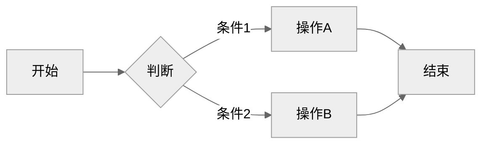
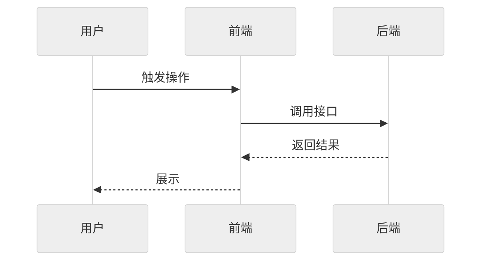
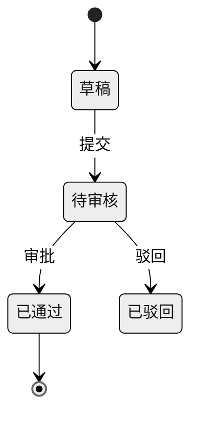

# REQ-005: 模型与 Gitea 配置存入数据库

## 元信息

| 属性 | 值 |
|-----|-----|
| 编号 | REQ-005 |
| 类型 | 后端 |
| 状态 | 已完成 |
| 模块 | 系统配置 |
| 优先级 | P1 |
| 创建日期 | 2026-11-24 |
| 负责人 | - |
| branch | feat/REQ-005-connection-settings-db |
| issue | - |
| 完成日期 | 2026-11-24 |

## 生命周期

<!-- 需求状态流转：草稿 → 待评审 → 评审通过 → 开发中 → 测试中 → 已完成 -->

- [x] 草稿（编写中）
- [x] 待评审
- [x] 评审通过
- [x] 开发中
- [x] 测试中
- [x] 已完成

---

## 一、需求描述

### 1.1 背景

灵工的模型（`Config.Model` / `LightModel`）和 Gitea 连接（地址、机器人 token、Webhook 密钥等）现在都必须在代码里通过 `lingo.Config` 传入。接入方通常从环境变量或配置文件读取这些值，再写进代码。想换模型、换 key 或轮换 Gitea token，都要改配置，然后重新部署或重启。缺少 Gitea 配置时 `lingo.New` 直接报错，服务起不来。

希望把这些连接配置存进数据库，由有权限的人通过接口修改，修改后不用重启就生效。

### 1.2 目标

- **功能目标**：模型和 Gitea 的连接配置保存在数据库中（明文），通过 Go 方法和 REST 查看与修改。修改权限由接入方回调决定。保存后各实例在 30 秒内生效。没有配置时灵工仍能启动，处于"未配置"状态。`Config` 里传了的配置优先使用。
- **效果目标**：换模型、换 key、轮换 Gitea token 都不用改代码或重新部署。首次部署时只需传入数据库连接就能启动，之后在后台填写配置。

### 1.3 客户场景

> 记录客户提出的原始业务场景和诉求

- **场景1**：管理员在接入方后台填写 DeepSeek 的 API Key 和模型名，保存后知识问答和建单整理马上就能用，不用改环境变量、不用重新部署。
- **场景2**：Gitea 机器人 token 到期需要轮换，管理员在后台更新 token，正在运行的实例自动换成新 token。
- **场景3**：新环境首次部署时，代码里只传数据库，灵工以"未配置"状态启动；管理员在后台填好 Gitea 和模型配置后，功能自动恢复。

### 1.4 价值

- 配置变更从"改代码或环境变量并重新部署"变成"后台填写，自动生效"，运维成本更低
- 密钥轮换不用停机
- 首次部署门槛更低：先起服务，再填配置

### 1.5 范围与边界

> 明确本期做什么、不做什么，防止范围蔓延

- **本期包含**：
  - 模型配置：主模型、轻量模型各一套（类型 OpenAI 兼容 / DeepSeek、BaseURL、模型名、向量模型名、API Key），轻量模型可以留空，留空时用主模型
  - Gitea 配置：地址、机器人 token、Webhook 密钥、自动注册 Webhook 的开关与回调地址、拒绝重定向（标签前缀、回复模式仍只在代码中配置）
  - 配置存数据库（明文），全局一套；新增迁移 0004
  - 查看（密钥只返回掩码，并标出每项的来源）、按字段修改、连通测试
  - 修改权限回调 `Config.AuthorizeSettings`；未配置时只允许 admin
  - 热更新：保存后当前实例立即生效，其他实例 30 秒内生效
  - "未配置"状态：缺少 Gitea 配置时也能启动，相关功能暂停，配置填好后自动恢复
  - `Config` 优先：代码里传入的项不能通过接口修改
  - 入口：Go 方法、REST
- **本期不做**：
  - 密钥加密存储（已确认使用明文）
  - 项目与仓库声明（`Config.Projects`）存进数据库
  - 按项目分别配置模型，或连接多个 Gitea 实例
  - 通过 MCP 查看或修改配置
  - 在数据库中配置接入方自定义的 `lingo.Model` 实现（仍只能通过 `Config` 传入）
  - 配置修改历史的完整版本回溯（只记录最近一次的修改人和时间，以及审计日志）

### 1.6 干系人

> 除了提出方，还有哪些人会因此变化受影响

| 角色 | 关注点 | 备注 |
|------|-------|------|
| 提出方（haiqing） | 配置不再依赖配置文件，存进数据库 | - |
| 接入方开发者 | `AuthorizeSettings` 回调、新接口、迁移 0004、`New` 的校验放宽 | 需要执行 `lingo.Migrate` |
| 接入方管理员 | 在后台填写和修改模型与 Gitea 配置 | 需要接入方做配置页面 |
| 运维 / DBA | 数据库中有明文密钥，需要收紧数据库账号与备份的访问 | 风险见第十章 |

---

## 二、功能清单

> 列出所有功能点，开发完成后勾选

- [x] **配置存储**：新增迁移 0004，配置表按类别（model / gitea）各存一行：内容（jsonb）、版本号、修改人、修改时间
- [x] **查看配置**：返回模型与 Gitea 的全部字段；API Key、token、Webhook 密钥只返回掩码（如 `sk-****abcd`）和"是否已设置"；每项标出来源（config / database / unset）；同时返回当前是否已配置齐全
- [x] **修改配置**：按字段修改，不传的字段保持不变；密钥字段不传则保留原值，传空串则清除；来源为 config 的项修改时返回冲突；校验格式（地址须为 http(s)、类型须为已支持的取值）；记录修改人和时间
- [x] **连通测试**：模型发一次简短对话；Gitea 读取当前用户与版本。可以测试待保存的值（未传的字段用当前值），返回成功或失败原因（不含密钥）
- [x] **修改权限回调**：新增 `Config.AuthorizeSettings(ctx, u, write)`，查看（write=false）与修改、测试（write=true）都经过它；未配置时只允许 admin
- [x] **热更新**：保存后当前实例立即重建模型与 Gitea 客户端；各实例每 30 秒检查版本号，发现变化就刷新；进行中的请求继续用旧配置
- [x] **"未配置"状态**：`lingo.New` 不再强制要求 Gitea 地址与 token。缺少 Gitea 配置时 Webhook 返回 503，建 Issue 等 Gitea 任务延后（不计入失败次数），对账与自检跳过；缺少模型时建单按原内容进行，问答返回 `ErrNoModel`；配置填好后自动恢复
- [x] **Config 优先**：`Config.Gitea`、`Config.Model` / `LightModel` 中传入的项优先使用；未传的项读数据库
- [x] **各组件改为读取当前配置**：Gitea 客户端（建单、评论同步、关闭 Issue、对账、自检、版本读取）、Webhook 验签密钥、Issue 链接地址、建单整理模型、知识问答模型
- [x] **审计与日志**：每次修改写一条审计日志（修改人、类别、修改了哪些字段，不含值）；日志与错误信息中不出现密钥原文
- [x] **REST 接口**：`GET` / `PUT /settings/connections`、`POST /settings/connections/test`
- [x] **文档与示例**：接入文档说明配置方式、优先级、明文风险与权限建议；`examples/server` 改为只传数据库也能启动

---

## 三、业务规则

| 类型 | 规则 | 说明 |
|------|-----|------|
| 权限控制 | 查看与修改经过 `AuthorizeSettings` | 返回 nil 允许，返回 `ErrForbidden` / `ErrNotFound` 拒绝；未配置时只允许 admin |
| 权限控制 | 不通过 MCP 提供 | 避免 Agent 接触连接配置 |
| 数据校验 | 地址格式 | 模型 BaseURL、Gitea 地址、Webhook 回调地址须为 http(s) 绝对地址 |
| 数据校验 | 模型类型 | 取值 `openai`（OpenAI 兼容）、`deepseek`；主模型的模型名必填（DeepSeek 默认 deepseek-chat） |
| 数据校验 | 自动注册 Webhook | 开启时须同时有回调地址和 Webhook 密钥，与现有 `New` 的校验一致 |
| 状态转换 | 已配置的判定 | Gitea 已配置 = 地址和 token 都有值；模型已配置 = 主模型的类型和模型名都有值（API Key 可空，兼容本地服务） |
| 状态转换 | 生效 | 保存成功后，当前实例立即生效；其他实例在下次检查（最多 30 秒）时生效；进行中的请求与任务使用开始时的配置 |
| 优先级 | Config 优先 | 字段级：`Config` 中有值的字段以 `Config` 为准，来源标为 config，修改返回 `ErrConflict`；无值的读数据库 |
| 安全 | 密钥不外露 | 接口只返回掩码（前缀加最后 4 位，长度不足时全部掩码），日志、错误、审计里都不出现原文；连通测试的失败原因只含类别和状态码 |
| 安全 | 明文存储 | 密钥以明文保存在配置表中，能读取该表的数据库账号即可获得密钥（已确认接受） |
| 安全 | 连通测试 | 会向填写的地址发请求，只对有修改权限的人开放 |
| 安全 | 改地址须重填密钥 | Gitea 或模型的地址换了协议或主机（含换模型类型）而没同时提交令牌 / API Key 时，保存与测试都返回参数错误，避免把已存的密钥发往新地址；清空地址时一并清空数据库中的密钥；首次设置 Gitea 地址（原来为空）放行；令牌在代码中时，地址设置后的清空或更改须改代码（返回冲突） |
| 安全 | 自动注册缺密钥 | 开启自动注册但生效的回调地址或密钥为空时，自检不注册并报告错误，不会把空密钥写入 Gitea |
| 优先级 | 模型按槽位 | `Config.Model` / `LightModel` 是接口对象，按槽位整体判定来源：代码中设置了该槽位即为 config |
| 优先级 | 布尔项 | 代码中为 true 时锁定为 config；为 false 时读数据库（代码中无法强制关闭） |
| 运维 | 审计 | 每次保存写一条应用日志（修改人、类别、字段名、版本），不建审计表 |
| 运维 | 对账 | 未配置期间 Gitea 推送失败的 Webhook 不会重投，由定时对账补齐；对账关闭（`ReconcileInterval < 0`）时补不回 |
| 运维 | 改 Webhook 密钥 | Gitea 端未同步前，按旧密钥签名的投递会验签失败；开启自动注册时，灵工在保存后的下一次自检中同步 Gitea 端的密钥 |
| 运维 | 改 Gitea 地址 | 只用于同一实例的地址变更（域名、协议）；换成另一个 Gitea 实例会使已有工单的 Issue 关联失效，文档中明确提示 |
| 非功能约束 | 兼容 | 只新增方法、字段与回调；`New` 放宽校验（缺少 Gitea 配置时不再报错）；代码里传入配置的接入方行为不变 |
| 非功能约束 | 多实例 | 版本号检查每 30 秒一次；不依赖进程内状态的一致性 |
| 非功能约束 | 迁移 | 新增 `migrations/0004_*.sql`，不修改已发布的迁移 |

---

## 四、使用场景

### 场景1：管理员在后台填写模型配置

- **角色**：admin（或 `AuthorizeSettings` 放行的人）
- **前置条件**：代码中未传 `Config.Model`
- **基本流程**：
  1. 管理员打开配置页 → 接入方调用查看接口，显示模型未配置（来源 unset）
  2. 管理员选择 DeepSeek，填入 API Key → 点击"测试" → 灵工发一次简短对话，返回成功
  3. 管理员点击"保存" → 配置写入数据库，版本号加 1，当前实例立即生效
  4. 用户在对话窗口提问 → 知识问答正常回答
- **异常流程**：
  - 测试失败（key 错误、地址不通） → 返回失败原因（如"认证失败（HTTP 401）"），不含 key
  - 代码中已传 `Config.Model` → 模型配置显示来源 config，修改返回冲突
  - 无权限 → 返回 forbidden

### 场景2：轮换 Gitea 机器人 token

- **角色**：admin
- **前置条件**：Gitea 配置来源为 database
- **基本流程**：
  1. 管理员在 Gitea 生成新 token → 在配置页只填写 token 并保存（其他字段不传，保持不变）
  2. 当前实例立即用新 token；其他实例 30 秒内切换
  3. 之后的建 Issue、评论同步都使用新 token
- **异常流程**：
  - 新 token 权限不足 → 保存不受影响；测试接口与后续自检会报出缺少的权限；建 Issue 任务按现有规则失败并保留原因

### 场景3：首次部署，未配置状态

- **角色**：接入方运维、admin
- **前置条件**：代码只传了 `DB`、`Projects`、`Authenticate`
- **基本流程**：
  1. 服务启动 → 灵工以未配置状态运行，日志提示缺少 Gitea 与模型配置
  2. 用户提交工单 → 工单正常保存，自动转出的建 Issue 任务延后
  3. 管理员填写 Gitea 配置并保存 → 延后的任务开始执行，Issue 正常创建
- **异常流程**：
  - 未配置期间 Gitea 推送 Webhook → 返回 503（Gitea 不会重投；配置好后由定时对账补齐）
  - 未配置期间提问 → 返回 `ErrNoModel`

### 场景4：修改 Webhook 密钥

- **角色**：admin
- **前置条件**：开启了自动注册 Webhook
- **基本流程**：
  1. 管理员修改 Webhook 密钥并保存 → 灵工用新密钥验签
  2. 下一次自检时更新各仓库 Webhook 的密钥 → 之后的投递验签通过
- **异常流程**：
  - 未开启自动注册 → 在 Gitea 端同步前，投递会验签失败；文档提示需要在 Gitea 端同步修改

---

## 五、数据与交互

> 根据需求类型填写不同内容：
> - **后端 / 全栈**：描述需要的接口能力和业务语义，技术方案在 `/rd:dev` 阶段生成
> - **前端**：描述页面交互逻辑，`/rd:dev` 阶段自动匹配后端接口

### 后端/全栈：接口需求

| 能力 | 输入 | 输出 | 说明 |
|------|------|------|------|
| 查看连接配置 | 用户 | 模型与 Gitea 配置（密钥为掩码）、每项来源、是否已配置、是否在本实例生效（applied）、版本号、最近修改人与时间 | 经 `AuthorizeSettings(write=false)`；applied 为假表示保存了但未生效（如地址不可用、模型创建失败） |
| 修改连接配置 | 用户、要修改的字段 | 修改后的配置（同查看） | 按字段修改；来源为 config 的项返回冲突；经 `AuthorizeSettings(write=true)` |
| 连通测试 | 用户、待测试的字段（可空，用当前值补全） | 模型与 Gitea 各自的成功或失败原因 | 不保存；经 `AuthorizeSettings(write=true)` |
| 修改权限回调 | 上下文、用户、是否修改 | 允许或拒绝 | `Config.AuthorizeSettings`；未配置时只允许 admin |

### 前端：交互逻辑

> 本项目无前端，以下为推荐给接入方的配置页形态，写入接入文档

**页面：连接配置**

| 操作/区域 | 用户行为 | 数据需求 | 交互反馈 |
|----------|---------|---------|---------|
| 模型 / Gitea 表单 | 进入页面 | 当前配置（掩码）、来源、是否已配置 | 来源为 config 的项只读，并提示"由代码配置" |
| 测试按钮 | 点击测试 | 当前表单值 | 显示各项成功或失败原因 |
| 保存按钮 | 点击保存 | 修改的字段 | 成功提示"已保存，其他实例 30 秒内生效" / 失败原因 |

---

## 六、测试要点

### 6.1 技术测试

- [x] 存储与读取：保存后重新读取一致；密钥只返回掩码，任何接口都不返回原文
- [x] 按字段修改：未传的字段不变；密钥不传保留、传空串清除；版本号递增，记录修改人
- [x] Config 优先：`Config` 中有值的字段来源为 config，修改返回冲突；无值的读数据库
- [x] 权限：未配置回调时只有 admin 可以查看和修改；配置回调后按回调结果；MCP 中没有配置相关工具
- [x] 校验：非法地址、非法模型类型、自动注册缺回调地址或密钥时返回参数错误
- [x] 热更新：当前实例保存后立即使用新配置（建单和问答使用新模型、新 token）；另一个实例在 30 秒内切换；进行中的请求不受影响
- [x] 未配置状态：只传 DB 也能 `New` 和 `Run`；Webhook 返回 503；建 Issue 任务延后且不计入失败次数；问答返回 `ErrNoModel`；填好配置后任务自动执行
- [x] Webhook 密钥切换：保存后用新密钥验签；开启自动注册时下次自检更新 Gitea 端密钥
- [x] 连通测试：成功与失败（401、地址不通）各自返回原因，原因中不含密钥
- [x] 日志与审计：修改写审计日志（含字段名、不含值）；日志与错误中搜不到密钥原文
- [x] 兼容：代码里传入完整 `Config` 的现有测试全部通过
- [x] 迁移：0004 可以在已执行 0001–0003 的库上增量执行

### 6.2 验收标准

> 产品/业务方验收时的确认项，描述可观测的业务结果

- [x] 代码只传数据库时服务能启动；填好 Gitea 配置后，提交的 Bug 能自动建出 Issue
- [x] 在配置页填入 DeepSeek key 并保存后，不重启服务，知识问答即可回答
- [x] 更换 Gitea token 后，不重启服务，新建的 Issue 由新 token 创建
- [x] 查看配置时只能看到掩码，看不到完整的 key 和 token
- [x] 代码中已配置的项在配置页显示为只读，修改被拒绝
- [x] 无权限的用户无法查看和修改配置

### 6.3 手动测试用例

> 执行 `/rd:test_new REQ-005 --type=manual` 生成，供测试人员逐条复测

_待生成_

---

## 七、图示（可选）

> 用 Mermaid 绘制，GitHub/Gitea 原生渲染。主题建议统一用 `neutral`（打印友好、明暗模式兼容）。
> 无图可删除本节，按需保留下方子节。

### 7.1 流程图（业务流程、用户操作路径）

### 7.2 时序图（接口调用链、前后端交互）

### 7.3 ER 图 / 状态图（按需）

---

## 八、评审记录

| 日期 | 评审人 | 结论 | 意见 |
|-----|-------|------|------|
| 2026-11-24 | AI 预审 | 提审 | 无阻塞项。建议 3：标签前缀、回复模式不属于连接配置，运行时修改会让已有 Issue 的标签失配，建议移出范围或禁止在已有工单后修改；"审计日志"写日志还是写表需明确；未配置期间漏掉的 Webhook 依赖定时对账补齐，对账关闭时（ReconcileInterval<0）需提示。信息 2：Gitea 客户端、验签密钥、模型目前在 New 时创建并被各组件持有，改造面较大；依赖 REQ-003 合并。 |
| 2026-11-24 | haiqing | 通过 | 开发时采纳预审建议：标签前缀、回复模式移出范围（仍由 Config 传入）；审计写进应用日志；文档提示对账关闭时未配置期间的投递无法补齐 |

---

## 九、变更记录

| 日期 | 变更内容 | 影响范围 |
|-----|---------|---------|
| 2026-11-24 | 初始版本 | - |
| 2026-11-24 | PR #36 审查后确认：查看接口新增 applied；改地址保护细化（协议、首次设置、代码令牌）；自动注册缺密钥时自检不注册 | 三、五 |
| 2026-11-24 | 落实评审结论（标签前缀、回复模式移出范围，审计写日志，对账提示）与开发时确认的规则（改地址须重填密钥、模型按槽位、布尔项锁定、New 同步读一次） | 1.5、三 |

---

## 十、关联信息

- **关联需求**：REQ-003 知识问答（问答模型改为从这里取当前配置，需先合并）；REQ-004 工单可见性回调（同为接入方授权回调的模式）
- **相关文档**：[PRD 3.2.0.1 公开 API](../PRD.md)、[PRD 5.4 数据库迁移约定](../PRD.md)、[Gitea 对接调研](../../architecture/gitea-integration.md)
- **假设**：
  - 全局一套 Gitea 与模型配置能满足当前接入方（不需要按项目或多实例拆分）
  - 30 秒的生效延迟可以接受
  - 接入方能控制谁可以读取数据库中的配置表
- **外部依赖**：接入方执行 `lingo.Migrate` 应用迁移 0004；接入方实现配置页面与 `AuthorizeSettings`（不实现时只有 admin 可用）
- **风险项**：
  - 安全风险：密钥明文入库，数据库账号、备份或只读副本泄露即泄露密钥 → 文档提示收紧权限；接口与日志不返回原文
  - 技术风险：Gitea 客户端、Webhook 验签、模型在多处被直接持有，改为按次读取当前配置需要逐处改造 → 开发时用集成测试覆盖每个使用点
  - 运维风险：改 Webhook 密钥或 Gitea 地址可能导致投递失败或 Issue 关联失效 → 文档与接口说明中提示
  - SSRF 风险：连通测试向任意地址发请求 → 只对有修改权限的人开放

---

## 十一、实现方案

> 本章节在 `/rd:dev` 阶段由 AI 分析代码后自动生成，创建需求时无需填写。

### 11.1 数据模型

新增迁移 `migrations/0004_settings.sql`（0001–0003 已发布，不改）：

| 表 | 字段 | 说明 |
|----|------|------|
| `lingo_settings` | category（PK，`model` / `gitea`）、content（jsonb，明文）、version（每次保存 +1，0 表示从未保存）、updated_by、updated_at | 迁移中预置两行。保存时 `SELECT … FOR UPDATE` 锁行读改写，按字段修改不丢并发更新 |

- `gitea` 内容：`base_url`、`token`、`webhook_secret`、`auto_register_webhook`、`webhook_url`、`reject_redirects`。LabelPrefix、ReplyMode 不入库（评审结论）
- `model` 内容：`{"main":{provider,base_url,api_key,model},"light":{…}}`，provider 取 `openai` / `deepseek`
- 不含向量模型、Temperature、Headers（本期不加，之后增加兼容）

### 11.2 API 设计

**根包（`settings.go`）**

- `Config.AuthorizeSettings func(ctx, u User, write bool) error`：未配置时只允许 admin
- `ConnectionSettings(ctx, u)`、`UpdateConnectionSettings(ctx, u, in)`、`TestConnectionSettings(ctx, u, in)`
- 视图：每项标来源（config / database / unset）；密钥只返回是否已设置与掩码（长度 ≥ 12 时为前 3 位 + `****` + 后 4 位，否则 `****`）；各类别返回版本号、修改人、修改时间，以及是否已配置
- 输入：指针字段，nil 表示不改，指向空串表示清除；改 config 来源的项返回 `ErrConflict`
- 连通测试：不落库；Gitea 读当前用户与版本（10 秒），模型发一次 ping（30 秒，不重试）；结果按错误类别给出脱敏的 code / status / message

**来源与优先级（已确认）**

- Gitea 字符串项：Config 非空为 config，否则数据库非空为 database，否则 unset
- Gitea 布尔项：Config 为 true 时锁定为 config；为 false 时读数据库
- 模型按槽位：`Config.Model` / `LightModel` 非空时该槽位整体为 config，否则读数据库
- 改地址保护：Gitea 或模型的地址 host 变了而没同时提交对应密钥时，保存与测试都返回 `ErrInvalidInput`

**领域包 `internal/settings`**：类型、`Resolve`（合并 Config 与数据库）、`Apply`（按字段修改、校验）、`Mask`、`Service`；仓储接口 `LoadSettings`、`MutateSettings`

**热更新（根包 `connections.go`）**

- 当前连接放在原子替换的快照中：Gitea 客户端、Webhook 验签处理器、问答模型、建单整理模型、机器人账号缓存
- 保存后当前实例立即替换；各实例每 30 秒检查版本号（Handler 侧按需后台刷新，Run 侧定时刷新），只有版本更高才重建
- `New` 同步加载一次（5 秒超时，失败只告警，按 Config 运行）
- worker 任务、Webhook 投递、对账、问答在开始时取定一份连接，过程中不变

**未配置状态**

- `New` 不再要求 Gitea 地址与 token；Webhook 返回 503
- worker 未配置时不领取任务（不计失败），配置后下一次轮询恢复；对账与自检跳过；机器人账号不获取
- 问答返回 `ErrNoModel`；建单按原内容

**Webhook 密钥与地址**：保存后立即用新密钥验签；Gitea 配置变化且开启自动注册时，后台补跑一次自检同步 Gitea 端密钥（`SkipSelfCheck=true` 时不同步，文档注明）

**审计**：保存成功写一条应用日志（修改人、类别、字段名、版本），不含值

**REST**：`GET` / `PUT /settings/connections`、`POST /settings/connections/test`；不提供 MCP

### 11.3 文件改动清单

| 层 | 文件 | 新增/修改 | 说明 |
|----|------|----------|------|
| Migration | `migrations/0004_settings.sql` | 新增 | 配置表与两行预置 |
| Domain | `internal/settings/{doc,settings,patch,service}.go` 及测试 | 新增 | 合并、修改、校验、掩码 |
| Store | `internal/store/settings.go` | 新增 | LoadSettings、MutateSettings |
| Async | `internal/worker/{worker,issue,webhook,reconcile,release,close,perspective}.go` | 修改 | 连接按任务绑定；未配置不领取 |
| Domain | `internal/assistant/{assistant,turn,query}.go` | 修改 | 模型按次取（BrainFor） |
| API | `connections.go`、`settings.go` | 新增 | 快照与刷新；公开方法、鉴权、视图、测试 |
| API | `lingo.go`、`assistant.go`、`selfcheck.go`、`tickets.go`、`mcp_tools.go`、`handler.go`、`types.go` | 修改 | 装配、未配置处理、路由 |
| 测试 | `settings_test.go`、`tests/settings_test.go` 等 | 新增 | 单测与集成测试 |
| 文档 | `README*.md`、`examples/server/main.go`、`docs/architecture/*`、PRD | 修改 | 配置方式、优先级、明文风险、权限建议 |

### 11.4 实现步骤

1. 迁移 0004。验收：迁移测试与集成迁移测试通过
2. `internal/settings` 及单测。验收：`go test ./internal/settings`
3. Store。验收：集成测试并发按字段修改不丢、版本各加 1
4. worker 与 assistant 的连接绑定。验收：现有单测全过；未配置时不领取任务
5. 根包装配。验收：`go build ./... && go vet ./...`；现有集成测试全过；只传 DB 时可启动、Webhook 503、任务不计失败
6. API 与 REST。验收：`tests/settings_test.go` 覆盖场景 1–4、权限、冲突、多实例生效、日志不含密钥
7. 文档与示例。验收：`go run ./examples/server` 只配数据库能启动
