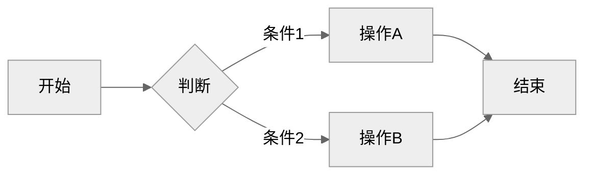
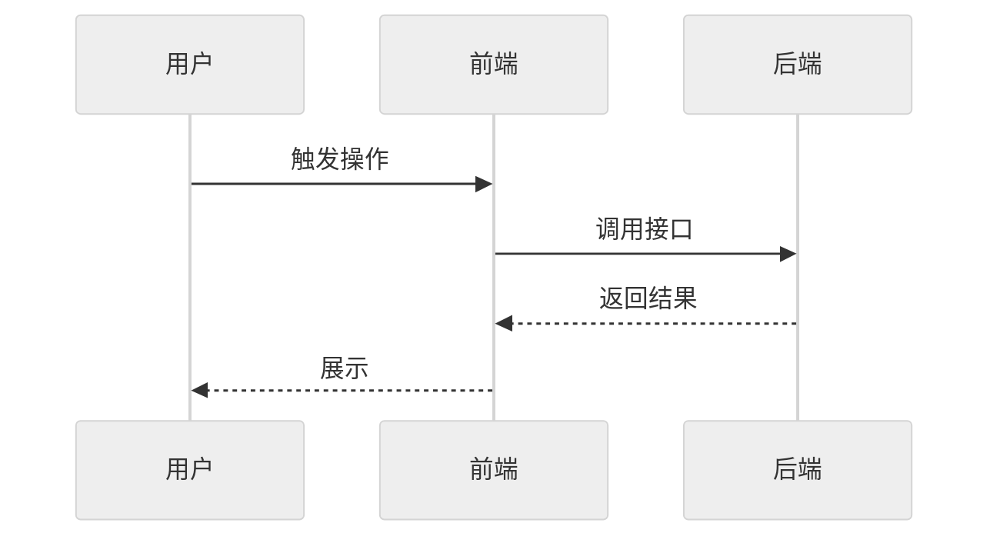
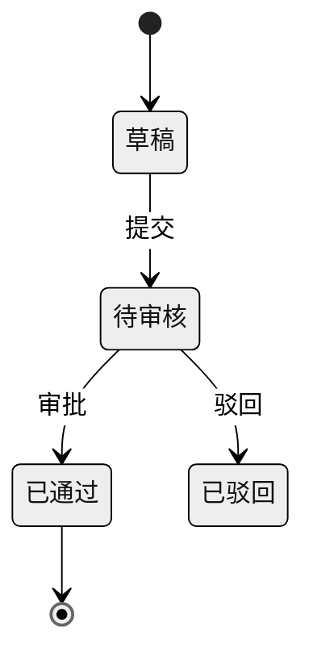

# REQ-006: 知识库一期：后台答复入库与检索作答

## 元信息

| 属性 | 值 |
|-----|-----|
| 编号 | REQ-006 |
| 类型 | 后端 |
| 状态 | 已完成 |
| 模块 | 知识问答 |
| 优先级 | P2 |
| 创建日期 | 2026-11-24 |
| 负责人 | - |
| branch | feat/REQ-006-knowledge-base |
| issue | - |
| 完成日期 | 2026-11-25 |

## 生命周期

<!-- 需求状态流转：草稿 → 待评审 → 评审通过 → 开发中 → 测试中 → 已完成 -->

- [x] 草稿（编写中）
- [x] 待评审
- [x] 评审通过
- [x] 开发中
- [x] 测试中
- [x] 已完成

---

## 一、需求描述

### 1.1 背景

灵工的定位是"能答即答，答不了转研发，结果回流知识库"（PRD 2.1、3.2.5），但知识库至今未实现：`internal/knowledge` 只有 `doc.go`，也没有知识库的表。REQ-003 的问答只查工单与版本记录，"导出报表为什么是空的""怎么配置 SSO"这类使用方法与已知问题会被判为超出范围，用户只能提交咨询工单，后台反复答复同类问题。

知识库按 AI 预审建议拆为两期：**本需求（一期）**建立知识条目的存储、检索与问答作答，知识来自后台人员答复时主动勾选入库的内容与手动新建的条目；**REQ-007（二期）**再加入模型从结案工单抽取、用户认可的回答、审核流程与未答上统计。

### 1.2 目标

- **功能目标**：后台答复工单时可选"加入知识库"（可改写为通用的问题与答案）；reviewer / admin 手动新建与维护条目；问答检索知识库作答并附知识引用；研发 Agent 经 MCP 检索知识库
- **效果目标**：后台答复过的同类咨询问题再被问到时由问答直接回答，咨询工单数量下降；知识类回答 100% 附来源；reviewer 能看到每个条目的引用次数

### 1.3 客户场景

> 记录客户提出的原始业务场景和诉求

- **场景1**：用户遇到使用问题（如导出为空、某配置项怎么填）目前都提交咨询工单，同类问题反复出现，后台每次手工答复
- **场景2**：后台希望把写过的通用答复沉淀下来，下次由问答直接回答，而不是再答一遍

### 1.4 价值

减少重复咨询与后台答复工作量；问答从"查进度"扩展到"答问题"，兑现 PRD 中知识问答 Agent 的核心定位；入库由后台人员把关，不会把面向个人的答复公开出去。

### 1.5 范围与边界

> 明确本期做什么、不做什么，防止范围蔓延

- **本期包含**：
  - 知识条目存储（迁移 `0005_knowledge.sql`）
  - 后台答复时勾选"加入知识库"入库（默认不勾，可改写问题与答案），勾选即生效
  - 手动新建、编辑、停用 / 恢复、删除、按来源工单批量停用、条目列表与引用次数（reviewer / admin）
  - 检索：全文检索（中文二元切词）+ 关键词兜底；配置向量模型时对全文检索前 50 条重排
  - 问答作答：知识类意图检索知识库作答并附知识引用，同时检索调用者可见的同类工单；无命中时引导提交咨询工单
  - MCP `search_knowledge`
- **本期不做**（REQ-007 二期）：
  - 模型从结案 Bug / 需求工单抽取知识
  - 已转研发工单上的后台评论加入知识库（本期只有待确认工单的直接答复可入库）
  - 用户对回答的"有帮助 / 没帮助"反馈与据此入库
  - 待审核流程、"可能重复"提示、未答上的问题统计
- **不做**：版本说明入知识库（版本相关问题沿用 REQ-003 的版本问答，避免两套答案）；批量导入文档 / FAQ；pgvector 加速；多语言

### 1.6 干系人

> 除了提出方，还有哪些人会因此变化受影响

| 角色 | 关注点 | 备注 |
|------|-------|------|
| 提出方（接入方） | 咨询工单减少；不引入新依赖与数据库扩展；升级只需执行迁移 | 新增迁移 0005 |
| external 用户 | 问题当场得到回答并能看到来源 | 知识由后台主动勾选并可改写，不含他人信息 |
| reviewer / admin | 答复时决定是否入库、维护知识、查看引用次数 | 范围限 `User.Projects` |
| AI 研发 Agent | 经 MCP 检索已有答复 | 只读 |

---

## 二、功能清单

> 列出所有功能点，开发完成后勾选

- [x] **知识条目存储**：迁移 `0005_knowledge.sql`，条目含问题、答案、项目、可选仓库、来源（手动 / 工单答复）与来源工单 ID、状态（已生效 / 已停用）、引用次数、创建人与更新时间、可选向量及向量模型名
- [x] **答复时入库**：后台直接答复工单（`AnswerTicket` 及 REST / MCP 对应接口）时可选"加入知识库"，可提供改写后的问题与答案（缺省为工单标题 + 正文与答复原文）；默认不入库
- [x] **维护接口**：手动新建（直接生效）、编辑、停用 / 恢复、删除、按来源工单批量停用、条目列表（按状态、引用次数、更新时间）
- [x] **检索**：全文检索（中文二元切词）+ 关键词兜底；`Model.Embed` 可用时存向量，对全文检索前 50 条按相似度重排；向量模型标识不一致或不可用时只用全文检索；条目编辑后重新生成向量；新增可选接口提供向量模型标识
- [x] **问答作答**：新增知识类意图；检索前 5 条已生效条目，并检索调用者可见的同类工单，一并交给模型依据作答；回答附知识引用（条目编号、标题；来源工单仅对能查看它的调用者返回）；引用次数 +1；无命中时引导提交咨询工单
- [x] **历史引用重新判断**：重新打开会话或作为历史送给模型时，已停用 / 删除的知识条目只保留编号
- [x] **MCP `search_knowledge`**：检索知识库，与 REST / Go 对齐
- [x] **文档**：README（中英文，含个人数据删除说明）、PRD 3.2.1 答复入库与 3.2.5 知识库、`Config` / 方法注释

---

## 三、业务规则

| 类型 | 规则 | 说明 |
|------|-----|------|
| 状态转换 | 入库须主动勾选 | 答复工单时默认不入库；勾选"加入知识库"后入库并直接生效；建议后台改写为通用的问题与答案，去掉面向个人的内容 |
| 状态转换 | 条目状态 | 已生效 ↔ 已停用；删除为物理删除；手动新建的直接生效 |
| 状态转换 | 来源变化 | 来源工单之后被合并 / 驳回时条目保留；可按来源工单 ID 批量停用（如用户要求删除个人数据） |
| 数据校验 | 内容 | 问题、答案必填，长度有上限（dev 阶段定）；入库前正则兜底清理邮箱、手机号；不存提交人身份、附件与内部讨论 |
| 权限控制 | 归属与范围 | 条目按项目归属，可关联仓库；检索与维护都限调用者 `User.Projects`，不同项目的条目互不可见 |
| 权限控制 | 可见 | 所有角色只能检索已生效条目；已停用的只有 reviewer / admin 在维护列表中可见 |
| 权限控制 | 维护 | 答复时入库、新建、编辑、停用、删除只允许 reviewer / admin |
| 数据校验 | 意图分流 | 知识类问题（使用方法、原因、怎么做）检索知识库，同时检索调用者可见的同类工单；工单进展、版本类问题沿用 REQ-003；版本相关内容不入知识库 |
| 数据校验 | 引用 | 回答只能引用检索结果中的条目编号（同 REQ-003 的防编造规则）；历史引用按条目当前状态重新判断 |
| 权限控制 | 来源工单 | 知识引用与检索结果中的来源工单只对能查看该工单的调用者（`ticket.Readable`）返回，其他人只看到知识条目本身，不暴露他人工单的存在 |
| 非功能约束 | 依赖 | 不引入新依赖、不要求数据库扩展；检索用 Go 端二元切词 + PostgreSQL 内置 GIN 数组索引（按重合度排序），向量存 `real[]`，由灵工计算相似度 |
| 非功能约束 | 向量 | 向量只用于重排全文检索前 50 条；条目记录向量模型标识，换模型后旧向量不参与重排，由后台任务重新生成；条目的问题或答案被编辑后同样重新生成；向量由 `Run` 后台扫描待生成的条目异步生成（租约防多实例重复），失败下一轮重试 |
| 非功能约束 | 向量模型标识 | `Model` 接口不提供模型名：新增可选接口（如 `EmbedModelName() string`，内置适配器实现）；未实现时以向量维度作为标识，维度不一致的向量不参与重排 |
| 非功能约束 | 性能 | 每项目 1 万条以内，单次检索的数据库部分 P95 ≤ 200ms；配置向量模型时另有一次查询向量的模型调用，出错时只用切词检索 |
| 非功能约束 | 成本 | 回答只送前 5 条、每条截断后的内容；用量计入 `GET /usage`（用途 `knowledge_answer`、`knowledge_embed`） |
| 非功能约束 | 安全 | 知识条目作为数据交给模型，不是指令；业务数据工具结果不入库 |
| 非功能约束 | 兼容 | 只新增配置、方法字段、路由与工具；`AnswerTicket` 原签名保留（入库经新增的选项）；新增迁移 0005，0001–0004 不改；未配置向量模型时只用全文检索 |

---

## 四、使用场景

### 场景1：后台答复时沉淀知识

- **角色**：reviewer
- **前置条件**：有一张待确认的咨询工单
- **基本流程**：
  1. reviewer 直接答复工单，勾选"加入知识库"，把问题改写为"导出报表为空怎么办"、答案去掉个人信息 → 工单按原流程答复并结束，同时入库一条已生效条目，关联来源工单
  2. 配置了向量模型 → worker 异步生成向量
- **异常流程**：
  - 未勾选 → 不入库（与现在一致）
  - 问题或答案为空、超长 → invalid_input，答复不执行
  - 向量化失败 → 退避重试，条目仍可被全文检索命中

### 场景2：用户提问由知识库直接作答

- **角色**：external 用户
- **前置条件**：项目内已有已生效的相关条目
- **基本流程**：
  1. 用户问"导出报表为什么是空的" → 意图解析为知识类问题
  2. 灵工在用户项目内检索已生效条目（前 5 条）与用户可见的同类工单 → 模型依据作答
  3. 回答附知识引用 → 条目引用次数 +1
- **异常流程**：
  - 无命中 → 回复"知识库里还没有相关内容"，引导提交咨询工单
  - 向量模型不可用 → 只用全文检索，照常作答
  - 引用的条目之后被停用 → 重新打开会话时引用只保留编号

### 场景3：维护知识与研发 Agent 检索

- **角色**：reviewer、AI 研发 Agent
- **基本流程**：
  1. reviewer 手动新建常见问题条目、按引用次数查看条目、停用过时条目
  2. 用户要求删除个人数据 → reviewer 按来源工单批量停用
  3. Agent 经 MCP `search_knowledge` 检索 → 返回已生效条目与来源
- **异常流程**：
  - 非 reviewer / admin 维护 → forbidden
  - 条目不在调用者项目内 → not_found

---

## 五、数据与交互

> 根据需求类型填写不同内容：
> - **后端 / 全栈**：描述需要的接口能力和业务语义，技术方案在 `/rd:dev` 阶段生成
> - **前端**：描述页面交互逻辑，`/rd:dev` 阶段自动匹配后端接口

### 后端/全栈：接口需求

| 能力 | 输入 | 输出 | 说明 |
|------|------|------|------|
| 答复并入库 | 工单 ID、答复、加入知识库（可选问题 / 答案） | 工单 | 扩展现有答复接口（Go / REST / MCP），默认不入库 |
| 检索知识 | 问题或关键词、项目、条数 | 已生效条目（含来源） | Go / REST / MCP `search_knowledge`；所有角色 |
| 新建 / 编辑条目 | 项目、可选仓库、问题、答案 | 条目 | reviewer / admin；新建直接生效 |
| 停用 / 恢复 / 删除 | 条目 ID | 结果 | reviewer / admin |
| 按来源停用 | 来源工单 ID | 停用条数 | reviewer / admin |
| 条目列表 | 项目、状态、排序（引用次数 / 更新时间）、游标 | 条目列表（含引用次数） | reviewer / admin |
| 问答作答 | 现有提问接口 | 回答 + 知识引用 | 意图新增知识类；`Citations` 新增知识条目 |

### 前端：交互逻辑

> 按页面/模块描述用户操作和数据流转，不指定具体接口

**页面：无**（灵工不提供前端，界面由接入方实现）

| 操作/区域 | 用户行为 | 数据需求 | 交互反馈 |
|----------|---------|---------|---------|
| - | - | - | - |

---

## 六、测试要点

### 6.1 技术测试

> 2026-11-25 /rd:test：单测 `internal/knowledge/knowledge_test.go`；集成 `tests/knowledge_test.go`（TestKnowledgeAnswerMaintainAndSearch、TestKnowledgeVectorRerank、TestKnowledgeAssistant、TestKnowledgeMigrationIncremental）与 `TestMigrateFreshAndIdempotent`；全量单测与集成测试通过

- [x] 迁移 0005 在空库与已执行 0001–0004 的库上都能执行
- [x] 答复时勾选入库：条目直接生效并关联来源工单；改写的问题 / 答案生效；未勾选不入库；空 / 超长返回 invalid_input 且答复不执行
- [x] 正则兜底：条目中的邮箱、手机号被清理
- [x] 维护：新建 / 编辑 / 停用 / 恢复 / 删除 / 按来源停用正确；非 reviewer / admin 返回 forbidden
- [x] 权限：不同项目的条目互不可见；已停用条目不参与检索，external 不可见
- [x] 检索：中文全文检索能命中；配置向量模型时重排前 50 条；向量模型不可用或标识不一致时退回全文检索；条目编辑后向量重新生成；未实现模型标识接口时按维度判断
- [x] 来源工单：引用与检索结果中的来源工单只对能查看它的调用者返回，external 看不到他人工单编号
- [x] 问答：知识类问题作答并附知识引用，引用次数 +1；同时引用可见的同类工单；无命中时引导提交咨询工单；回答引用检索结果外的编号时改用按数据生成的回答
- [x] 意图分流：工单进展、版本类问题仍走 REQ-003 的逻辑
- [x] 历史引用：条目停用 / 删除后，消息列表与送给模型的历史中只保留编号
- [x] 安全：条目中的"忽略上述指令"等内容不改变助手行为（以脚本模型验证条目只作为"数据"传入、回答提示含忽略指令规则；真实模型的遵循程度依赖提示词）
- [x] REST 与 MCP `search_knowledge` 与 Go 方法结果一致；用量按用途计入 `GET /usage`
- [x] 不使用知识库时现有问答与工单流程不变（回归）

### 6.2 验收标准

> 产品/业务方验收时的确认项，描述可观测的业务结果

- [x] 后台答复时勾选入库的问题，再被问到时问答直接给出答复并注明来源
- [x] 知识库没有相关内容时，问答不编造，引导提交咨询工单
- [x] reviewer 能新建、编辑、停用条目，并看到每个条目的引用次数
- [x] 未勾选入库的答复不会出现在任何其他用户的回答中

### 6.3 手动测试用例

> 执行 `/rd:test_new REQ-XXX --type=manual` 生成，供测试人员逐条复测

_待生成_

---

## 七、图示（可选）

> 用 Mermaid 绘制，GitHub/Gitea 原生渲染。主题建议统一用 `neutral`（打印友好、明暗模式兼容）。
> 无图可删除本节，按需保留下方子节。

### 7.1 流程图（业务流程、用户操作路径）

### 7.2 时序图（接口调用链、前后端交互）

### 7.3 ER 图 / 状态图（按需）

---

## 八、评审记录

| 日期 | 评审人 | 结论 | 意见 |
|-----|-------|------|------|
| 2026-11-24 | AI 预审 | 预审未提审 | 阻塞：来源 a 直接生效会把用户原文与面向个人的答复公开给项目内所有用户。建议：拆两期；意图分流；向量只重排全文前 N 条并记录向量模型；版本说明与 REQ-003 版本问答重复；未答上提问的脱敏、保留期与归并；补权限 / 降级 / 历史引用测试 |
| 2026-11-24 | AI 预审 | 提审 | 无阻塞项。建议：①知识引用中的来源工单只对能查看该工单的调用者返回；②条目编辑后重新生成向量；③向量模型名的来源（Model 接口不提供模型名，需新增可选接口或配置）。信息：AnswerTicket 只用于待确认工单，已转研发工单的后台评论不在本期入库范围 |
| 2026-11-24 | haiqing | 通过 | 预审建议已全部采纳；二期见 REQ-007 |

---

## 九、变更记录

| 日期 | 变更内容 | 影响范围 |
|-----|---------|---------|
| 2026-11-24 | 初始版本：四类来源入库（按来源审核）、审核维护、全文 + 可选向量检索、问答作答与反馈、MCP search_knowledge | 一~六、十 |
| 2026-11-24 | 按 AI 预审拆为两期：本需求为一期（答复时勾选入库、手动维护、检索作答、MCP），模型抽取 / 用户反馈 / 审核 / 未答上统计移至 REQ-007；去掉版本说明入库；补意图分流、向量重排与模型名、历史引用、按来源停用 | 一~六、十 |
| 2026-11-24 | 采纳第二次 AI 预审建议：来源工单按查看权限返回、编辑后重新生成向量、向量模型标识的来源；二期范围补充"已转研发工单的后台评论入库" | 一、二、三、六、十 |
| 2026-11-24 | 开发中确认：检索改用二元切词 + GIN 数组索引（不依赖 tsvector 解析器的区域设置）；向量由 Run 扫描待生成条目（租约）而非 outbox；P95 只计数据库部分；知识条目在回答中写作 K编号 | 三、十一 |

---

## 十、关联信息

- **关联需求**：REQ-007（知识库二期：模型抽取、用户反馈、审核与未答上统计，依赖本需求）；REQ-003（知识问答：扩展意图与引用）；REQ-005（模型连接配置）
- **相关文档**：PRD 2.1、3.2.0.5（业务数据不入知识库）、3.2.0.6（数据隔离）、3.2.1（答复可入知识库）、3.2.5 知识库
- **假设**：每个项目知识条目在 1 万条以内；PostgreSQL 内置全文检索配合二元切词对中文的召回可接受（验收时用真实问题集评估）
- **外部依赖**：接入方提供的 `Model`（作答）；可选的 `Embed`（DeepSeek 适配器无向量接口，OpenAI 适配器需配置 `EmbeddingModel`）；可选的向量模型标识接口（内置适配器实现，接入方自定义 Model 可不实现）
- **风险项**：中文检索召回不足（二元切词 + 关键词兜底，可选向量重排）；知识过时（带更新时间，reviewer 停用）；后台勾选入库时未去掉个人内容（界面提示改写，正则兜底，可按来源批量停用）；用户要求删除个人数据时派生的条目需按来源停用（README 说明）；新增迁移 0005，接入方升级须执行 `lingo.Migrate`

---

## 十一、实现方案

> 本章节在 `/rd:dev` 阶段由 AI 分析代码后自动生成，创建需求时无需填写。

### 11.1 数据模型

新增迁移 `0005_knowledge.sql`：表 `lingo_knowledge`——`project_id`、`repo_id`（可空）、`question`、`answer`、`source`（`manual` / `ticket_answer`）、`source_ticket_id`（可空，工单删除时置空）、`status`（`active` / `disabled`）、`cite_count`、`search_tokens`（`text[]`，Go 端二元切词，GIN 索引，仅已生效）、`embedding`（`real[]`，为空表示待生成）、`embed_model`、`embed_locked_until`（生成向量的租约）、`created_by` / `updated_by` / `created_at` / `updated_at`。

### 11.2 API 设计

> 基于第五章接口需求，结合项目代码和 CLAUDE.md API 风格，生成具体技术方案

- **Go**：`AnswerTicketWith(ctx, u, id, TicketAnswer{Answer, Knowledge *KnowledgeDraft})`（`AnswerTicket` 不变）；`SearchKnowledge(ctx, u, query, project, limit)`；`ListKnowledge(ctx, u, KnowledgeFilter{Project, Status, Sort, Offset, Limit})`；`CreateKnowledge` / `UpdateKnowledge` / `DisableKnowledge` / `EnableKnowledge` / `DeleteKnowledge` / `DisableKnowledgeByTicket`；类型 `KnowledgeEntry`、`KnowledgeDraft`、`KnowledgeCitation`（`Citations.Knowledge`）；可选接口 `EmbeddingModelNamer`（内置 OpenAI / DeepSeek 适配器实现）
- **REST**：`POST /tickets/{id}/answer` 可带 `knowledge`；`GET /knowledge/search`；`GET` / `POST /knowledge`；`PUT` / `DELETE /knowledge/{id}`；`POST /knowledge/{id}/disable|enable`；`POST /knowledge/disable-by-ticket`
- **MCP**：`search_knowledge`；`answer_ticket` 新增 `add_to_knowledge`、`knowledge_question`、`knowledge_answer`
- **检索**：切词重合度（重合词数 / √条目词数）取前 50 条，无命中时关键词 ILIKE 兜底；向量可用时综合分 = 0.5×归一化重合度 + 0.5×余弦相似度（向量模型标识不一致的以重合度代替）
- **问答**：意图 `knowledge_ask`；事实 `kind: knowledge`（知识条目写作 K编号）+ 同类工单；防编造同时校验 `#N` 与 `K{N}`；用量 `knowledge_answer`；引用次数 +1；历史引用（消息列表与送给模型的历史）按条目当前状态与来源工单可读性重新判断
- **向量**：`Run` 每 30 秒（新建 / 编辑后立即）领取待生成条目（每批 16 条，租约 2 分钟），保存时校验 `updated_at` 未变；用量 `knowledge_embed`

### 11.3 文件改动清单

| 层 | 文件 |
|---|---|
| 迁移 | `migrations/0005_knowledge.sql`（新） |
| knowledge | `internal/knowledge/{doc,knowledge,tokenize}.go`、`knowledge_test.go`（新） |
| ticket | `internal/ticket/service.go`（`AnswerWith`） |
| store | `internal/store/knowledge.go`（新） |
| assistant | `assistant.go`、`query.go`、`turn.go`、`reply.go`、`conversation.go` |
| llm | `assistant.go`（意图、回答提示、用量类别）、`openai.go`（`EmbeddingModelName`） |
| 根包 | `knowledge.go`（新）、`lingo.go`、`assistant.go`、`models.go`、`handler.go`、`mcp_tools.go` |
| 测试 | `tests/knowledge_test.go`（新）、`tests/migrate_test.go` |
| 文档 | `README.md`、`README.zh-CN.md`、PRD（3.2.5、MCP 工具、数据模型、v1.31）、`docs/architecture/overview.md` |

### 11.4 实现步骤

1. 迁移 0005；knowledge 领域层（切词、脱敏校验、维护、检索与重排、向量生成）；store
2. `ticket.AnswerWith`；assistant 知识意图、事实、引用与历史重新判断；llm 提示词与用量
3. 根包公开 API、REST、MCP、向量生成循环
4. 单测、集成测试与文档
