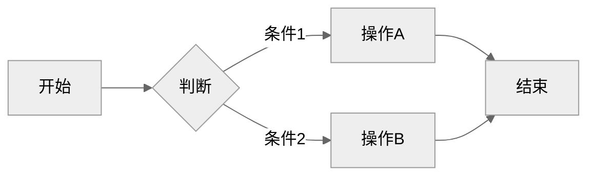
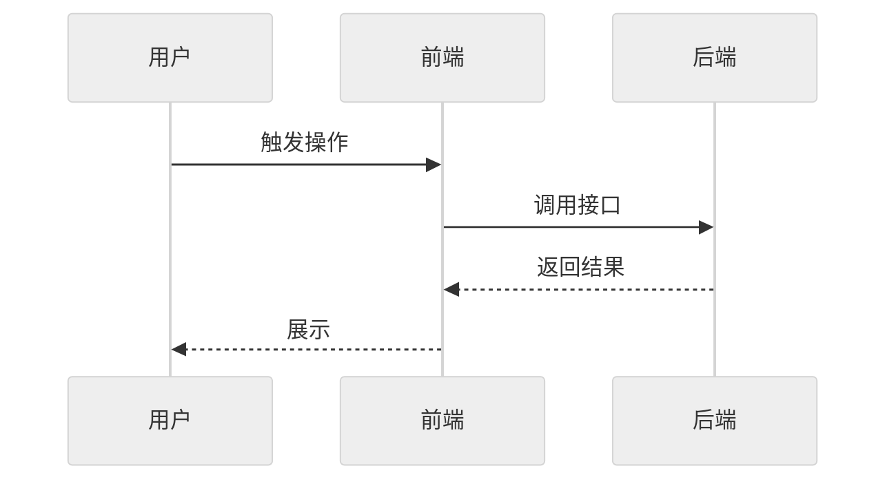
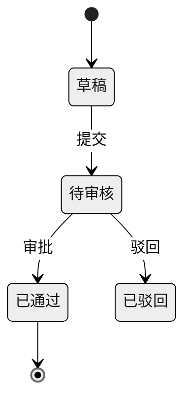

# REQ-008: 业务数据 Tool：以用户权限代查业务数据

## 元信息

| 属性 | 值 |
|-----|-----|
| 编号 | REQ-008 |
| 类型 | 后端 |
| 状态 | 已完成 |
| 模块 | 知识问答 |
| 优先级 | P2 |
| 创建日期 | 2026-11-25 |
| 负责人 | - |
| branch | feat/REQ-008-business-data-tools |
| issue | - |
| 完成日期 | 2026-11-25 |

## 生命周期

<!-- 需求状态流转：草稿 → 待评审 → 评审通过 → 开发中 → 测试中 → 已完成 -->

- [x] 草稿（编写中）
- [x] 待评审
- [x] 评审通过
- [x] 开发中
- [x] 测试中
- [x] 已完成

---

## 一、需求描述

### 1.1 背景

PRD 3.2.0.5 规划了"基于人员权限的业务数据请求"：问答时灵工以提问人员的身份调用接入方注册的业务数据工具，查到数据后回答。根包已有公开类型 `lingo.Tool`（`Name`、`Description`、`InputSchema`、`Scope`、`Mode`、`Sensitive`、`Call`）、`Config.Tools` 与 `User.Scopes`，但**没有任何代码使用**——接入方注册了工具也不会被调用。知识问答目前只能回答工单、版本与知识类问题，"订单 1024 为什么审批失败""我的请假余额还有几天"这类需要业务系统数据的问题答不了，用户只能截图或提工单。

本需求接通只读（`read`）工具：问答、MCP 与 Go 方法以提问人员的身份调用，灵工预校验权限、脱敏、审计与熔断，原始结果只用于本次回答、不留存。操作类（`write`）工具与转工单时附带业务数据留待后续需求。

### 1.2 目标

- **功能目标**：问答中按需调用当前用户有权限的只读工具并基于结果作答；MCP 暴露并可调用这些工具；Go 方法直接调用；每次调用先留审计记录再执行，可按权限查询
- **效果目标**：需要业务数据的常见问题在问答中直接得到回答，减少截图与咨询工单；任何调用都可追溯到人员、工具与结果状态；升级本版本不会因工具配置导致启动失败

### 1.3 客户场景

> 记录客户提出的原始业务场景和诉求

- **场景1**：用户问"我昨天提交的订单 1024 为什么审批失败"，希望灵工直接查到订单状态与失败原因来回答
- **场景2**：员工问"我的请假余额还有几天"，希望按本人身份查到余额，而不是去另一个系统查

### 1.4 价值

问答能回答业务数据类问题，覆盖面从"工单与知识"扩展到接入方自己的业务；权限沿用接入方的用户体系，灵工不持有超越用户本人的权限；审计让每次取数都可追溯，且审计本身按人员与明确授权的项目隔离。

### 1.5 范围与边界

> 明确本期做什么、不做什么，防止范围蔓延

- **本期包含**：
  - `Config.Tools` 的注册校验：不合格的工具忽略并告警，不影响启动，不覆盖内置或先注册的有效工具
  - 问答新增业务数据意图：模型从可调用的工具中选一个并填参数，灵工校验后调用并据结果作答（每次提问最多一个工具）
  - MCP：`tools/list` 列出当前用户可调用的业务工具，`tools/call` 调用
  - Go 方法 `CallTool`
  - 审计归属项目由工具结果声明：`Call` 可返回 `lingo.ToolOutput{Project, Data}` 声明所查数据的实际归属项目
  - 权限预校验、参数轻量校验、`Sensitive` 脱敏、结果截断、超时与并发上限、熔断
  - 审计表与查询接口（先写后调、按本人与明确授权的项目隔离、保留 180 天）
- **本期不做**：
  - `write` 类工具（确认、幂等）
  - 转工单时附带业务数据
  - 按项目限定工具（工具本身不属于项目）
  - 推断审计归属项目（不依据模型解析、调用人可访问的项目或调用入口推断）
  - 跨实例共享熔断与并发状态
  - 完整 JSON Schema 校验
  - 改变其他模块中"`User.Projects` 为空表示不限制"的现有语义

### 1.6 干系人

> 除了提出方，还有哪些人会因此变化受影响

| 角色 | 关注点 | 备注 |
|------|-------|------|
| 提出方（接入方） | 注册工具简单；配置错误不导致启动失败；权限仍由业务侧控制；能审计 | `Call` 内必须按传入用户二次鉴权，并响应 ctx 取消 |
| external 用户 | 在问答中直接查到本人的业务数据 | 只能用 `User.Scopes` 覆盖的工具；可查本人的调用记录 |
| reviewer / admin | 审计自己明确负责的项目内的调用 | 只看 `User.Projects` 明确列出的项目；`Projects` 为空不授予跨用户审计；审计只含摘要 |
| AI 研发 Agent / 接入方 AI 客户端 | 经 MCP 调用业务工具 | 同样受权限、脱敏、审计约束；工具结果未声明归属的记录仅本人可见，仍保留审计 |

---

## 二、功能清单

> 列出所有功能点，开发完成后勾选

- [x] **工具注册校验**：`New` 逐个校验 `Config.Tools`——名称非空、只含字母 / 数字 / 下划线且不超过 64 字符；`Mode` 为 `read`；`Scope` 非空；`InputSchema` 为合法 JSON 对象；`Call` 非空；`Timeout` 不为负且不超过 60 秒。不满足的工具**忽略并记 Warn**（只含序号、名称与原因代码），`New` 不因此失败；与内置 MCP 工具或先注册的有效工具同名（不区分大小写）时忽略后者，**不覆盖**任何已有工具；`Tool` 新增可选的 `Timeout`（0 表示默认 10 秒，上限 60 秒）
- [x] **工具调用核心**：权限预校验（`User.Scopes` 含 `Tool.Scope`）、参数轻量校验（必填与基本类型）、以当前用户调用 `Call`（默认超时 10 秒）、并发上限（超时未退出的调用仍占用名额）、按 `Sensitive` 路径脱敏、结果截断到 8KB、熔断（5 分钟内连续失败 5 次暂停 1 分钟，之后放行一次试探）
- [x] **审计**：迁移 `0007_data_requests.sql`；调用前先写带租约的"待完成"记录，写入失败则不调用；记录调用人、归属项目（可空，只取工具结果的声明）、工具、入口、参数摘要、结果状态与原因、耗时、时间；保留 180 天，`Run` 定期清理，并只把租约已过期的待完成记录标为中断；新增公开类型 `ToolOutput{Project, Data}` 供 `Call` 声明归属
- [x] **问答意图**：意图解析时提供当前用户可调用的工具清单（最多 30 个、描述截断 300 字）；新增业务数据意图，模型选择工具并给出参数；结果作为数据交给模型作答；引用中只记工具名；没有可调用工具时意图解析与 v0.8.0 完全一致
- [x] **MCP**：`tools/list` 合并列出当前用户可调用的业务工具；`tools/call` 调用并返回脱敏结果；看不到的工具与不存在的工具返回相同错误
- [x] **Go 方法 `CallTool`**：接入方界面直接调用，规则同上（不接受调用方指定归属项目）
- [x] **审计查询**：`ListDataRequests`（REST `GET /data-requests`）：所有人看本人记录；reviewer / admin 另可看归属项目在其 `User.Projects` 中明确列出的记录；可按工具、用户、时间、状态筛选
- [x] **文档**：README（中英文，含 `Call` 必须二次鉴权、必须响应 ctx、错误不应携带业务数据、模型合规提醒、被忽略工具的告警说明）、PRD 3.2.0.5 与数据模型、`Tool` / `Config.Tools` 注释

---

## 三、业务规则

| 类型 | 规则 | 说明 |
|------|-----|------|
| 数据校验 | 注册 | 名称非空、只含字母数字下划线、不超过 64 字符；`Mode` 为 `read`；`Scope` 非空；`InputSchema` 为合法 JSON 对象；`Call` 非空；`Timeout` 不为负且不超过 60 秒；`Scope` 不含空白或控制字符（含首尾空格）。不满足时忽略该工具并记 Warn，`New` 照常成功 |
| 数据校验 | 不覆盖 | 与内置 MCP 工具同名、或与先注册的有效工具同名（不区分大小写）时忽略后注册的；被忽略的工具对任何人不可见、不可调用，不影响内置工具与已接受工具的行为 |
| 权限控制 | 预校验 | 调用前校验 `User.Scopes` 含 `Tool.Scope`；不满足时不调用，问答中模型也看不到该工具；`Scope` 为空的工具在注册时已被忽略，不存在"所有人可用"的工具 |
| 权限控制 | 代用户调用 | `Call` 收到当前 `lingo.User`，业务侧必须在 `Call` 内按该用户鉴权与过滤数据；灵工的 `Scope` 预校验只是第一道防线，不使用超级账号、不提升身份 |
| 权限控制 | 无权限与不存在 | MCP / Go 调用无权限或不存在的工具返回同一错误（not_found），不说明工具是否存在及其用途；MCP 对无权调用同样写拒绝审计 |
| 数据校验 | 参数 | 校验 `InputSchema` 中的 `required` 与 `properties` 的基本类型（string / number / integer / boolean）；输入必须整体是一个完整、合法的 JSON 对象（对象之后不能再有其他内容），否则按参数不合法处理、不调用 `Call`；`integer` 与 Go 标准库解码到整型的规则一致：只接受十进制整数写法且在 int64 范围内（`3.0`、`1e3` 不接受）；多个参数不合法时按参数名顺序报第一个；不做类型转换。缺少参数时问答请用户补充，类型不符时明确提示格式不对；MCP / Go 返回 invalid_input；错误信息只含参数名与期望类型，不含参数值 |
| 数据校验 | 脱敏 | `Sensitive` 为字段路径（如 `phone`、`customer.phone`、`items.*.price`），结果与审计参数摘要中匹配到的值替换为 `***`；字段名不区分大小写（默认安全） |
| 数据校验 | 截断 | 结果序列化为 JSON 后超过 8KB 时在字符边界截断（问答与 MCP 均标注已截断） |
| 状态转换 | 熔断 | 同一工具 5 分钟内连续失败 5 次（调用错误、超时、panic、编码失败计为技术故障；拒绝、参数错误、归属拒绝与业务结果不计）后暂停 1 分钟并记 Warn；暂停期间返回"暂时不可用"；暂停结束后放行一次试探，成功恢复、失败再暂停 1 分钟；成功调用清零计数；暂停前已在途的调用晚到的结果不计入，不影响试探；结果编码或脱敏失败计为失败；状态只在当前实例内存中 |
| 状态转换 | 业务结果 | `Call` 返回（可包装的）`ErrNotFound` 表示查无数据、`ErrForbidden` 表示业务侧按调用人拒绝：属于正常业务结果，记入审计（拒绝，原因 `no_data` / `business_denied`，只记参数名），不计入熔断（试探时交还试探名额），调用方得到与工具不存在相同的结果；其他错误视为技术故障，计入熔断；仍按工具熔断 |
| 非功能约束 | 超时 | 默认 10 秒，`Tool.Timeout` 可单独配置，上限 60 秒；为 0 时用默认值，为负或超过 60 秒时按注册规则忽略该工具并记 Warn（不截到 60 秒）；超时即返回错误，不等待 `Call` 退出；时限到达后才取到的结果一律按超时丢弃 |
| 非功能约束 | 资源约束 | 每个工具同时最多 8 个、全部工具合计最多 64 个调用在途（本期为固定上限，不提供配置）；超时后仍未退出的 `Call` 继续占用名额直到真正返回，其迟到的结果直接丢弃、不交给模型或客户端；名额用尽时不调用、返回"暂时不可用"并记审计；文档要求 `Call` 响应 ctx 取消 |
| 数据校验 | 问答 | 每次提问最多调用一个工具；工具清单最多 30 个、描述截断 300 字；模型给出的工具不在清单内时按追问处理；`Call` 失败如实说明查询失败，不编造数据 |
| 数据校验 | 留存 | 原始结果只用于本次回答：不写入会话、知识库、审计与日志；助手回答正文按现有规则作为会话消息保留；引用只记工具名 |
| 数据校验 | 知识回流 | 业务数据类回答被标为有帮助时不生成知识候选，也不计入"未答上的问题"（REQ-007 规则只作用于知识类问题） |
| 权限控制 | 审计归属 | 归属项目只取可信接入方上下文对**实际所查数据**的确认：`Call` 返回 `ToolOutput` 并声明 `Project`。模型解析出的项目、调用人可访问的项目、调用入口（问答 / MCP / Go）都不作为归属依据；`CallTool` 不接受调用方指定归属。未声明归属的记录归属为空，仍完整记录审计 |
| 权限控制 | 归属拒绝 | 声明的归属项目不是已配置项目，或调用人无权访问该项目（`User.Projects` 非空且不含该项目）时：丢弃结果、不交给模型或客户端；对用户与客户端返回与工具不存在相同的 not_found，不区分"项目不存在"与"无权访问"；审计记为拒绝（原因 forbidden），归属为空、参数摘要只含参数名；`User.Projects` 为空的调用人按其他模块的现有语义视为可访问 |
| 权限控制 | 审计可见 | 所有角色可看本人记录；reviewer / admin 另可看归属项目在其 `User.Projects` 中**明确列出**的记录；`User.Projects` 为空不授予任何跨用户审计；归属为空的记录（含所有未声明归属的问答、MCP、Go 调用）只有本人可见；按用户筛选他人时只返回上述范围内的记录，不暴露范围外记录是否存在；其他模块中 `Projects` 为空表示不限制的语义不变 |
| 非功能约束 | 审计内容 | 人员 ID 与角色、归属项目、工具名、入口（问答 / MCP / Go）、参数摘要、结果状态与原因、耗时、时间；不含结果与错误原文；保留 180 天（按数据库时钟清理）。参数摘要只含 `InputSchema` 声明的参数，未声明的字段不记录名称与值（工具不存在时不记参数）：成功、错误与不可用的记录含参数名与截断到 32 字的值（经 `Sensitive` 脱敏）；**拒绝记录**（不存在、无权限、参数不合法、归属拒绝）只含参数名，不含参数值 |
| 非功能约束 | 审计先行 | 调用前写入"待完成"记录，写入失败时不调用并返回"暂时不可用"；调用后（含超时到点时）更新为最终状态，更新失败只记日志、不影响本次结果 |
| 状态转换 | 中断恢复 | 待完成记录带租约：到期时间 = 写入时的数据库时间 + 该工具超时 + 2 分钟（全程用数据库时间，不依赖各实例时钟）。执行实例最迟在超时到点时结束待完成状态，超时后仍未退出的 `Call` 不再处于待完成；`Run` 只把租约已过期的待完成记录标为中断，不触碰任何租约未过期的记录，因此不会误标其他实例仍在执行的调用；多实例并发标记时以条件更新保证每条只标一次 |
| 非功能约束 | 日志与错误 | 日志、审计与返回给用户 / 客户端的错误都不包含参数值、原始结果、`Call` 返回的错误原文、panic 内容与数据库错误详情；只记工具名、原因代码、耗时与审计编号（数据库错误只记错误码） |
| 非功能约束 | 安全 | 工具结果作为数据交给模型，不是指令 |
| 非功能约束 | 依赖 | 不引入 JSON Schema 校验库 |
| 非功能约束 | 兼容 | 只新增字段、方法、路由与迁移 0007；不注册工具时问答与 MCP 行为与 v0.8.0 一致；**行为变化**：已注册的合格 `read` 工具开始被调用、不合格的工具被忽略并告警（需在版本说明中说明） |

---

## 四、使用场景

### 场景1：问答中查业务数据

- **角色**：external 用户（`User.Scopes` 含 `order:read`）
- **前置条件**：接入方注册了 `get_order`（`Scope: order:read`，`InputSchema` 要求 `order_id`，`Sensitive: ["customer.phone"]`）
- **基本流程**：
  1. 用户问"订单 1024 为什么审批失败" → 意图解析看到可调用工具清单，返回调用 `get_order`、参数 `{"order_id":"1024"}`
  2. 灵工校验权限与参数 → 写待完成审计 → 以当前用户调用 `Call` → 脱敏、截断 → 更新审计
  3. 模型依据结果作答"订单 1024 在财务审批环节被退回，原因是发票抬头不符"，引用中列出 `get_order`；会话中只保存回答正文与工具名
- **异常流程**：
  - 缺少订单号 → 追问"请提供订单号"
  - `Call` 返回错误或超时 → "查询业务数据失败，请稍后再试"，审计记错误原因代码，不记错误原文
  - 工具已熔断或在途调用已满 → "该查询暂时不可用"
  - 审计写入失败 → 不调用，"该查询暂时不可用"
  - 用户没有 `order:read` → 模型看不到该工具，按其他意图处理

### 场景2：MCP 调用

- **角色**：AI 研发 Agent 或接入方 AI 客户端
- **基本流程**：
  1. `tools/list` → 内置工具 + 当前用户可调用的业务工具
  2. `tools/call get_leave_balance` → 同样校验、脱敏、审计（工具结果未声明归属时归属为空），返回结果
- **异常流程**：
  - 无权限 / 不存在 → 返回相同错误，不暴露工具用途
  - 参数不合法 → invalid_input，只说明参数名与期望类型

### 场景3：查看审计

- **角色**：reviewer / admin、external 用户
- **基本流程**：
  1. `get_order` 的 `Call` 返回 `ToolOutput{Project: "crm", Data: 订单}`；`User.Projects` 为 `["crm"]` 的 reviewer 调 `ListDataRequests` 按工具与时间筛选 → 看到本人记录与归属 `crm` 的调用摘要
  2. 用户调同一接口 → 只看到本人的调用
- **异常流程**：
  - `User.Projects` 为空的 reviewer → 只看到本人记录
  - 按用户筛选范围外的人员 → 返回空列表
  - 工具声明的归属项目调用人无权访问 → 用户得到与工具不存在相同的错误，审计记拒绝、归属为空、只含参数名
  - 超过 180 天的记录已清理

### 场景4：注册配置有误

- **角色**：接入方
- **基本流程**：
  1. `Config.Tools` 中有一个 `write` 工具、一个 `Scope` 为空的工具、一个与内置工具同名的工具
  2. `New` 成功返回，为三个工具各记一条 Warn（序号、名称、原因代码）；其余合格工具与内置工具正常可用
- **异常流程**：
  - 两个同名的合格工具 → 保留先注册的，后者忽略并告警

---

## 五、数据与交互

> 根据需求类型填写不同内容：
> - **后端 / 全栈**：描述需要的接口能力和业务语义，技术方案在 `/rd:dev` 阶段生成
> - **前端**：描述页面交互逻辑，`/rd:dev` 阶段自动匹配后端接口

### 后端/全栈：接口需求

| 能力 | 输入 | 输出 | 说明 |
|------|------|------|------|
| 注册工具 | `Config.Tools` | 被接受的工具；被忽略的记 Warn | 已有类型，新增 `Timeout`；`New` 不因工具配置失败 |
| 调用工具 | 用户、工具名、参数 | 脱敏结果（可能截断） | Go `CallTool`；MCP `tools/call`；`Call` 可返回新类型 `ToolOutput{Project, Data}` 声明所查数据的归属项目 |
| 列出可用工具 | 用户 | 工具名、描述、参数格式 | MCP `tools/list` 合并内置工具 |
| 问答作答 | 现有提问接口 | 回答 + 工具引用 | 意图新增业务数据；`Citations` 新增工具名 |
| 查询审计 | 工具、用户、时间范围、状态、游标 | 审计摘要列表 | Go `ListDataRequests`、REST `GET /data-requests`；按本人与明确授权的项目过滤 |

### 前端：交互逻辑

> 按页面/模块描述用户操作和数据流转，不指定具体接口

**页面：无**（灵工不提供前端，界面由接入方实现）

| 操作/区域 | 用户行为 | 数据需求 | 交互反馈 |
|----------|---------|---------|---------|
| - | - | - | - |

---

## 六、测试要点

### 6.1 技术测试

- [x] 注册：空名、非法字符、超长名、`write`、空 `Scope`、非法 `InputSchema`、空 `Call`、`Timeout` 为负或超过 60 秒时该工具被忽略并记 Warn（`Timeout` 恰为 60 秒时接受，为 0 时按 10 秒），`New` 成功；Warn 内容不含 Schema 与 `Call` 信息
- [x] 不覆盖：与内置 MCP 工具同名（含大小写不同）、与先注册的有效工具同名时，内置工具与先注册工具的列出与调用结果不变
- [x] 权限：`Scopes` 不含 `Scope` 时不调用；问答中模型看不到无权限工具；MCP `tools/list` 只列可调用的；无权限与不存在返回相同错误
- [x] 代用户调用：`Call` 收到的是当前用户
- [x] 参数校验：缺必填、类型不符返回 invalid_input，错误信息不含参数值；问答中追问
- [x] 脱敏：简单字段、嵌套路径、数组通配都替换为 `***`；审计参数摘要同样脱敏
- [x] 截断：超过 8KB 时在字符边界截断并标注
- [x] 超时：超过 `Timeout`（默认 10 秒）按时返回错误并记审计；不响应 ctx 的 `Call` 持续占用并发名额直到返回，迟到结果被丢弃；名额用尽时返回"暂时不可用"且不调用
- [x] 业务结果：`Call` 返回 `ErrNotFound` / `ErrForbidden` 时记入审计（拒绝）、不计入熔断、对外与不存在相同；技术故障照常计入
- [x] MCP 无权调用写拒绝审计，响应与不存在相同；参数类型不符时追问说明格式不对；`Scope` 含空白时忽略并告警；`integer` 与 Go 整型解码一致（不接受 `3.0`）；输入须为完整的单个 JSON 对象；脱敏字段名不区分大小写；清理按数据库时钟
- [x] 熔断：连续失败 5 次后暂停，期间返回"暂时不可用"；暂停结束后试探成功恢复、失败再暂停；拒绝与参数错误不计失败
- [x] 问答：业务数据意图调用工具并据结果作答，引用含工具名；会话中只有回答正文与工具名、没有原始结果；模型给出清单外的工具时追问；`Call` 失败时如实说明
- [x] 知识回流：业务数据类回答标为有帮助不生成知识候选，未命中不计入未答上的问题
- [x] 审计：成功 / 拒绝 / 错误 / 不可用都有记录，不含结果与错误原文；拒绝记录只含参数名、不含参数值；待完成记录写入失败时不调用；180 天清理
- [x] 审计更新失败：调用后更新审计失败时，本次结果照常返回，只记不含原文的日志，记录保持待完成直到租约过期
- [x] 中断恢复：租约过期的待完成记录被标为中断；租约未过期的记录（模拟另一实例正在执行、含长 `Timeout` 工具）不被标记；两个实例同时执行恢复时每条只标一次
- [x] 审计归属：未返回 `ToolOutput` 或未声明 `Project` 时归属为空；模型解析出的项目、调用人可访问的项目都不会写入归属
- [x] 归属拒绝：声明未配置的项目与声明调用人无权访问的项目，返回内容完全相同（与工具不存在一致）、结果被丢弃、不交给模型；审计记拒绝、归属为空、只含参数名；不计入熔断
- [x] 审计权限边界：本人可见；reviewer / admin 只见归属项目在其 `Projects` 明确列出的记录；`Projects` 为空的 reviewer / admin 只见本人；归属为空的记录只本人可见；按用户筛选范围外人员返回空；external / agent 看不到他人记录
- [x] 日志与错误：`Call` 返回含敏感内容的错误、panic、数据库报错时，日志、审计与返回内容都不含其原文、参数值或结果
- [ ] 安全：结果中的"忽略上述指令"等内容作为数据，不改变助手行为（未实测：需真实模型验证，本地不具备条件；已验证：结果只以数据块传入、回答提示词含防注入规则、脚本化模型下行为不变）
- [x] 迁移 0007 在已执行 0001–0006 的库上增量执行，重复执行幂等
- [x] 回归：不注册工具（或全部被忽略）时，意图解析发给模型的内容、MCP `tools/list` 的工具集合与内容、`tools/call` 内置工具结果、引用 JSON 与 v0.8.0 一致；REQ-003 / 006 / 007 现有测试全部通过
- [x] 回归：其他模块（工单、会话、知识库、版本）中 `User.Projects` 为空表示不限制的行为不变

### 6.2 验收标准

> 产品/业务方验收时的确认项，描述可观测的业务结果

- [x] 有 `order:read` 的用户在问答中问"订单 1024 为什么审批失败"，得到基于订单数据的回答并看到所用工具
- [x] 没有对应权限的用户无法让灵工查到该数据
- [x] 用户问"我的请假余额还有几天"，得到本人的余额；敏感字段不出现在回答与 MCP 结果中
- [x] 工具声明了归属项目时，负责该项目的 reviewer 能查到这些调用的人员、工具与结果状态；用户只能查到本人的记录；未明确负责项目的 reviewer 看不到他人记录
- [x] 注册配置有误的工具不会让服务启动失败，也不会替换已有工具
- [x] 工具声明的数据归属项目用户无权访问时，用户拿不到数据，也看不出该项目是否存在

### 6.3 手动测试用例

> 执行 `/rd:test_new REQ-XXX --type=manual` 生成，供测试人员逐条复测

_待生成_（验收 6 项由 `tests/datatool_acceptance_test.go` 自动覆盖：本地临时 schema、虚构订单与请假数据、脚本化模型，未调用真实业务系统或模型服务）

---

## 七、图示（可选）

> 用 Mermaid 绘制，GitHub/Gitea 原生渲染。主题建议统一用 `neutral`（打印友好、明暗模式兼容）。
> 无图可删除本节，按需保留下方子节。

### 7.1 流程图（业务流程、用户操作路径）

### 7.2 时序图（接口调用链、前后端交互）

### 7.3 ER 图 / 状态图（按需）

---

## 八、评审记录

| 日期 | 评审人 | 结论 | 意见 |
|-----|-------|------|------|
| 2026-11-25 | AI 预审 | 预审未提审 | 无阻塞项；建议 5：MCP 调用无归属、问答归属依赖模型解析、并发上限 8/64 未确认、`CallTool` 无权项目的拒绝未写明、审计更新失败缺测试。已按意见修订 |
| 2026-11-25 | AI 预审 | 提审 | 无阻塞项；建议 1：`Tool.Timeout` 未设上限，过长会拉长并发占用与待完成租约，评审时确认是否限定（如 60 秒）。信息 2：接入方不返回 `ToolOutput` 时 reviewer 经接口看不到他人调用；`ToolOutput.Data` 同样按 `Sensitive` 脱敏、截断 |
| 2026-11-25 | haiqing | 通过 | 评审通过；采纳 `Tool.Timeout` 上限 60 秒，超限按注册规则忽略并告警 |

---

## 九、变更记录

| 日期 | 变更内容 | 影响范围 |
|-----|---------|---------|
| 2026-11-25 | 初始版本：只读工具、问答与 MCP 入口、权限预校验、脱敏截断、熔断、审计；write 与转工单附数据留待后续 | 一~六、十 |
| 2026-11-25 | 按方案确认修订：不合格注册（含 write、空 Scope）忽略并告警、不覆盖已有工具；无权限与不存在统一为 not_found；审计先写后调、归属项目只取明确指定、仅本人与明确授权项目可见（空 Projects 不授予跨用户审计）；新增并发上限与超时未退出约束；日志与错误不含参数值、结果与错误原文；明确留存口径与知识回流排除；补充回归测试 | 一~六、十 |
| 2026-11-25 | 预审意见处理：审计归属只取 `Call` 返回的 `ToolOutput` 声明，不依据模型解析、可访问项目或入口，`CallTool` 不接受指定归属；新增归属拒绝规则（不泄露项目存在性、拒绝记录不带归属与参数值）；并发上限固定 8 / 64；待完成记录加租约，中断恢复只处理租约过期记录；补审计更新失败、中断恢复、归属拒绝测试 | 一~六、十 |
| 2026-11-25 | 评审通过：`Tool.Timeout` 上限 60 秒，为负或超限的工具忽略并告警，为 0 时取默认 10 秒 | 二、三、六 |
| 2026-11-25 | 交付前修订：审计参数只保留 InputSchema 声明的字段；熔断不计入暂停前在途调用的晚到结果；时限到达后取到的结果按超时处理；编码失败计为失败；审计维护不依赖是否注册工具；无工具时意图回退与会话标题同 v0.8.0 | 三 |
| 2026-11-25 | PR #50 审查修订：区分业务结果（无数据 / 业务拒绝，保留审计、不计入熔断）与技术故障；MCP 无权调用写审计；参数类型不符明确提示；Scope 含空白忽略并告警；integer 接受无小数部分的数；脱敏不区分大小写；清理按数据库时钟 | 三、六 |
| 2026-11-25 | PR #50 复核修订：输入须为完整的单个 JSON 对象（对象后有其他内容时按参数不合法，不调用 Call、不计入熔断）；integer 改为与 Go 标准整型解码一致的严格规则，撤回上一轮"接受 3.0 / 1e3"的放宽——放宽后校验通过的值会让接入方 `json.Unmarshal` 到 int 时失败，被记为技术故障并计入熔断，严格规则让这类输入在调用前就作为参数错误拒绝 | 三、六 |

---

## 十、关联信息

- **关联需求**：REQ-003（知识问答：扩展意图与引用）、REQ-007（回答反馈入库与未答上统计：本需求的回答不参与）；后续需求：write 类工具（确认与幂等）、转工单时附带业务数据
- **相关文档**：PRD 3.2.0.5（基于人员权限的业务数据请求）、3.2.0.6（数据隔离）、4.3 安全需求
- **假设**：接入方在 `Call` 内按传入用户鉴权并响应 ctx 取消；注册的工具数量通常在 30 个以内；工具响应在 10 秒内
- **外部依赖**：接入方实现的 `Tool.Call`；接入方提供的 `Model`（意图解析与作答）
- **风险项**：模型选错工具或填错参数（参数校验 + 业务侧二次校验 + 回答注明工具）；接入方 `Call` 未二次鉴权导致越权（文档明确要求，`Scope` 预校验只是第一道）；业务数据经模型外泄（README 提醒合规选型，`Sensitive` 脱敏）；`Call` 不响应 ctx 导致资源占用（并发上限兜底）；配置错误被静默忽略（Warn 告警 + 文档说明）；接入方不声明归属时 reviewer 无法经接口审计他人调用（文档引导返回 `ToolOutput`）；审计表增长（180 天清理）；已注册工具开始被调用、不合格工具被忽略属于行为变化（版本说明）

---

## 十一、实现方案

> 本章节在 `/rd:dev` 阶段由 AI 分析代码后自动生成，创建需求时无需填写。

### 11.1 数据模型

迁移 `migrations/0007_data_requests.sql` 新增 `lingo_data_requests`（每次调用一行，不含结果与错误原文）：

| 字段 | 说明 |
|------|------|
| `id` | bigserial，分页游标 |
| `user_id` / `user_role` | 调用人 |
| `project_key` | 归属项目，只取 `ToolOutput.Project` 的声明；未声明、拒绝记录为空 |
| `tool` / `channel` | 工具名（截断 64 字）；入口 `assistant` / `mcp` / `api` |
| `conversation_id` | 问答入口的会话（不设外键） |
| `arg_names` / `args` | 参数名；参数名 → 截断 32 字、脱敏后的值（拒绝记录为空） |
| `status` / `reason` | `pending` / `ok` / `denied` / `error` / `unavailable` / `interrupted`；原因代码 |
| `duration_ms` / `truncated` | 耗时；结果是否截断 |
| `lease_until` | pending 租约 = 数据库时间 + 工具超时 + 2 分钟 |
| `created_at` / `finished_at` | 数据库时间 |

索引：`(user_id, id DESC)`、`(project_key, id DESC)`（非空）、`(created_at)`、`(lease_until) WHERE status = 'pending'`。

### 11.2 API 设计

- `Tool.Timeout time.Duration`（0 为 10 秒，上限 60 秒）；新类型 `ToolOutput{Project, Data}`
- `CallTool(ctx, u, name, input) (ToolResult{Tool, Data, Text, Truncated}, error)`：`ErrNotFound`（不存在 / 无权 / 归属拒绝）、`ErrInvalidInput`、新错误 `ErrToolUnavailable`、`ErrToolFailed`
- `ListDataRequests(ctx, u, DataRequestFilter{Tool, UserID, Status, Since, Until, Before, Limit}) ([]DataRequest, error)`
- REST `GET /data-requests?tool=&user_id=&status=&since=&until=&before=&limit=`；`ErrToolUnavailable` → 503 `tool_unavailable`，`ErrToolFailed` → 502 `tool_failed`
- MCP：`tools/list` 追加调用人可调用的业务工具；看不到的与归属拒绝均返回 `unknown tool`（与不存在相同）；参数错误为 `invalid arguments`
- 问答：意图 `data_query`（`tool`、`tool_input`）；引用 `Citations.Tools []ToolCitation{Name}`（无时省略）；用量类型 `data_answer`

### 11.3 文件改动清单

| 层级 | 文件 | 说明 |
|------|------|------|
| 迁移 | `migrations/0007_data_requests.sql` | 新增审计表 |
| 领域 | `internal/connector/{doc,registry,schema,mask,breaker,service}.go` 及测试（沿用架构规范预留的 connector 包） | 注册校验、参数校验、脱敏截断、熔断、并发上限、超时、审计先行、查询与维护 |
| 存储 | `internal/store/data_requests.go` | 审计写入、更新、查询、中断、清理 |
| MCP | `internal/mcp/server.go` 及测试 | `Tool.Visible`、`ErrUnknownTool` |
| 问答 | `internal/assistant/{assistant,turn,data,query}.go` 及测试；`internal/llm/assistant.go` 及测试 | 工具清单、`data_query` 意图、作答与引用 |
| 根包 | `types.go`、`datatools.go`（新）、`lingo.go`、`handler.go`、`mcp_tools.go`、`assistant.go` | 公开类型与方法、装配、REST、MCP、问答适配 |
| 测试 | `tests/datatool_test.go`（新）、`tests/datatool_acceptance_test.go`（新，验收）、`internal/connector/{connector,fixes,review}_test.go`（新）、`tests/testdata/mcp_tools_v0.8.0.json`（新，v0.8.0 生成的 tools/list 快照）、`tests/migrate_test.go`、`internal/mcp/server_test.go`、`internal/llm/datatool_test.go`（新）、`example_tool_test.go`（新） | 集成、回归与示例 |
| 文档 | `README.md`（英文）、`README.zh-CN.md`、`docs/requirements/PRD.md`、`docs/architecture/overview.md` | 接入说明与示例 |

### 11.4 实现步骤

1. 核心与审计：`internal/connector`、迁移 0007、store、根包 `CallTool` / `ListDataRequests` / REST、`Run` 维护任务
2. MCP：`mcp.Tool.Visible` 与按调用人列出、调用业务工具
3. 问答：工具清单进入意图解析（无工具时提示词与输入不变）、`data_query` 分派、作答与引用
4. 文档与示例：中英文 README、PRD、架构概览、Go 示例
